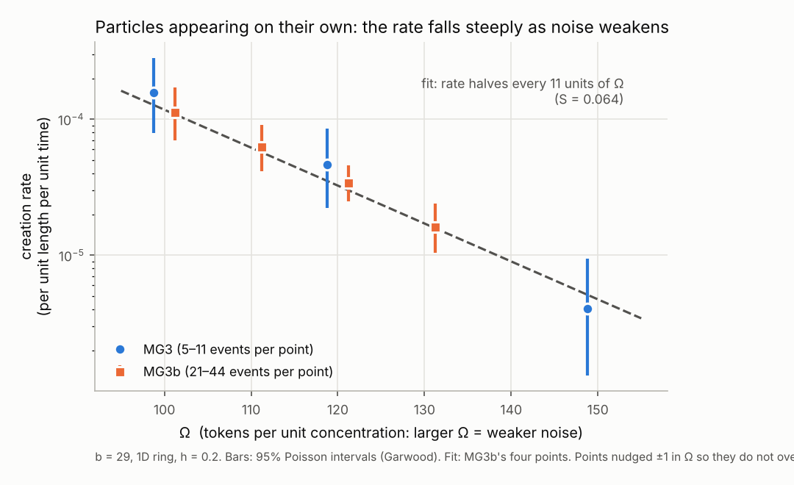

# Model G on a discrete "ether": what MG1–MG3b asked, found and mean

*Plain-language summary. Claude, 2026-10-30. Written for a general reader. The formal records are in `GATES.md` and
`results/`. Where this summary simplifies, those govern.*

## The idea in one paragraph
Paul LaViolette's Model G (Subquantum Kinetics) describes space as filled with reacting "etherons": a few kinds of
substance that turn into each other and spread out, like chemicals in a dish. In the right conditions the reactions
settle into a small, stable, self-sustaining pattern, a "dissipative soliton". LaViolette identifies such patterns with
particles. Stephen Wolfram's approach describes space itself as a network of points updated by simple rewrite rules.
This project asks whether the two fit together: if the etherons are individual tokens sitting on the points of a network,
hopping and reacting by simple rules, do Model G's particles still appear? We test this in steps, and each step (a "gate")
has its pass/fail rules written down *before* the computer run that tests it. That way a result can't be reinterpreted
after we have seen it.

## MG1 — Can we reproduce the published particle? (Result: yes, with one recorded exception)
**Purpose.** Before anything new, check that our solver reproduces the stationary particle that Pulver and LaViolette
published in 2013, in 1, 2 and 3 dimensions. Without this baseline, nothing later could be trusted.

**Result.** The particle's size, depth, and the spacing of its surrounding rings (the "wavelength", about 3.08) all
matched the published values to within a fraction of a percent, in all three dimensions. An independent replication by
ChatGPT agreed to about 0.001%. One registered test failed: in 1D the particle is still very slowly settling at the
published end time (t = 100). It is fully settled by t = 300. You accepted this as a pass with the exception kept on
record.

**Also found.** One table in the paper (the "full integrals" row) cannot be reproduced. Basic conservation arithmetic says
two of those numbers should be essentially zero for a settled particle, and our solver gives zero. This does not affect
the particle itself.

**What it means.** We have a trustworthy reference particle. Note for later: in standard Model G, a settled particle has
*no net* deficit of the G substance. That matters if G is later meant to represent mass or gravity.

## MG2 — Do the token rules reproduce Model G when tokens are plentiful? (Result: FAIL as registered, but the core test passed)
**Purpose.** Replace smooth concentrations with countable tokens on a ring of 500 points. The number Ω sets how many
tokens stand for one unit of concentration. With a huge Ω the tokens should behave exactly like the smooth equations.
With a small Ω, randomness from counting individual tokens ("intrinsic noise") becomes important.

**Result.**
- **The central question passed.** With very many tokens (Ω = 10⁸), the token model reproduces the smooth particle to
  better than 0.1%, on two different spacings of points. So the mapping from Model G to token rules is exact in that
  limit.
- **Two registered criteria failed, both at smaller Ω, where noise matters:**
  - At Ω = 100, the size of the random fluctuations was 17% above the standard theoretical prediction, against a 10%
    allowance.
  - At the centre of the particle's stable range (b = 29.16) and Ω ≤ 300, noise sometimes made the particle split in
    two.
- At the published setting (b = 29), noise often made the particle disappear. In this 1D setup, b = 29 sits close to the
  lower edge of the range where a particle can exist at all.
- Seeded particles formed reliably when the seed was large enough, and did not form when it was too small, as expected.

**What it means.** The translation into tokens is right. At low token counts, noise really does change what happens:
particles can be lost, or can split. In 1D the published parameters leave the particle fragile.

## MG3 — Do particles appear by themselves out of the noise? (Result: FAIL as registered, but spontaneous creation was seen)
**Purpose.** This is the central claim of Subquantum Kinetics: particles can emerge spontaneously from fluctuations in
the ether. We started from a uniform state with no seed and asked whether particles appear from the token noise alone,
and how the rate depends on Ω.

**Result.**
- **Spontaneous particle creation happens.** Particles appeared on their own, and we confirmed them by checking that the
  structure survives when the noise is switched off: 15 confirmed events at Ω = 100 and 11 at Ω = 120.
- The rate rises steeply as Ω falls, about ten-fold for every 30 or so fewer tokens per unit. That is the pattern expected
  when random fluctuations must climb an energy-like barrier ("activated" behaviour).
- The rate also rises as the setting b moves deeper into the particle's stable range.
- **The registered failure:** we required at least 80% of long-lived noisy dips to be genuine particles. About 62–71%
  were. The rest faded away when the noise was turned off: noise had made something particle-like that had not yet
  crossed the barrier.
- The compute budget overran slightly (19.0 of 18 core-hours). This is recorded as an exception.

**What it means.** The answer to the headline question is yes: noise in the token model creates real particles, at a
rate that behaves like barrier-crossing. The FAIL is about how cleanly our detector separates real particles from
temporary look-alikes, against a threshold set before we had any data. Two things were left open: whether the result
depended on the simulation's time step, and how precise the rates were.

## MG3b — Follow-up: firmer numbers (Accepted estimation study; no pass/fail)
**Purpose.** A separate, newly registered study, designed after MG3. It does not re-score MG3, whose FAIL stands. It asks
three things: does halving the time step change the creation rate; what are the rates with more events; and what is the
best estimate of the barrier steepness S.

**Result.**
- **Time step:** halving it changed the rate by a factor of 0.95. That is well inside the pre-agreed "same within a factor
  of 2" margin, so the results are not an artefact of the time step at that level.
- **Rates:** with 21–44 events per setting, the rate falls by about half for every 10 extra tokens per unit (Ω from 100
  to 130).
- **Barrier steepness S** is 0.064 per unit Ω (approximate range 0.047–0.082), consistent with MG3's 0.073.
- Whether the creation rate stays constant over time could not be decided: the test had too little power, and it is
  labelled uninformative.
- ChatGPT independently reproduced every number, including all 302 "real particle or not" checks. You signed off on
  2026-10-30.

*Creation rate against Ω (log scale). Blue circles: MG3; orange squares: MG3b; bars: 95% intervals; dashed line: the MG3b fit. Made by `paper/make_rate_chart.py` from the recorded event counts and exposures.*

**What it means.** Spontaneous particle creation from token noise is now a measured, reproducible effect with a
well-defined rate law over the tested range. It does not yet show the underlying mechanism.

## The overall picture so far
1. Model G's particle is reproduced (MG1).
2. Token rules turn into Model G exactly when tokens are plentiful (MG2).
3. With fewer tokens, the noise does real things: it destroys or splits particles (MG2), and it creates them, at a
   barrier-like rate (MG3, MG3b).

**Caveats a reader should keep in mind:**
- All of this is on a 1D ring, with one particular point spacing.
- **Noise-driven effects need very few tokens per point.** Particles appearing on their own (MG3, MG3b), and particles
  being lost or splitting (MG2), happen at Ω of about 100–300. The creation rate falls roughly as e^(−S·Ω) with
  S ≈ 0.064, so it halves for every 11 more tokens per unit (see the chart).
  - A rough estimate from LaViolette's own etheron densities puts real-world Ω at about 10²⁰ or more. That figure is an
    order-of-magnitude guess with heavy caveats.
  - At that Ω the exponent is about −6 × 10¹⁸, so the rate is zero for any practical purpose. Counting noise shrinks like
    1/√Ω, to about 10⁻¹⁰ of the background. It would still jiggle the field very slightly, but it could never push the
    field over the barrier to create or destroy a particle.
  - If that holds, spontaneous creation in nature needs fluctuations that are much larger at the particle's scale. What
    matters is the number of *independent* fluctuating units per cell, not the raw count. More independent tokens mean
    more entropy but *smaller* relative fluctuations.
  - So strongly correlated or entangled etherons, fluctuating together rather than one by one, could act like a much
    smaller effective Ω. Something like 10²⁰ etherons could behave like Ω_eff ≈ 100. That is one candidate source.
    Fluctuations from the rewriting of the network itself (the MG5 phase) are another.
  - This is speculative, but testable later: give tokens correlated noise, and check whether the creation rate follows
    the effective Ω rather than the raw count.
- In standard Model G, a settled particle has no net G deficit, so "mass" and "gravity" still need defining (Phase 5).

**Next (MG4, registered 2026-10-30):** move from a regular ring to irregular 2D networks, closer to Wolfram-style space,
and ask whether the particle survives there and keeps its shape (noise-free first).
