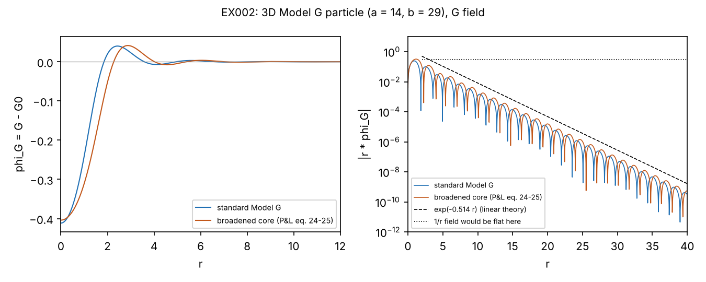

# EX002 (EXPLORATORY): far field of the 3D Model G particle

**EXPLORATORY. This cannot support a programme claim on its own.**

**Result.**
- The 3D particle at a = 14, b = 29 exists. Its net G perturbation is zero to numerical precision.
- Its G field decays exponentially, as e^(−0.514 r) cos(2.037 r)/r, exactly the linear-theory rates. It does not
  decay as 1/r.
- Pulver & LaViolette's broadened-core variant does give a negative net G (−1.84), as they reported. Its far field,
  however, decays at the same exponential rate.
- So in Model G as written, a particle's G field reaches only a few units from its core, with or without the
  broadened core. A long-range, gravity-like field would need a change to the model.

In plain terms, the "G-well" at the centre is real but is balanced by G-hills in the surrounding shells, so the
particle carries no net G deficit. Even when a net deficit is forced in with a broadened core, the field around the
particle dies off exponentially (by a factor of about 10 for every 4.5 units of distance), because the G equation
itself contains a decay term (−qG) that screens any source. The particle drifts down an imposed G gradient (MG192,
MG194), but it does not create a long-range gradient for others. This agrees with MG194's 1D two-particle result and
with MG001's integral identity.

Run by Claude at the PI's request (Richard Benear, 2026-11-16 12:32 America/Denver: "Let's go on to the 3D far field. I
question whether 2D would be useful."). The exploratory log entry was committed before the run (`e3f26629`).

## Why zero net G is exact

For any stationary, localized solution in any dimension with constant sources:

1. Integrating the G equation gives −q∫φ_G + g∫φ_X = 0.
2. Adding the X and Y equations and integrating gives p∫φ_G − ∫φ_X = 0, because the reaction terms X²Y and bX cancel
   in the sum.
3. Together these give (q − g p)∫φ_G = 0. With q − g p = 0.9, ∫φ_G = 0, and then ∫φ_X = 0.

This is MG001's identity. Nothing in it depends on dimension. It fails only if the diffusion terms do not integrate to
zero, either because of flux through an outer boundary or because the Laplacian is modified. The broadened-core
variant replaces ∇ with δ(r)∇², which does not integrate to zero.

## Method

- **Discretization:** spherically symmetric, conservative finite volumes in r, with exact shell volumes. With a
  zero-flux outer boundary, the discrete integrals obey the identity to round-off.
- **Parameters:** a = 14, b = 29, inside the 3D window (MG003's 3D lower edge is 26.972).
- **Finding the particle:**
  - The plain 1D profile, used as a seed, decayed in 3D. One trial seed nucleated a particle: the 1D profile ×4 in
    amplitude and stretched 1.5× in r.
  - The seed was settled by linearly implicit Euler (dt 0.2, T 400), then refined by Newton (residual ≤ 1e-10).
- **Cases:**
  - Outer radius R = 20, 30, 40, 60, each with zero-flux (Neumann) and fixed-value (Dirichlet) outer boundaries.
  - dr = 0.02, checked at dr = 0.01 for R = 40.
  - The same set again for the broadened core, δ(r) = 1 + e^(−4r²/9) multiplying every Laplacian (P&L eqs. 24–25).
- **Tail fit:** r φ = e^(−κr)(A cos kr + B sin kr) + C e^(−κ₂ r), fitted on r ∈ [8, 40] at R = 60.

## Numbers

| Case | Core φ_X | Core φ_G | Net G | Net X | Net Y | G deficit inside r < 3 |
| --- | ---: | ---: | ---: | ---: | ---: | ---: |
| Standard, zero-flux, any R ≥ 20 | −14.633 | −0.411 | 2.5e-08 | 8e-08 | 3.485 | −3.166 |
| Standard, fixed-value, R = 20 | same | same | −1.0e-03 | −0.099 | 3.494 | −3.166 |
| Standard, fixed-value, R = 30 | same | same | −2.1e-05 | −8.5e-04 | 3.485 | −3.166 |
| Standard, fixed-value, R ≥ 40 | same | same | < 1e-06 | 6e-06 | 3.485 | −3.166 |
| Broadened core, any R and boundary | −14.610 | −0.404 | **−1.844** | −66.64 | 12.99 | −6.433 |

Net G, X and Y are integrals over the ball of φ.

- **Core balance.** The G deficit inside r < 3 is balanced by G-hill shells; φ_G peaks at +0.04 near r = 2.4.
- **Grid check.** At dr = 0.01, core values change by 3e-5 relative and the net G stays at 3e-7. The Newton residual
  there stalled at 2.7e-10, just above the 1e-10 target. That is round-off with finer cells, and was not pursued.

| Tail fit | κ | k | Linear theory at b = 29 |
| --- | ---: | ---: | --- |
| Standard, φ_G | 0.51423 | 2.03672 | κ = 0.51414, k = 2.03669 |
| Standard, φ_X | 0.51423 | 2.03684 | same |
| Broadened core, φ_G | 0.51426 | 2.03699 | same |

- Fit residuals are below 0.7% relative.
- A non-oscillating second term fits κ₂ ≈ 0.93, against the linear 0.9655. It is weakly determined.
- Nothing in the tail decays more slowly than e^(−0.514 r)/r. A 1/r field would be flat in the right panel of the
  figure.

## Comparison with Pulver & LaViolette (2013)

- **§4.2, Table 1: not reproduced.** They report a small positive net φ_G for their 3D particle (+2.87e-2). Here it is
  zero with a zero-flux boundary, and slightly negative with a fixed-value boundary, shrinking to nothing by R = 40.
  The identity says it must vanish for a truly stationary localized particle. Their value may come from their
  boundary treatment, domain size, discretization or a not-fully-stationary state. This was not resolved, and I have
  not seen their code.
- **Broadened core: reproduced.** They say it makes the net G negative, and it does here (−1.84). They call the
  broadening artificial.
- **Far field: consistent.** They give no 1/r law for φ_G. Their quoted X-maxima falloffs (r^−3.7, r^−7, r^−10 at 2,
  4 and 6 wavelengths) are local power-law readings of an exponential decay.

## Records

- Code: `src/ex002_far_field_3d.py` and `src/ex002_figure.py`.
- Data: `results.json` and `profile_R*.npz`.
- Figure: `paper/figures/EX002_far_field_3d.png`.
- Compute: 50 s on one core (plus a few minutes of seed trials), against the 2 core-hour cap.
- Not done: no separate recomputation (exploratory), and no dynamic stability check of the 3D particle.
