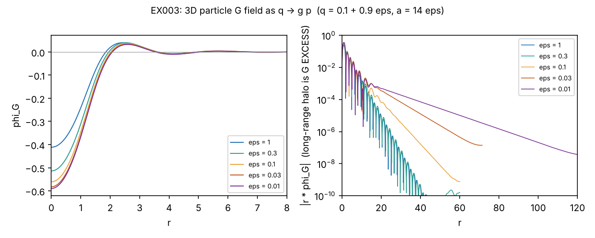

# EX003 (EXPLORATORY): can Model G parameters give a particle a long-range G field? What if −qG is removed?

**EXPLORATORY. This cannot support a programme claim on its own.**

**Result.**
- **Removing −qG destroys the ether.** With the published a, b, g and p, there is no steady background state, and G
  and X grow without bound (G ≈ 1.4e10 by t = 200).
- **The range can be made long.** Weakening the decay gradually, so that q approaches g·p while the ether is held
  fixed, does stretch the particle's G field. Its range grows as 1/√ε, about 10 at ε = 0.01, against about 1 at the
  published point.
- **But the long-range part is a G excess, not a deficit, and it gets weaker as it gets longer.** Its amplitude falls in
  proportion to ε. It is a halo that holds exactly the G the core is missing, so the net G is still zero.
- **Read with SQK's rule** (particles move toward lower G), that halo would push other particles away, not pull them in.
  So no parameter choice in this family gives an attractive, gravity-like long-range field.

In plain terms, the −qG term is what lets the ether reach a steady state. Taking it away makes the ether blow up. Making it just strong enough to keep a steady state does let a particle's influence reach much further. But the identity that forces zero net G still holds, so what reaches far out is the particle's compensating G surplus, spread thinner and thinner. A long-range attraction would need the zero-net-G identity itself to fail. That means changing the equations, for example a source or sink that does not conserve the X+Y balance, or a modified diffusion term like LaViolette's broadened core. It cannot be done by tuning parameters.

Run by Claude at the PI's request (Richard Benear, 2026-11-16 13:02 America/Denver: "go ahead and do the exploratory
check using the parameters. Also, what happens if the -qG term is removed."). The exploratory log entry was committed
before the run (`25bb6d77`).

## Why parameters cannot give net G

The identity (q − g p)∫φ_G = 0 holds for any parameters with a steady background. A steady background needs
q − g p > 0, because G0 = a/(q − g p). So whenever a stationary particle exists, its net G is zero. The only parameter
route to a long range is q − g p → 0⁺. There, the determinant of the homogeneous Jacobian goes to zero and the slowest
spatial decay rate goes to zero as √(q − g p).

## Family and linear decay rates

The family is p = 1, g = 0.1, q = 0.1 + 0.9 ε and a = 14 ε, which keeps G0 = X0 = 140/9 fixed. b sits at the same
fraction of the Turing threshold as 29 does at the published point. ε = 1 is the published point.

| ε | q | a | b | Slow (non-oscillating) decay rate | Range 1/κ | Oscillating tail (decay, wavenumber) |
| ---: | ---: | ---: | ---: | ---: | ---: | --- |
| 1 | 1.000 | 14.0 | 29.000 | 0.965 | 1.0 | 0.514, 2.037 |
| 0.3 | 0.370 | 4.2 | 28.987 | 0.530 | 1.9 | 0.516, 2.033 |
| 0.1 | 0.190 | 1.4 | 28.982 | 0.307 | 3.3 | 0.516, 2.032 |
| 0.03 | 0.127 | 0.42 | 28.981 | 0.168 | 6.0 | 0.516, 2.031 |
| 0.01 | 0.109 | 0.14 | 28.980 | 0.097 | 10.3 | 0.516, 2.031 |
| 0.001 | 0.1009 | 0.014 | 28.980 | 0.031 | 33 | 0.517, 2.031 |

The slow rate follows about 0.97 √ε. The oscillating (Turing) tail does not change.

## 3D particles along the family

The EX002 radial solver was continued in ε from 1 to 0.01 in 30 steps. Every step converged (residual ≤ 8e-10), with
outer radius at least 12 slow lengths and a zero-flux outer boundary.

| ε | Core φ_X | Core φ_G | Net G | G inside r < 12 | G outside r ≥ 12 | Halo amplitude C (fit r φ_G = C e^(−κr), κ fitted) | Halo sign |
| ---: | ---: | ---: | ---: | ---: | ---: | --- | --- |
| 1 | −14.633 | −0.411 | −3e-08 | (no halo) | (no halo) | no slow tail resolved | — |
| 0.3 | −14.661 | −0.514 | −1e-06 | — | — | no slow tail resolved | — |
| 0.1 | −14.675 | −0.561 | 1e-06 | −0.576 | +0.576 | 0.0349 (κ 0.3061) | excess (+) |
| 0.03 | −14.682 | −0.582 | −5e-06 | −1.892 | +1.893 | 0.0103 (κ 0.1674) | excess (+) |
| 0.01 | −14.685 | −0.590 | −4e-04 (truncated tail) | −3.161 | +3.161 | 0.00349 (κ 0.09705) | excess (+) |

- **Range.** The fitted halo decay rates agree with linear theory to 0.2% or better.
- **Halo strength.** C falls roughly in proportion to ε, about 0.35 ε. The halo's total G, 4πC/κ², stays near 4.7.
  In other words, as ε falls, more of the core's G deficit is moved out into a weaker, wider surplus. The two always
  cancel.
- **The core itself barely changes** (core φ_X −14.63 → −14.69).
- **Inference, not computed.** Where a second particle would sit in the halo, G decreases outward. Under SQK's rule it
  would drift outward, away from the first particle. This is the opposite of gravity. Its strength scales with ε. A
  direct check would be a two-particle run like MG194, in 1D, at small ε.

## q = 0: −qG removed

The homogeneous equations were integrated from the published ether state with q = 0 and everything else unchanged
(Radau solver):

| t | 0 | 1 | 10 | 50 | 100 | 200 |
| --- | ---: | ---: | ---: | ---: | ---: | ---: |
| G | 15.56 | 31.3 | 252 | 1.5e4 | 1.5e6 | 1.4e10 |
| X | 15.56 | 21.7 | 219 | 1.4e4 | 1.4e6 | 1.3e10 |
| Y | 1.86 | 1.34 | 0.13 | 0.002 | 0 | 0 |

G and X feed each other, through G → X (+pG) and X → G (+gX), with nothing removing G. So they grow exponentially and
there is no ether for a particle to live in. The steady-state formula gives G0 = a/(q − g p) = −140, which is not
physical. Removing the G → X reaction altogether (p = q = 0) instead cuts off X's only source, and the ether dies.

## Records

- Code: `src/ex003_screening.py` (reuses `src/ex002_far_field_3d.py`) and `src/ex003_figure.py`.
- Data: `results.json` and `profile_eps*.npz`.
- Figure: `paper/figures/EX003_screening.png`.
- Compute: the continuation finished in under an hour of one core. The first run then stalled for about an hour in an
  explicit ODE solver on the q = 0 runaway and was stopped at the 2-hour background limit, after the particle results
  had been saved. The q = 0 part was rerun with a stiff solver in under a second. Total about 2 core-hours, at the
  cap. No separate recomputation (exploratory).
