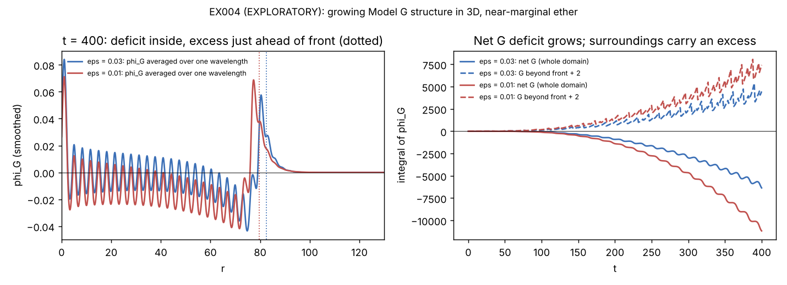

# EX004 (EXPLORATORY): does growth give a Model G structure a G-well, and does it reach far?

**Answer.** Growth does give a net G deficit, as the budget requires, and it grows roughly as 1/ε when the ether is
made near-marginal (q → g p). But the deficit sits *inside* the growing structure. Just outside it there is a G
*excess*, and beyond that the field dies off exponentially within about 10–20 length units. A distant observer sees
no G-well. Making the ether near-marginal does not lengthen the range here, because the moving front sets it: the
field ahead of a front moving at speed v decays at (v + √(v² + 4κ²))/2, which stays near v ≈ 0.2 even as κ → 0.

Exploratory only (protocol v2): no registered predictions, one parameter path, spherical symmetry. Not a claim.

## Set-up
- 3D radial finite-volume solver from EX002, family from EX003: q = 0.1 + 0.9ε, a = 14ε, g = 0.1, p = 1, so the
  ether state stays G0 = X0 = 140/9.
- Budget with no boundary flux: dI_G/dt = −q I_G + g I_X and dS/dt = p I_G − I_X + W, where I_f = ∫φ_f,
  S = I_X + I_Y and W = ∫w for an added X source w. Steady with a source: I_G = gW/(q − gp). Slow growth:
  I_G ≈ −g (dS/dt)/(q − gp).

## Arm C: calibration with a steady X sink (W = −1, Gaussian, σ = 2)
| ε | Net G | Budget prediction | Relative error | Far-field decay | Linear slow rate |
| ---: | ---: | ---: | ---: | ---: | ---: |
| 1 | −0.11111 | −0.11111 | −1.7e-7 | mixed (fit 0.79) | 0.514 / 0.966 |
| 0.03 | −3.7037 | −3.7037 | +7.5e-7 | 0.16800 | 0.16800 |

A *steady* sink gives exactly the predicted deficit, and at ε = 0.03 it is a true well with the long linear range
1/κ ≈ 6. So the solver and the budget agree, and a static sink would give a long-range well.

## Arm G: the model's own growth
- The 3D particle exists up to an upper fold b_fold just below the Turing threshold b_c (ε = 1: 29.930 vs 30.044;
  ε = 0.03: 29.887 vs 30.024; ε = 0.01: 29.882 vs 30.024). Run at b = b_fold + 0.3 (b_c − b_fold), seeded with
  the fold particle, R = 200, Neumann, dr = 0.05, linearly implicit Euler dt = 0.2, T = 400. ε = 1 repeated with
  dr = 0.025, dt = 0.1.
- Above the fold the particle grows by adding Turing shells. The front moves at a steady speed of about 0.27
  (ε = 1), 0.22 (ε = 0.03) and 0.21 (ε = 0.01), reaching r ≈ 80–97 by t = 400.

| ε | Net G at t = 400 | Interior mean φ_G | G in band front+2 to +20 | Beyond front+20 | Decay ahead of front | Comoving prediction |
| ---: | ---: | ---: | ---: | ---: | ---: | ---: |
| 1 | −562 (fine grid −293) | about −0.002 | sign flips shell to shell | ~0 | — | — |
| 0.03 | −6356 | −0.012 | +4582 | +11 | 0.310 | 0.301 |
| 0.01 | −11176 | −0.020 | +7545 | +54 | 0.265 | 0.246 |

- **Budget.** At ε = 1, 20-unit window averages of net G follow −g(dS/dt)/(q − gp) to within a few percent (the
  quasi-static form holds because the relaxation time 1/(q − gp) ≈ 1 is short). At small ε the relaxation time
  (37 and 111) is not short, so the quasi-static form overestimates; the exact ODE dI_G/dt = −q I_G + g I_X holds
  to the sampling accuracy of the 1-unit record (5–13%).
- **Where the deficit is.** Inside the structure, where the patterned state has a lower mean G than the ether.
  The front band carries large alternating contributions as each new shell forms. Immediately ahead of the front,
  G is *raised*, and that excess decays at the comoving rate, not the static range 1/κ.
- **ε = 1 grid check.** The fine grid gives the same front speed (0.266 vs 0.268) and the same qualitative picture.
  Snapshot values of net G differ (−293 vs −562) because shell formation is bursty and the two grids are at
  different phases of it.

## What this means
- Matter creation breaks the zero-net-G identity, as expected, and near-marginal parameters make the deficit large.
- But within Model G the deficit is internal and is wrapped in a G excess. Seen from outside, a growing body is a
  slight G *hill* with a short screened skin, not a well. Under SQK's rule (bodies move toward lower G) that would
  be weakly repulsive at short range, and nothing at long range.
- A long-range well would need a structure that consumes G while growing very slowly (v ≪ κ) *and* puts the deficit
  outside itself, like the steady sink in Arm C. In this model the X+Y storage happens at the front, and the G
  response there is positive. Whether particle nucleation (rather than pattern invasion) behaves differently is open.

## Limits
Spherical symmetry; growth here is Turing-pattern invasion, not discrete particle creation; one fold offset (0.3);
first-order time stepping; only ε = 1 has a grid check. About 0.05 core-hours.

## Files
`src/ex004_growth.py` (driver), `src/ex004_posthoc.py` (bands, budget ODE check, comoving rate),
`src/ex004_figure.py`; `results.json`, `posthoc.json`, `run_log.txt`, `growth_eps*.npz` (time series and φ
snapshots every 20 time units; 6 MB, not committed, regenerated by the driver in about 2 minutes). Platform: Linux, Python 3.13, NumPy 2.5.3, SciPy 1.18.1.
