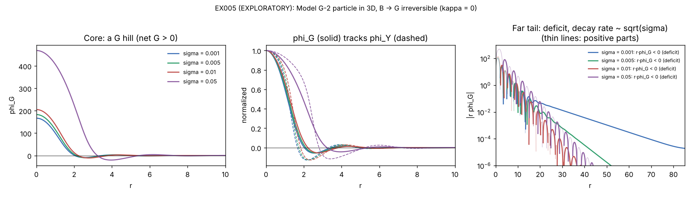

# EX005 (EXPLORATORY): Model G-2 particle in 3D

**Answer.** Model G-2 has stable 3D particles. Unlike Model G, a particle has a **non-zero net G, and it is positive**:
the core is a large G *hill*, and φ_G tracks φ_Y closely (spatial correlation 0.93–0.99), as LaViolette says. Further
out the picture changes. When G is consumed only weakly (small σ, see below), the G field far from the particle is a
**deficit**, a well, that falls off as e^(−κr)/r. Its range grows as 1/√σ, and its total depth (about −460 in G units)
stays roughly the same as σ shrinks. So in the weak-consumption limit G-2 gives a G-hill core inside a long-range
G-well. That is the first long-range well we have found in this programme. It is still an exponentially screened well,
and how strongly another particle would feel it is untested.

Exploratory only (protocol v2): no registered predictions, parameters chosen by Claude (the book gives none). Not a
claim.

## Equations and parameters
Reactions (LaViolette, *Subquantum Kinetics*): A → X, B → G, G + X → Y + Z, 2X + Y → 3X, X → Ω. A reverse step
G → B with rate κ is optional. Dimensionless, with the same scalings as Model G (D_G = D_X = 1, D_Y = 12, X decay
rate 1):

- G_t = ∇²G + β − κG − σGX
- X_t = ∇²X + α − σGX + X²Y − X
- Y_t = 12∇²Y + σGX − X²Y

- Background state: X0 = α, G0 = β/(κ + σX0), Y0 = σG0/X0. The product σG0 plays the role of the Brusselator b.
- σ is the strength of G + X → Y + Z in these units. It is the one free constant that rescaling cannot remove. Small
  σ means a large, weakly perturbed G reservoir.
- Choices: α = X0 = 140/9 (as Model G). κ = 0 (B → G irreversible, as written in the book), plus κ = 1 as a variant.
  β is set so that σG0 sits at the same fraction of the Turing threshold as the Model G reference point
  (29/30.044 = 0.9653).
- Stationary budget for a localized particle: ∫φ_X = 0 exactly, and (κ + σX0)·∫φ_G = −σ·∫φ_G φ_X. G is used up by
  X, so φ_G and φ_X are anti-correlated, and the budget then forces net G > 0.

## Results (3D radial solver from EX002, dr = 0.05, Neumann, Newton)
| κ | σ | Turing b_c | G0 | Core φ_G | Net G | Identity check | corr(φ_G, φ_Y) | Far-tail rate (linear) | Far-tail amplitude C (r φ_G) |
| ---: | ---: | ---: | ---: | ---: | ---: | :---: | ---: | ---: | ---: |
| 0 | 0.001 | 30.04 | 28997 | +167 | +746 | 11.6051 / 11.6053 | 0.932 | 0.126 | −0.587 |
| 0 | 0.002 | 29.94 | 14448 | +174 | +794 | equal | 0.933 | 0.180 | −1.30 |
| 0 | 0.003 | 29.83 | 9599 | +177 | +845 | equal | 0.934 | 0.223 | −2.16 |
| 0 | 0.005 | 29.63 | 5719 | +183 | +959 | equal | 0.936 | 0.295 | −4.45 |
| 0 | 0.01 | 29.12 | 2810 | +205 | +1318 | equal | 0.940 | 0.442 | −15.6 |
| 0 | 0.02–0.1 | 28.1–22.9 | 1358–221 | +258 to +833 | +2509 to +77186 | equal | 0.95–0.97 | 0.70–2.24 | negative, poorly fixed |
| 0 | 0.15–1 | — | — | no particle found | | | | | |
| 1 | 0.01 | 29.31 | 2830 | +124 | +93 | equal | 0.981 | 1.16 | poorly fixed |
| 1 | 0.1 | 24.13 | 233 | +168 | +1833 | equal | 0.986 | 2.40 | — |
| 1 | 1 | 17.14 | 16.5 | +193 | +17611 | equal | 0.964 | 5.24 | — |

- The particle's X core is essentially the Model G one (core φ_X ≈ −14.6 to −15.5).
- **Net G is positive** in every case, and the identity holds to Newton accuracy.
- **The far tail is a deficit.** The tail was fitted as a monotone mode plus the oscillating mode, with rates fixed at
  the linear values. At σ ≤ 0.01 the fit residual is 0.3–3%. The monotone part is negative and dominates beyond
  r ≈ 15 at σ = 0.001.
- **Halo depth vs σ.** The halo's total deficit, estimated as 4πC/κ², is about −464, −504, −643 and −1005 at
  σ = 0.001, 0.002, 0.005 and 0.01. It approaches a constant as σ → 0 while its range 1/κ grows as about 4/√σ.
- **Checks** (`check.json`, a separate log-linear estimator):
  - σ = 0.001 with dr = 0.025, and with R = 136 instead of 88: far rate 0.1260 / 0.1261 (linear 0.1261), C = −0.579,
    net G 746.1 / 746.06.
  - σ = 0.005: rate 0.2938 (linear 0.2951), C = −4.27.
- No particle was found for κ = 0 with σ ≥ 0.15. Settling from the σ = 0.1 particle blew up. That was not explored.

## What this means, and what it doesn't
- G-2 behaves as LaViolette describes in the core: G is correlated with Y, and a particle is a G-hill ("matter").
- Unlike Model G, the far field is a G-well. In the weak-consumption limit it is a fixed-depth well with growing range,
  the limiting behaviour a 1/r field would need. It is still screened at any finite σ.
- **Open: would another particle feel it?** The far deficit relative to the background is tiny (|φ_G|/G0 ~ 1e-5 at
  r = 10 for σ = 0.001). A particle feels G only through σG, so the perturbation it sees is σφ_G, about
  6e-4·e^(−0.126r)/r here, which shrinks as σ → 0. Whether a G-2 particle drifts toward lower G, and how fast, has
  not been tested.
- **Natural next steps** (not authorized):
  - G-2 drift and mobility, as in MG192.
  - The two-particle force at small σ, in 1D or 3D.

## Limits
One α, a fixed fraction of the Turing threshold, κ = 0 and 1 only, and spherical symmetry. Only stationary particles
were found, by continuation in σ from a Model G seed; stability was not checked beyond surviving the settling and
Newton steps. Under 0.05 core-hours.

## Files
- Code: `src/ex005_model_g2.py` (driver), `src/ex005_check.py`, `src/ex005_figure.py`.
- Results: `results.json`, `check.json`, `run_log.txt`.
- Not committed: profiles `profile_k*_s*.npz` (2 MB). The driver regenerates them in under 2 minutes.
- Platform: Linux, Python 3.13, NumPy 2.5.3, SciPy 1.18.1.
