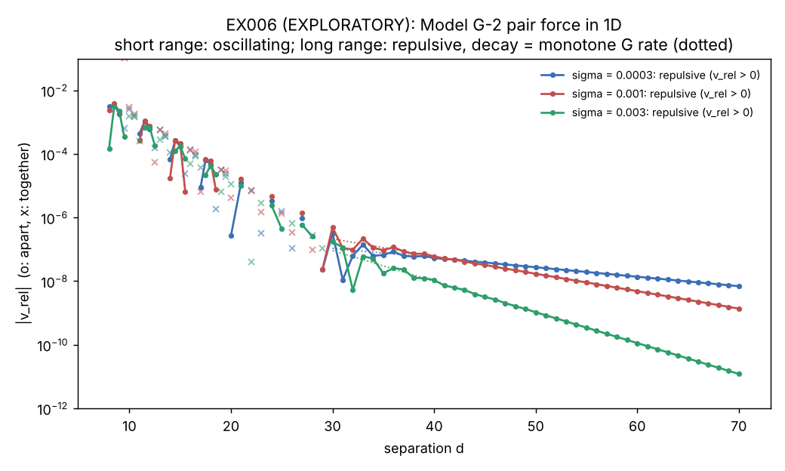

# EX006 (EXPLORATORY): Model G-2 drift and two-particle force (1D)

**Answer.** Model G-2 particles drift toward **higher** G, the opposite of Model G. The G-deficit well that EX005 found
around a G-2 particle therefore pushes other particles **away**. In 1D the force between two G-2 particles is the
familiar short-range oscillating Turing force out to d ≈ 28, and beyond that it is **purely repulsive**. That
repulsion decays at exactly the monotone G rate κ_m ∝ √σ, so its range grows as σ → 0. Its strength falls roughly
as σ², though, so it fades out. Mobility times the partner's G-tail slope predicts the long-range force to within
2% (σ = 0.0003), 6% (0.001) and 26% (0.003). So the mechanism is simply "climb the G gradient, and the gradient
points away from the other particle". No long-range attraction was found.

Exploratory only (protocol v2), with constants chosen by Claude. Not a claim.

## Set-up
- EX005's G-2 equations with κ = 0 (B → G one-way), α = 140/9, D = (1, 1, 12), on a 1D periodic Fourier grid
  (h ≈ 0.098). Methods are those of MG192/MG194: even-subspace Newton, adjoint of the translation mode, ETDRK4 with
  dt = 0.005.
- 1D existence windows in b_eff = σG0, found by continuation from the Model G soliton:

  | σ | Window |
  | ---: | :---: |
  | 0.0003 | [29.036, 29.475] |
  | 0.001 | [29.048, 29.395] |
  | 0.003 | [28.697, 29.175] |
  | 0.01 | none found (b_c = 29.12) |

  The runs use each window's midpoint. Every particle is stable: the leading non-zero eigenvalue is −0.0047,
  −0.0156 and −0.047, the slow G mode.

## A. Drift in a source gradient β(x)
| σ | Core φ_X | Core φ_G | Net G | μ_β | μ_G = μ_β σα (per unit dG0/dx) | Direct run vs adjoint |
| ---: | ---: | ---: | ---: | ---: | ---: | ---: |
| 0.0003 | −8.99 | +87.1 | +39.7 | +5.13e-4 | +2.39e-6 | — |
| 0.001 | −9.44 | +91.1 | +44.6 | +4.78e-4 | +7.44e-6 | −19% |
| 0.003 | −9.78 | +93.5 | +47.6 | +4.43e-4 | +2.07e-5 | −8% |

- A positive μ means the particle moves *up* the gradient of β, and so of G0.
- The direct runs (β(x) = β(1 + 0.002 sin 2πx/100), x0 = 12.5, T = 200, fit from t ≥ 50) confirm the sign.
- Their speeds agree less well than MG192's did (within 3%). The likely reason is that the slow G mode relaxes
  over about 1/0.0156 ≈ 64 time units, so the fit window still contains a transient. The L = 100 domain is also
  short; the mobility changes 2% between L = 100 and 200 at σ = 0.001.
- Per unit of b_eff gradient, the drift is about +0.0073, similar in size to Model G's but opposite in sign.

## B. Two particles (separations 8 to 70; L = 300 for σ = 0.0003, L = 200 otherwise; T = 100, fit t ≥ 20)
- **Short range (d < 28).** v_rel oscillates in sign with a period of about 3, decaying at the oscillating tail rate
  (≈ 0.46). This is the same Turing interaction as MG194. One run (σ = 0.001, d = 9.5) moved 6.2 units into a bound
  state.
- **Long range (d ≥ 30).** v_rel is positive (repulsive) at every separation for σ = 0.0003 and 0.001, and from
  d = 32 on for σ = 0.003. The last attractive separation is 28, 28 and 29 for the three σ values.

| σ | Fitted decay of v_rel (d ≥ 45) | Linear monotone rate | Amplitude (extrapolated to d = 0) | v_rel at d = 40 | Prediction ÷ measured |
| ---: | ---: | ---: | ---: | ---: | ---: |
| 0.0003 | 0.06858 | 0.06855 | 8.4e-7 | 5.3e-8 | 1.02 |
| 0.001 | 0.12621 | 0.12614 | 9.4e-6 | 6.0e-8 | 1.06 |
| 0.003 | 0.22349 | 0.22349 | 7.5e-5 | 1.1e-8 | 1.26 |

- The prediction is 2·μ_G·(slope of the partner's G tail), using the single-particle tail fitted as
  A·e^(−κ_m|x|), with A = −2.60, −5.28 and −10.2 (a deficit).
- **Checks at d = 40.** Halving dt, and doubling L, each changed v_rel by less than 1e-12 relative. The single-particle
  null drift is below 1e-16.

## What this means
- The G-2 well is real and reaches far, but G-2 particles move *toward* higher G. So two particles repel at long
  range, and the repulsion weakens as roughly σ² while its range grows as σ^(−1/2).
- For SQK gravity to come out of G-2, one of two things would have to be true. Either particles would have to drift
  toward lower G, as in Model G, but Model G has no well. Or the well would have to be a G excess. Neither model, as
  set up here, has both properties.
- Both of those could depend on choices made here: κ = 0, α, the fraction of the Turing threshold, and the
  assumption that the B → G and G + X steps have the stoichiometry written in the book. One option is a G-2 variant
  in which G *feeds* X, for example G → X as in Model G alongside G + X → Y + Z. That would add Model G's drift
  direction. It would be a separate test.

## Limits
1D only (in 3D the long-range part would carry an extra 1/r but the same exponential), κ = 0, one point per σ (the
window midpoint). The direct drift check is short. About 0.35 core-hours: 1055 s wall on 4 processes plus probes.

## Files
`src/ex006_g2_1d.py` (solver and driver), `src/ex006_posthoc.py`, `src/ex006_figure.py`; `results.json`,
`posthoc.json`, `run_log.txt`, `particle_s*.npz`. Platform: Linux, Python 3.13, NumPy 2.5.3, SciPy 1.18.1.
