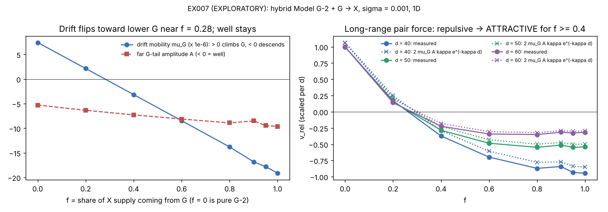

# EX007 (EXPLORATORY): hybrid Model G-2 + G → X, drift direction and long-range pair force (1D)

**Answer.** Yes, there is a regime with long-range attraction. Adding G → X to G-2 reverses the drift. Once G
supplies more than about 28% of X (f > 0.28), particles move toward **lower** G. They still carry the far G-deficit
well (it actually deepens with f). So two particles **attract** at long range, at the slow monotone G rate. Direct
pair runs at separations 40, 50 and 60 confirm the attraction for every f from 0.4 to 1. The simple prediction
(mobility × slope of the partner's G well) gets the sign right everywhere and the size within about 5–30%.

This is the first gravity-like (attractive, longer-range than the Turing force) interaction found in the
programme. It is still exponentially screened (range 1/κ ≈ 5.6 at σ = 0.001, growing as σ shrinks) and it is weak.
1D only, one σ, constants chosen by Claude, and the hybrid is our construction, not LaViolette's. Exploratory, not a
claim.

## Equations
EX006's G-2 (κ = 0, σ = 0.001) plus G → X at rate γ:
- G_t = G'' + β − σGX − γG
- X_t = X'' + α + γG − σGX + X²Y − X
- Y_t = 12Y'' + σGX − X²Y

X0 = 140/9 and b_eff = σG0 are held fixed. The parameter f = γG0/X0 is the share of the X supply that comes from G,
so α = X0(1 − f). f = 0 is pure G-2. At f = 1, X is fed only through B → G → X, as in Model G's A → G → X chain, with
G + X → Y + Z in place of B + X → Y + Z. Each f uses the midpoint of its 1D existence window. All particles are
stable: the leading non-zero eigenvalue runs from −0.016 to −0.032.

## Results
| f | Window in b_eff | Net G | Far tail A (< 0 = well) | κ_m | μ_G (drift per dG0/dx) | v_rel at d = 40 | 50 | 60 |
| ---: | :---: | ---: | ---: | ---: | ---: | ---: | ---: | ---: |
| 0 | 29.048–29.395 | +44.6 | −5.28 | 0.126 | +7.4e-6 | +6.0e-8 | +1.7e-8 | +4.8e-9 |
| 0.2 | 29.063–29.401 | +36.7 | −6.34 | 0.139 | +2.2e-6 | +1.0e-8 | +2.7e-9 | +6.8e-10 |
| 0.4 | 29.078–29.406 | +31.2 | −7.28 | 0.150 | −3.2e-6 | −2.2e-8 | −4.8e-9 | −1.1e-9 |
| 0.6 | 29.092–29.411 | +27.1 | −8.13 | 0.160 | −8.5e-6 | −4.2e-8 | −8.2e-9 | −1.6e-9 |
| 0.8 | 29.105–29.416 | +23.9 | −8.90 | 0.170 | −1.38e-5 | −5.2e-8 | −9.3e-9 | −1.7e-9 |
| 0.9 | 28.960–29.418 | +20.3 | −8.51 | 0.175 | −1.68e-5 | −5.0e-8 | −8.7e-9 | −1.5e-9 |
| 0.95 | 29.115–29.419 | +21.9 | −9.45 | 0.177 | −1.78e-5 | −5.6e-8 | −9.3e-9 | −1.6e-9 |
| 1 | 29.119–29.420 | +21.3 | −9.62 | 0.179 | −1.92e-5 | −5.7e-8 | −9.2e-9 | −1.5e-9 |

- Positive v_rel means the pair separates; negative means it comes together.
- **Sign change.** Interpolating μ_G puts the change at f ≈ 0.28. Between f = 0.2 and 0.4 the long-range force goes
  from repulsive to attractive.
- **Decay rate.** At f = 1, v_rel falls from d = 40 to d = 50 at a rate of 0.182, against the linear rate 0.179.
- **Prediction.** 2μ_G A κ_m e^(−κ_m d) matches the measured v_rel at d = 40, 50 and 60. The prediction runs
  8–30% low at f = 0.4–0.6 and 4–11% low at f ≥ 0.8. At f = 0.2 it runs 30–45% high.
- Net G stays positive (a G-hill core) and shrinks as f grows.
- f = 0.9's window has a lower end out of line with its neighbours (28.96). That is probably a continuation
  artefact; its midpoint is shifted slightly, but its results fit the trend.

## Limits
- 1D only. In 3D the long-range part should carry an extra 1/r with the same exponential; not checked.
- One σ (0.001), with κ = 0 and X0, D and the Turing fraction as in EX005–EX006.
- Pair runs only at d = 40, 50 and 60 (T = 100, fit t ≥ 20, L = 200, dt = 0.005). The dt and L checks were not
  repeated here; in EX006 the same set-up changed by under 1e-12 relative.
- The attraction is weak, about 5e-8 at d = 40, and its strength probably falls about as σ² as σ → 0 (seen in
  EX006 for the repulsive case), while its range grows as σ^(−1/2).
- Cost: 1566 s wall, mostly serial, about 0.6 core-hours.

## Natural next steps (not authorized)
1. The σ dependence at f = 1 (range vs strength).
2. A 3D check (radial solver: a Yukawa e^(−κr)/r attraction?).
3. Whether the attraction survives with a non-zero G → B reverse step (κ > 0) and away from the window midpoint.
4. If it holds up, register a confirmatory study.

## Files
`src/ex007_g2_gx.py`, `src/ex007_figure.py`; `results.json`, `run_log.txt`, `particle_f*.npz`. Platform: Linux,
Python 3.13, NumPy 2.5.3, SciPy 1.18.1.
