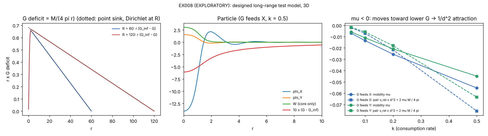

# EX008 (EXPLORATORY): a designed test model with a true long-range (1/r) G field

**Answer.** The design works on all three counts, in 3D.

1. A stable particle exists, with the consumer species W confined to the core.
2. Its G field outside the core is exactly a point sink, G = G∞ − M/(4πr), with M equal to the particle's net G
   consumption. This matches to 1 part in 10⁶ and does not depend on how far away the outer boundary is. This is the
   first true monopole ("mass") in the programme, with no screening.
3. The particle drifts toward **lower** G, for both coupling variants tested. Combined with (2), that implies an
   inverse-square **attraction** between particles, v_rel = 2|μ|M/(4πd²).

The drift comes from 3D linear response only. A direct 3D two-particle run was not done, and a 1D cross-check was not
possible because this X/Y chemistry has no localized 1D particle. The model is our construction. It drops Model G's
uniform ether source of G and adds a core-only species W. Exploratory, not a claim.

## Equations (A = 140/9, b = 29, D_Y = 12, D_W = 0.1, c = 1, G∞ = 1)
- X_t = ∇²X + A − (1+b)X + X²Y + c_x·kGW
- Y_t = 12∇²Y + bX − X²Y + c_y·kGW
- W_t = 0.1∇²W − W + cYW² − W³
- G_t = ∇²G − kGW, with G = G∞ at the outer radius R (supply from far away)

Notes on the construction:
- **Ether.** The ether state is X = A, Y = b/A, W = 0, with G any constant (set by the boundary).
- **W, the core-only species.** W's non-zero state needs cY > 2. In the ether cY = 1.86, so W = 0 there (and that
  state is stable). In the particle core Y ≈ 3.5, so W ≈ 3.1 there. W's tail dies off at a rate of √10 ≈ 3.2.
- **G.** G has no source and no loss in the ether. It is consumed only by G + W → W + X (variant "G feeds X",
  c_x = 1) or G + W → W + Y ("G feeds Y", c_y = 1).
- **Solver.** 3D spherically symmetric finite volumes as in EX002, dr = 0.05. The particle was found by settling
  from the EX002 profile, then Newton with continuation in k.

## Results
| Variant | k | M (net G consumption) | Core G | Far field vs point sink (max rel. dev., r = 15 to R−5) | Leading l = 0 eigenvalue | Mobility μ = v/E | 2μM/4π (pair v_rel × d²) |
| --- | ---: | ---: | ---: | ---: | ---: | ---: | ---: |
| G feeds X | 0.05 | 1.886 | 0.866 | 1.3e-6 | −0.0028 | −0.00701 | −0.0021 |
| G feeds X | 0.1 | 3.306 | 0.765 | 1.3e-6 | −0.0028 | −0.01356 | −0.0071 |
| G feeds X | 0.2 | 5.334 | 0.621 | 1.3e-6 | −0.0028 | −0.02554 | −0.0217 |
| G feeds X | 0.5 | 8.597 | 0.391 | 1.3e-6 | −0.0028 | −0.05542 | −0.0758 |
| G feeds Y | 0.05 | 1.898 | 0.866 | 1.3e-6 | −0.0028 | −0.00574 | −0.0017 |
| G feeds Y | 0.1 | 3.341 | 0.763 | 1.3e-6 | −0.0028 | −0.01108 | −0.0059 |
| G feeds Y | 0.2 | 5.430 | 0.616 | 1.3e-6 | −0.0028 | −0.02082 | −0.0180 |
| G feeds Y | 0.5 | 8.879 | 0.380 | 1.3e-6 | −0.0028 | −0.04498 | −0.0636 |

(All rows at R = 60.)

- **Outer radius.** At R = 120, M changes by 0.1–0.4%, μ by under 1e-4, and the far-field deviation is 1.1e-6.
  The leading l = 0 eigenvalue moves from −0.0028 to −0.0007. That eigenvalue is the slow G-diffusion mode, which
  scales as 1/R², so it is not an instability.
- **Stability.** No eigenvalue is positive for l = 0 or l = 1. The l = 1 eigenvalue nearest zero is −2e-4, the
  translation mode (overlap with U′ is 1.0000), offset slightly by the fixed-G outer boundary.
- **Budget.** ∫φ_X = M exactly: G is turned into X, which leaves as Ω.
- **Drift method.** The imposed gradient is G → G∞ + E z far away. The particle's velocity is
  v = −lᵀP / lᵀU′, where l is the left null vector of the l = 1 Jacobian and P is the forcing from the harmonic part
  E r cosθ. This is the same projection used in MG192, EX006 and EX007, where direct runs confirmed the sign.
- **Pair force.** The partner's field near a particle is a uniform shift plus a gradient of size M/(4πd²) pointing
  away from the partner. With μ < 0, each particle moves toward the other, so v_rel = 2μM/(4πd²) < 0. Strictly this
  holds at large d, and assumes the two particles are identical and the motion is quasi-static.

## What this means
- Long range came from structure, as expected: a conserved carrier (no G source or loss in the ether, supply from far
  away) and consumption only inside the particle. No parameter is tuned to get it. The "mass" M is the consumption
  rate, as in LaViolette's gravity chapter. The difference from Model G is that here the ether really has zero G
  balance, which Model G's −qG + gX + a cannot provide.
- Both coupling variants move toward lower G. In this model the drift direction is set mainly by where consumption
  happens: the particle shifts toward the side where it consumes less. That is unlike G-2, where the particle climbed
  toward higher G.
- **Open issues:**
  1. A direct two-particle check of the 1/d² law. It needs a 3D axisymmetric (r, z) or full 3D solver.
  2. Whether the attraction and the particle survive at much smaller k (weak gravity).
  3. A steady state needs supply from infinity. In an infinite universe of consumers, G∞ would drift down slowly
     (LaViolette's G depletion).
  4. The electric (X/Y) analogue: a signed conserved quantity with source and sink particles. Not attempted.

## Files
`src/ex008_longrange.py` (model, solver, l = 1 drift), `src/ex008_figure.py`; `results.json`, `run_log.txt`,
`particle_*.npz`. Under 0.05 core-hours. Platform: Linux, Python 3.13, NumPy 2.5.3, SciPy 1.18.1.
