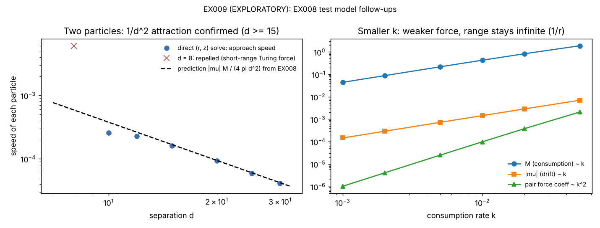

# EX009 (EXPLORATORY): follow-ups to the EX008 long-range test model

**Answer.**
- **(A) The inverse-square attraction holds in a direct two-particle solve.** I solved two 3D particles in
  axisymmetric (r, z) geometry, with no linearization. They approach each other at the speed EX008 predicted from
  one particle: 95.5% of it at d = 15 and 98.4–98.6% at d = 20–30. The remaining 1.5% is explained by each partner
  lowering the other's ambient G. The fall-off exponent from d = 15 to 30 is 1.95. Inside d ≈ 12 the short-range
  Turing force takes over, and at d = 8 the particles repel.
- **(B) A weaker "gravity" does not shorten its range.** Down to k = 0.001 the particle persists and its G field stays
  exactly 1/r. Mass M and mobility μ each scale as k, so the force scales as k² while the range stays infinite. This
  is unlike the small-σ route in EX005–EX007, where weakening the force also shortened it.
- **(C) The electric analogue works for signs, not for strengths.** I found reactions that make a "+" particle a
  source and a "−" particle a sink of a conserved C. They give like-repels / unlike-attracts. The strengths are not
  reciprocal, though: in a +− pair the − particle moves about 37× faster than the +.

Exploratory only. The model is our construction. Not a claim.

## A. Direct two-particle check (G feeds X, k = 0.5)
**Method**
- Axisymmetric finite volumes, uniform h = 0.1 within ρ < 8 and |z − d/2| < 8, stretched by ×1.1 per cell out to
  150. G is fixed at the far boundary; the other species have zero flux there.
- Half domain z ≥ 0 with mirror symmetry, so the second particle is the image.
- I solved the co-moving steady problem F(u) + v ∂_z u = 0 with a phase condition (bordered Newton). v is the speed
  of each particle; negative means approaching. The starting guess superposed two EX008 radial profiles.

**Resolution check:** a single particle on this grid gives M = 8.537, within 0.25% of the radial value 8.56.

| d | v (direct) | Prediction μM/(4πd²) | Ratio |
| ---: | ---: | ---: | ---: |
| 8 | +6.1e-3 (repulsion) | −5.9e-4 | — |
| 10 | −2.55e-4 | −3.78e-4 | 0.68 |
| 12 | −2.28e-4 | −2.62e-4 | 0.87 |
| 15 | −1.60e-4 | −1.68e-4 | 0.955 |
| 20 | −9.29e-5 | −9.44e-5 | 0.984 |
| 25 | −5.94e-5 | −6.04e-5 | 0.983 |
| 30 | −4.14e-5 | −4.19e-5 | 0.986 |

- **Checks at d = 12.** h = 0.075 changes v by 0.01%; moving the far boundary to 300 changes it by 0.24%.
- **Each particle's consumption** is 8.12 at d = 8, rising to 8.42 at d = 30, against 8.54 alone. The partner lowers
  the local G, by M/(4πd) to leading order, and that accounts for the remaining 1–2%.
- **Records.** `partA_pair2d.json` lists "M_each" at half its true value (I divided a half-domain integral by 2 by
  mistake). The values above are corrected.

## B. Smaller consumption rate (radial, R = 60)
| k | M | Core G | μ | Pair force coefficient 2μM/4π |
| ---: | ---: | ---: | ---: | ---: |
| 0.05 | 1.886 | 0.866 | −7.0e-3 | −2.1e-3 |
| 0.01 | 0.427 | 0.970 | −1.45e-3 | −9.8e-5 |
| 0.001 | 0.0440 | 0.997 | −1.46e-4 | −1.0e-6 |

- Log-log slopes for k ≤ 0.01: M 0.99, μ 1.00, force coefficient 1.98.
- The far field is a point sink to 1.3e-6 at every k. All eigenvalues stay negative.
- **Implication.** A gravity/electric ratio of 10⁻³⁶ would need k about 10⁻¹⁸ in these units, with no loss of range.
  This is an extrapolation of a clean power law, not a computation.

## C. Electric analogue (radial, one particle at a time, C∞ = 1)
- **Set-up.** Same X/Y/W particle, plus a conserved C: no ether source or loss, and fixed at the far boundary.
- **Drift rule.** A particle moves toward lower C (μ < 0) when the C-dependent core reaction *feeds* X or Y. It
  moves toward higher C (μ > 0) when that reaction *removes* X or Y. If the reaction touches neither, μ = 0 exactly.
- **What gives the right signs.** Like charges repel and unlike attract when sources move down the gradient and sinks
  move up it. That works with:
  - **"+" (source):** Y + W₊ ⇌ C + W₊ (forward k = 0.05, backward 0.1k). Q = +5.88, μ_C = −6.2e-4.
  - **"−" (sink):** C + X + W₋ → W₋ (k = 0.005). Q = −2.24, μ_C = +8.7e-3.
- **Signs implied by μ_i·Q_j:** ++ repel, −− repel, +− attract.
- **Not reciprocal.** In a +− pair, the + moves at |μ₊Q₋| = 1.4e-3 and the − at |μ₋Q₊| = 5.1e-2. μ/Q is roughly
  fixed for each reaction type, so changing k cannot balance them. EM-like reciprocity would need a design in which
  the + and − chemistries are mirror images.
- **Other couplings tried:**
  - Sinks whose consumed C feeds X or Y move down the gradient (wrong sign for EM, right for gravity).
  - The source variant drawn from X did not give a particle.
  - The two W species were not run together. Each particle carries one of them.

## Limits
- Exploratory. A, B and C use the EX008 parameters.
- A uses symmetric, identical particles; the co-moving form is quasi-static.
- C is signs plus single-particle linear response, with no direct pair run.
- About 0.3 core-hours.

## Files
- Code: `src/ex009_pair2d.py`, `src/ex009_smallk.py`, `src/ex009_charge.py`, `src/ex009_sinkvariants.py`,
  `src/ex009_sinkconsume.py`, `src/ex009_figure.py`.
- Records: `partA_pair2d.json`, `partA_log.txt`, `partB_smallk.json`, `partC_charge.json`,
  `partC_sink_variants.json`, `partC_sink_consume.json`.
