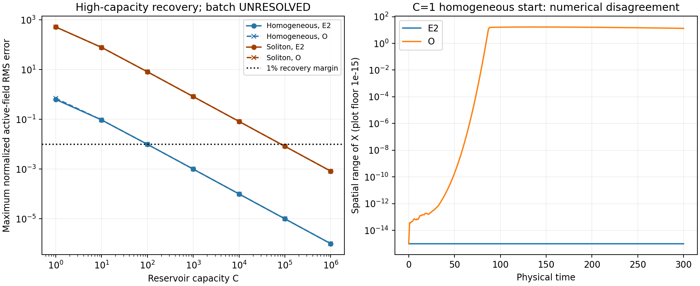

# MG10 first deterministic batch — UNRESOLVED

MG043, 2026-11-06. All 64 registered trajectories completed. Separate raw-data
recomputation agrees with the evaluator. The two largest capacities recover the
baseline for both starts, but one required low-capacity comparison is numerically
unresolved, so the registered batch verdict is **UNRESOLVED**. PI closure is pending.

## Registration and execution

The corrected specification, qualified implementation, forecast and registration
were committed and pushed as **88eabd2 before scientific production**. The PI
adopted the MG041 oracle correction and explicitly waived external review. The
original failed MG041 qualification remains preserved. Governing records:
spec/MG10_run_plan.md version 2, spec/MG10_prerun.md, and registration.json.

P17; periodic N=500, h=0.2; T=300; integer checkpoints 0..300. The scoring window
is 50..300 inclusive (251 checkpoints). Eight local workers, one library thread
each. The matrix has 8 chemostat controls and 56 finite trajectories, with the
three specified Euler steps and independent BDF reference. No replacements,
extensions, missing trajectories, timeouts or production budget stops occurred.

Production cost: **771.0576318 worker-seconds = 0.21418268 core-hours**, below the
14400-second ceiling. Qualification/timing upper account: 39.172795 seconds,
including failed development attempts. Evaluation and separate recomputation cost
20.9344418 seconds, separately recorded in analysis_ledger.json. These are local
compute costs, not measurements of assistant subscription usage.

## Frozen recovery results

Numbers below are the ODE reference primary errors. E2 agrees except for C=1 H.
The primary error is maximum RMS field difference divided by the frozen per-species
scale, over all active species and scoring times; it is unaligned. Soliton scales
are reference perturbation RMS, not full background concentrations. Thus an error
of 522 does not mean a 522-fold change in the underlying concentration.

| Capacity C | Homogeneous primary | Homogeneous verdict | Soliton primary | Soliton verdict |
|---|---:|---|---:|---|
| 1 | 0.699565 | NUMERICALLY UNRESOLVED | 522.008 | BASELINE NOT RECOVERED |
| 10 | 0.0947942 | BASELINE NOT RECOVERED | 78.7326 | BASELINE NOT RECOVERED |
| 100 | 0.00990983 | RECOVERS BASELINE | 8.20639 | BASELINE NOT RECOVERED |
| 1000 | 0.000995430 | RECOVERS BASELINE | 0.824459 | BASELINE NOT RECOVERED |
| 10000 | 0.0000995876 | RECOVERS BASELINE | 0.0824941 | BASELINE NOT RECOVERED |
| 100000 | 0.00000995921 | RECOVERS BASELINE | 0.00824994 | RECOVERS BASELINE |
| 1000000 | 0.000000995925 | RECOVERS BASELINE | 0.000824999 | RECOVERS BASELINE |

At C=100000 and 1000000, both starts satisfy the frozen detector conditions and
both E2 and O fall below 0.01. Soliton primary errors are about **0.825%** and
**0.0825%** of the frozen perturbation scales. The largest normalized contribution
is G: its absolute RMS discrepancies are about 1.55e-4 and 1.55e-5. The small G
pattern scale makes background offsets consequential. Descriptive background
removal reduces the normalized maxima to 0.0003202 and 0.00003206 respectively;
these descriptions do not replace the primary score.

All eight chemostat controls have the required counts at every scoring checkpoint:
zero for homogeneous starts and one for soliton starts. Finite soliton arms retain
one detection at C>=100; C=100 through 10000 still fail the primary error margin.
No claim about indefinite survival follows from this T300 study.

## Why the batch remains unresolved

Only C=1, homogeneous start, fails the E2/O numerical agreement clause. Its normalized
disagreement is **0.4996807**, versus the frozen maximum of 0.001. Its primary
errors are 0.6306550 (E2) and 0.6995648 (O). Both computations completed and passed
the transfer ledger and exact availability checks; this is a numerical-agreement
failure, not missing data or a conservation failure.

The Euler path stays exactly spatially uniform in the retained active arrays.
The BDF path develops spatial variation: the range exceeds 1e-6 at t=67 and the
maximum X range reaches 16.85. The exact equations preserve the homogeneous
subspace. Amplification of tiny numerical symmetry-breaking perturbations is a
plausible explanation, but the current data do not establish the instability's
mechanism or a physical nucleation rate. No new diagnostic trajectory was run.

A second measurement limitation is visible in the same raw data. At 69 checkpoints,
the exactly uniform E2 field nevertheless has nonzero detections after FFT smoothing.
For example, at t=61 its raw X range is zero, smoothing produces a range of only
1.33e-15, and the detector reports 10 minima. The depleted background lies below
the fixed reference threshold, allowing these roundoff minima to be counted.
These counts cannot be interpreted as physical particles. The frozen detector and
registered verdict have not been changed. Posthoc diagnostics use existing raw
arrays only and are retained in posthoc_diagnostics.json and src/report_mg10.py.

The required numerical clause prevents this ambiguous arm from being called a
resolved physical non-recovery. The overall 'otherwise UNRESOLVED' rule therefore
applies despite recovery in the four highest-capacity/start combinations.

## Verification and retention

All 64 trajectories pass the adopted exact-availability and independently
reconstructed seven-species ledger checks. Maximum per-site scaled residual is
3.66479e-11; maximum global scaled residual is 3.54573e-13, both below 1e-8.
Maximum A-oracle error is 7.35523e-14. Throughput, not enormous initial stocks,
normalizes these checks. FINITE has no external supply; CHEMOSTAT replacement
inputs are explicitly recorded. Total token conservation is not an energy law.

src/check_mg10.py independently recomputes primary errors, counts, availability,
ledger residuals, every arm label, batch label, raw hashes and budget totals.
It imports neither the model implementation nor evaluator. It shares the frozen
MG2 reference, detector and smoothing: this is same-author recomputation, not
independent external replication. The detector limitation above therefore survives
agreement of both analysis paths and is explicitly disclosed.

Every successful raw file retains all 301 unit-time states and cumulative reaction
and diffusion fluxes. All 64 NPZ files total **275086802 bytes**; the largest is
10927270 bytes, below GitHub's per-file limit. They and metadata, complete process
ledger, manifest, evaluation and recomputation are committed under production/.
The local primary location is recorded in retention.json; this is persistent local
Windows storage, and pushing the result commit supplies a second retained copy.

## Recommended next study — not yet run or registered

Resolve the C=1 homogeneous case before a broader finite-supply claim:

1. Compare against a homogeneous reduced ODE that structurally preserves symmetry.
2. Prespecify controlled spatial perturbations and a stability analysis along the
   depleted homogeneous trajectory, distinguishing exact homogeneous evolution
   from growth of specified fluctuations.
3. Validate detection on flat and weakly varying depleted backgrounds; propose
   a separately frozen measurement rule with an explicit numerical-noise floor.
4. Retain this batch's UNRESOLVED verdict. Any revised measurement or follow-up
   has its own registered scope and budget; do not rescore these data.

The high-capacity result supports the explicit-compartment approximation over this
finite horizon. It does not identify a physical source for A/B, derive quantum
entanglement, or qualify a finite-reservoir stochastic sampler. Those remain later
questions. No further production or gate closure is assumed here.
