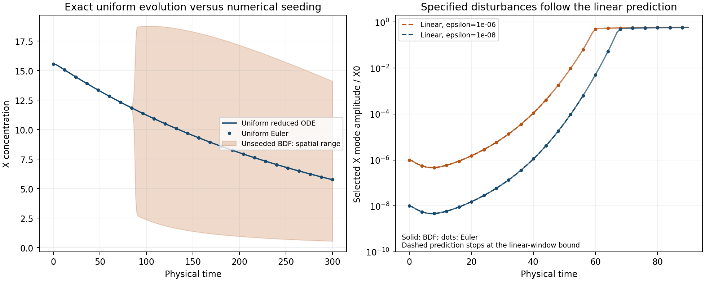

# MG10-C1 — Controlled amplification supported

MG045, 2026-11-06. All ten registered jobs completed. The separate checker agrees
with all three registered outcomes:

| Question | Registered outcome |
|---|---|
| Symmetry-preserving homogeneous reference | HOMOGENEOUS REFERENCE RESOLVED |
| Prescribed spatial disturbances | CONTROLLED AMPLIFICATION SUPPORTED |
| Contrast-qualified minimum detector | RESOLVED-MINIMUM QUALIFICATION PASS |

**The earlier MG10 result remains UNRESOLVED.** This follow-up explains and measures
the numerical issue without rescoring it. PI closure of this study is pending.

## What the study establishes

The exact homogeneous solution remains spatially uniform while its reservoir
depletes, but that trajectory is unstable to the tested small spatial disturbances.
Uniform Euler evolution agrees with the reduced homogeneous reference. Once the
same explicit disturbances are supplied, Euler and BDF both track the time-dependent
linear prediction before nonlinear saturation. This supports amplification of tiny
numerical symmetry-breaking perturbations as the explanation for the old unseeded
solver disagreement. A perfectly uniform numerical trajectory is not evidence of
physical stability, and the solver's roundoff is not a specified physical noise law.
Here instability means finite-time amplification over this horizon, not a proof
of asymptotic Lyapunov instability. Attribution solely to depletion would also need
an explicitly matched nondepleting perturbation control; this study tests the
depleted trajectory rather than that broader causal comparison.

All parameters match the C=1 finite-reservoir case: P17, N500, h=.2, T300. The
prospective design and code were committed and pushed as **1451074 before production**.
The study ran two reduced ODE references, two complete 250-mode linear scans and
six nonlinear trajectories with zero, 1e-6 and 1e-8 relative X disturbances using
E2 and tighter BDF O+. Mode selection, comparison windows, amplitudes and criteria
were frozen before the scans/nonlinear outcomes. No mode or trajectory was replaced.

## Reference and instability evidence

The independently expressed DOP853 and Radau reduced references agree to maximum
normalized error **8.1783e-10**, below 1e-8. Uniform E2 agrees with the reference
to **1.5568e-7**, below 1e-4, and its active spatial range remains exactly zero.
The unseeded O+ run nevertheless develops spatial variation: X range exceeds
1e-6 at t=68 and reaches about 16.94. Its departure is a numerical diagnostic,
not a spontaneous physical particle-production result.

The frozen all-mode selection picks **m=32**, wavelength 100/32=3.125, by maximum
integer-checkpoint peak X response in the primary linear scan. This is a planned
selection from that scan, not a fitted nonlinear wavelength or a claim that it is
the only growing mode. Primary/reference peak log gains agree to **9.2050e-6**,
below .02.

The formal selected tangent response reaches about 6.33e264 by T300. This is
an infinitesimal linear-response extrapolation around an unstable trajectory,
**not an attainable physical amplitude or reservoir output**. Finite disturbances
leave the linear regime much earlier; only the prespecified small-amplitude
window is used for the nonlinear verification below. All modes and their raw
responses are retained, including those not selected.

| Relative initial X disturbance | Method | Eligible integer times | Points | Maximum relative prediction error |
|---|---|---|---:|---:|
| 1e-6 | E2 | 31..46 | 16 | 0.01623% |
| 1e-6 | O+ | 31..46 | 16 | 0.0007780% |
| 1e-8 | E2 | 31..56 | 26 | 0.03295% |
| 1e-8 | O+ | 31..56 | 26 | 0.001899% |

Each window has at least three checkpoints and every error is below the frozen
5% bound. The comparison uses complex Fourier coefficients with fixed phase,
without alignment or fitting. Windows are determined by the registered linear
prediction bounds, not by selecting favorable nonlinear snapshots. Agreement is
not asserted after saturation, and roundoff-seeded onset is not required to be
identical across solvers or machines.

## What the detector result means

The new rule retains the old reference depth/merging conditions but requires
periodic prominence >=eta, with **eta=1.5555556e-7** in X concentration units,
and centers before FFT smoothing. All 23 prescribed fixtures pass: flat and
roundoff-rippled depleted fields, the committed reference profile, translated
one/two imposed Gaussian troughs, and subfloor/resolved sinusoidal ripples.
The independent checker reproduces these results using contour walks rather
than the production prominence implementation.

All 301 exactly uniform E2 checkpoints produce **zero resolved minima**, fixing
the demonstrated flat-background artifact for this tested case. Nonuniform runs
can produce resolved minima: counts reach 32 in the seeded runs and 33 in the
unseeded O+ run. These are contrast measurements, **not a classification of 32/33
self-sustaining particles**. Persistence, locality, physical noise and identity
would need separate definitions and validation. The original detector and MG10
scores are unchanged.

## Compute, checks and retention

Production cost: **116.5758434 worker-seconds = 0.03238218 core-hours**, below
the new 1800-second ceiling. Qualification/timing: 34.2176345 seconds, below 360;
failed development attempts are preserved and charged. Evaluation and separate
recomputation: 6.9235495 seconds, recorded separately. At most six simultaneous
production jobs were needed under the eight-worker limit, with library threads1.
There was no production timeout, missing job, budget stop or replacement.

All six nonlinear paths pass the seven-species transfer ledger and adopted exact
A-availability check. Maximum per-site scaled ledger residual is about 2.00e-13;
maximum full-path availability error is about 2.81e-14. No huge initial-stock
normalization hides ledger errors. Reduced references retain their actual adaptive
dense polynomial coefficients, validated before production; no coarse background
interpolation or output clipping is used.

The ten raw NPZ files total **40537823 bytes**; the largest is 10839540 bytes.
They include all unit-time nonlinear fields and fluxes, both reduced dense
solutions, and all 250-mode responses. Manifest, source/spec/reference hashes,
selection record, complete worker ledger, evaluation, independent recomputation
and detector fixtures are retained and committed under results/MG10C1/.

src/check_mg10c1.py imports neither the new model nor evaluator. It independently
recomputes arm/outcome decisions, Fourier errors, selection, gains, detector counts
and costs, and verifies raw hashes. Shared dependencies are the original reference
and smoothing and the earlier independent MG10 ledger helper. This is same-author
recomputation, not external replication. No external review was requested with
the PI's execution instruction.

## Implication for the next stage

The old ambiguity is now understood well enough to guide the next design:
specify the disturbances or noise explicitly, then compare numerical methods
for the same disturbed problem. Do not treat sparse-solver roundoff as the vacuum
or infer physical nucleation rates from it. Use contrast-qualified measurement
only within its validated scope and add particle-persistence criteria separately.

A stochastic finite-supply particle study should first qualify its finite-reactant
sampler against small-system SSA and freeze the physical fluctuation model and
measurement rules. Geometry-derived supply and quantum entanglement are not
established here. No additional production or historical rescoring is authorized
by this result, and PI sign-off remains the gate-closure step.
