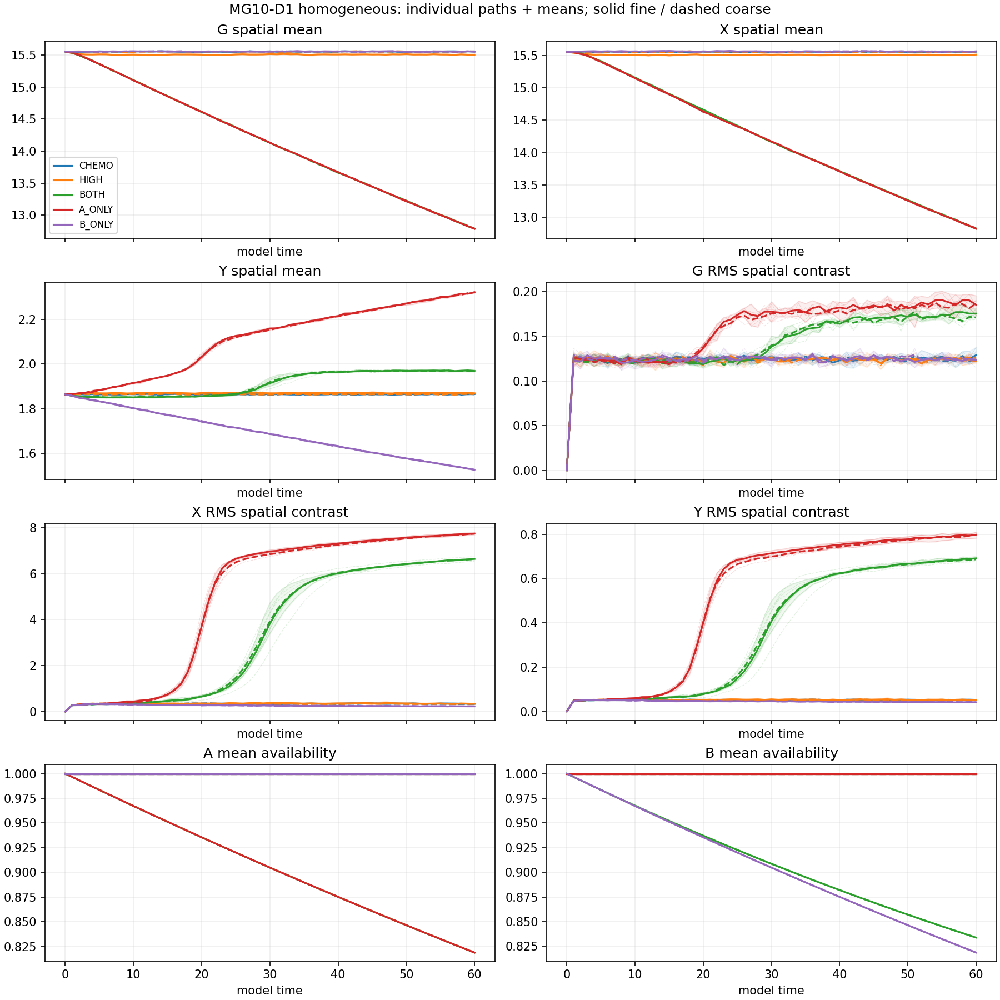
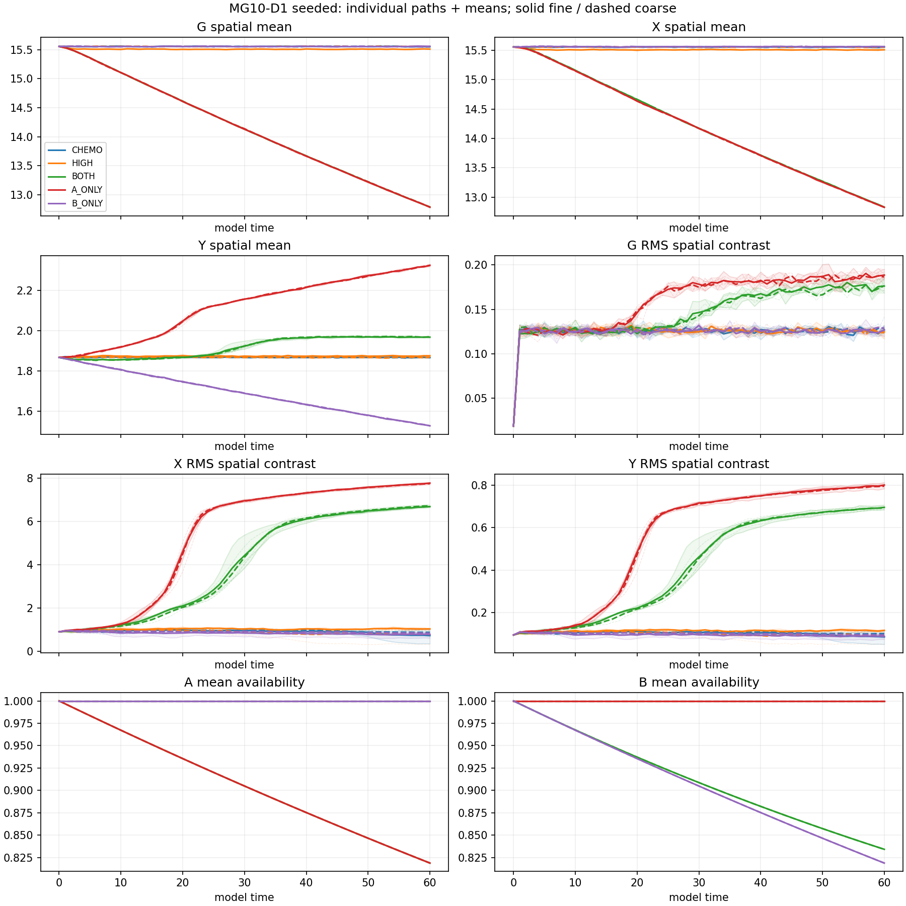

# MG10-D1 finite-supply estimation pilot — results

**COMPLETE DESCRIPTIVE PILOT**. Completed 80/80 registered trajectories. PI closure pending.

Production charge: 33.333427 local core-hours; ceiling60. Stop reason: None.

Five constructed-supply controls, N500/h.2/Omega1000, T60, H/S starts, four independent paths per arm/start/step. Numerical steps1/24000 and1/48000. Exact accounting includes maintained A/B external inputs.

## Fine-step endpoint estimates

Means across completed independent paths; A/B are fractional availability. Incomplete denominators are explicit. All per-path traces, mean/ranges, approximate t intervals, endpoint and time-average summaries for both steps are in production/evaluation.json.

|Arm|Start|n/4|Mean X|X contrast RMS|Mean A|Mean B|
|---|---|---:|---:|---:|---:|---:|
|CHEMO|H|4|15.5575|0.332325|1|1|
|CHEMO|S|4|15.5553|0.719326|1|1|
|HIGH|H|4|15.5126|0.336545|0.9999998|0.9999998|
|HIGH|S|4|15.5091|1.02532|0.9999998|0.9999998|
|BOTH|H|4|12.8275|6.6439|0.81873266|0.83389418|
|BOTH|S|4|12.8288|6.67518|0.81873285|0.83408137|
|A_ONLY|H|4|12.8255|7.74804|0.81873363|1|
|A_ONLY|S|4|12.8261|7.76116|0.81872697|1|
|B_ONLY|H|4|15.5639|0.222392|1|0.81865996|
|B_ONLY|S|4|15.5637|0.769945|1|0.81870917|

## Limits and checks

This is descriptive estimation. Four paths do not establish 1% recovery, stochastic equivalence, precise survival rates or discovery. A non-significant difference is not equivalence. RMS contrast does not establish localized particles or their identity. T60 does not answer T300/T500 behavior. Reservoirs and external inputs remain constructed resources, not a physical vacuum or quantum entanglement.

Student-t intervals are approximate and non-simultaneous, with limited reliability for n4/nonnormal populations. Step contrasts use independent samples and do not test equivalence. Numerical sensitivity may remain unresolved. Original MG10/S1/S2 outcomes remain unchanged.

The same-author independent raw checker writes production/independent_check.json after this report. Inspect that file before treating the accounting/recomputation as verified. Raw upload and PI closure are separate steps.

## Posthoc numerical caution — MG054

The registered accounting-complete result above is preserved. A subsequent analytic check finds HIGH fine-step mean A-source rates13.9579790 (H) and13.9574363 (S), versus expected13.9999986: deficits0.30014% and0.30402%. Coarse-step rates agree with expectation. Bath depletion of about2e-7 cannot explain that deficit. Exact integer ledgers and recomputed summaries do not validate random sampling probabilities. Do not use HIGH fine-step data to establish reservoir recovery or interpret its mean-field offset as physical. Original data and outcome rules are not replaced/rescored. See posthoc_source_check.json; a separately registered sampler diagnostic/corrected follow-up is next. Richard acknowledged the status and authorized proceeding; this does not erase the numerical concern.
