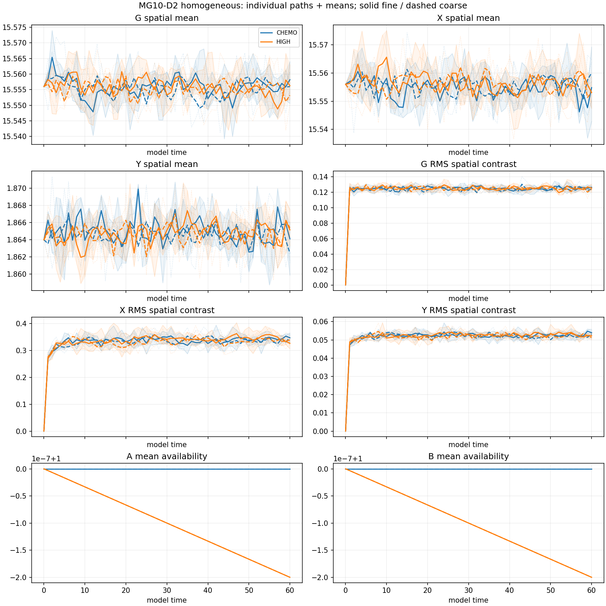
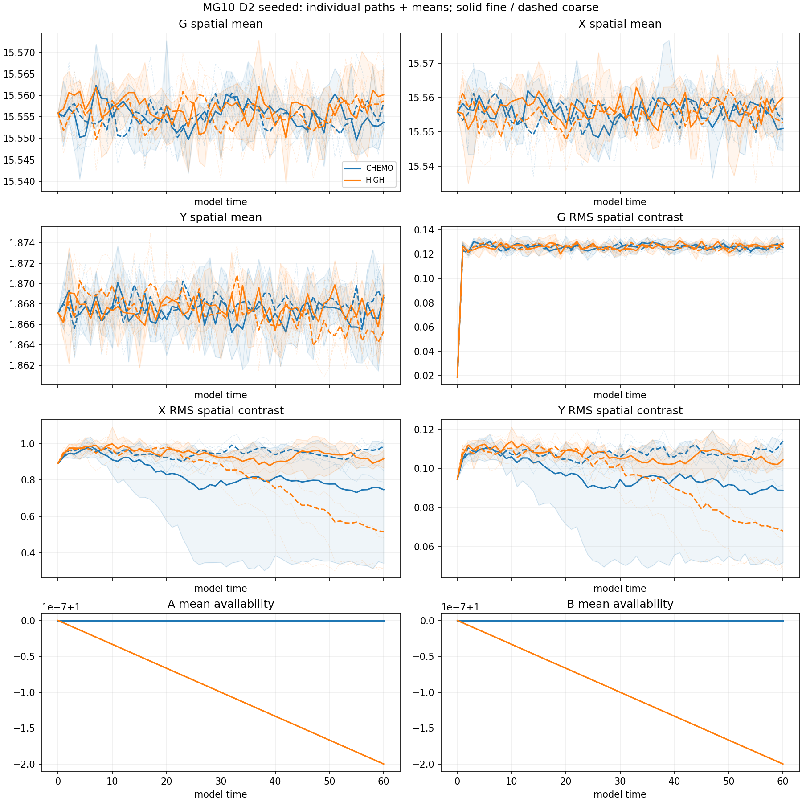

# MG10-D2 finite-supply estimation pilot — results

**COMPLETE DESCRIPTIVE PILOT**. Completed 32/32 registered trajectories. PI closure pending.

Production charge: 13.373943 local core-hours; ceiling24. Stop reason: None.

Two constructed-supply controls, N500/h.2/Omega1000, T60, H/S starts, four independent paths per arm/start/step. Numerical steps1/24000 and1/48000. Exact accounting includes maintained A/B external inputs.

## Fine-step endpoint estimates

Means across completed independent paths; A/B are fractional availability. Incomplete denominators are explicit. All per-path traces, mean/ranges, approximate t intervals, endpoint and time-average summaries for both steps are in production/evaluation.json.

|Arm|Start|n/4|Mean X|X contrast RMS|Mean A|Mean B|
|---|---|---:|---:|---:|---:|---:|
|CHEMO|H|4|15.5548|0.346658|1|1|
|CHEMO|S|4|15.551|0.747266|1|1|
|HIGH|H|4|15.5531|0.326036|0.9999998|0.9999998|
|HIGH|S|4|15.56|0.916886|0.9999998|0.9999998|

## Limits and checks

This is descriptive estimation. Four paths do not establish 1% recovery, stochastic equivalence, precise survival rates or discovery. A non-significant difference is not equivalence. RMS contrast does not establish localized particles or their identity. T60 does not answer T300/T500 behavior. Reservoirs and external inputs remain constructed resources, not a physical vacuum or quantum entanglement.

Student-t intervals are approximate and non-simultaneous, with limited reliability for n4/nonnormal populations. Step contrasts use independent samples and do not test equivalence. Numerical sensitivity may remain unresolved. Original MG10/S1/S2 outcomes remain unchanged.

The same-author independent raw checker writes production/independent_check.json after this report. Inspect that file before treating the accounting/recomputation as verified. Raw upload and PI closure are separate steps.

## MG056 inspected result and D1 comparison

All32 registered paths complete; no failure, timeout or budget stop. Independent raw reconstruction and192 summary checks PASS. Elapsed 1.850166hours; production13.373943core-hours below24. D1 plus D2 production total46.707371core-hours, below original60; source qualification/analysis overhead is separately recorded.

The old HIGH fine-step source deficit0.300-0.304% is absent. Corrected HIGH fine rates are14.00071249 (H) and14.00086923 (S), versus autonomous expectation13.9999986: offsets+0.00510% and+0.00622%. Approximate small-n/non-simultaneous intervals do not all include expectation; do not describe these measurements as exact agreement or certified equivalence. The direct rounded-P(0) defect was isolated and avoided prospectively; residual sampling fluctuations/offsets stay visible in source_rate_comparison.json.

Fine-step HIGH-minus-CHEMO mean-X offsets are-0.0017335 (H) and+0.0089710 (S), under0.06% of background. This is a descriptive improvement over D1's biased HIGH background; it is not a powered1% stochastic recovery verdict. Seeded contrast varies noticeably across independent samples and numerical steps (HIGH RMS X .515628 coarse/.916886 fine; CHEMO .985613/.747266). With four paths/group this study does not establish particle-shape/persistence equivalence or resolve long-time numerical sensitivity. No minima are promoted to particles. T60 does not answer T300/T500 behavior.

Original D1 data/labels are preserved with their caveat; no pooling/replacement. Next scientific design must distinguish a powered field-recovery claim from localization/identity/persistence qualification before interpreting noisy motifs as particles. PI closure remains pending.

## PI closure — MG057, 2026-11-07

Richard: “I approve closure for D2.” **MG10-D2 is CLOSED as COMPLETE DESCRIPTIVE PILOT.** All32 trajectories, independent raw/summary audit and full verified archive are retained. This closure preserves the registered scope and all limitations above; it does not declare stochastic equivalence, particle identity/persistence or long-horizon survival. Original D1 and earlier frozen outcomes remain unchanged. No next production is registered by this closure.
