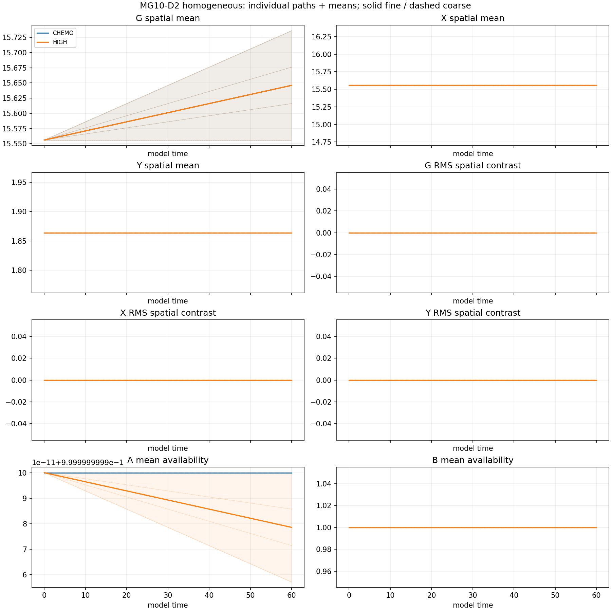
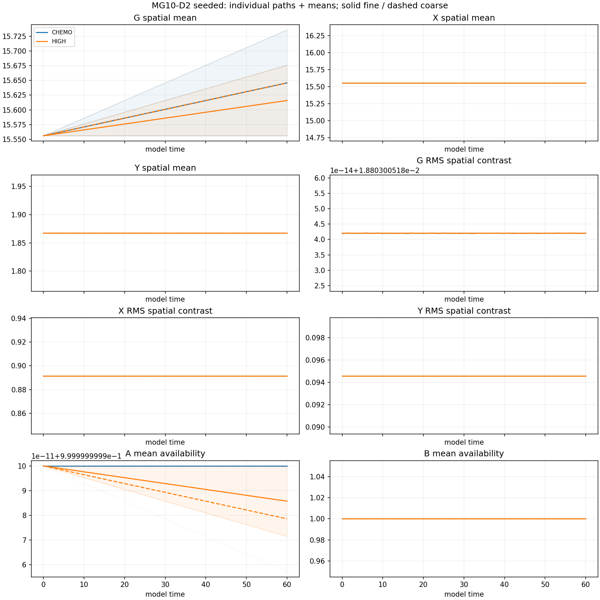

# MG10-D2 finite-supply estimation pilot — results

**INCOMPLETE**. Completed 31/32 registered trajectories. PI closure pending.

Production charge: 0.000000 local core-hours; ceiling24. Stop reason: TIMEOUT.

Two constructed-supply controls, N500/h.2/Omega1000, T60, H/S starts, four independent paths per arm/start/step. Numerical steps1/24000 and1/48000. Exact accounting includes maintained A/B external inputs.

## Fine-step endpoint estimates

Means across completed independent paths; A/B are fractional availability. Incomplete denominators are explicit. All per-path traces, mean/ranges, approximate t intervals, endpoint and time-average summaries for both steps are in production/evaluation.json.

|Arm|Start|n/4|Mean X|X contrast RMS|Mean A|Mean B|
|---|---|---:|---:|---:|---:|---:|
|CHEMO|H|4|15.556|0|1|1|
|CHEMO|S|4|15.5558|0.891434|1|1|
|HIGH|H|4|15.556|0|1|1|
|HIGH|S|3|15.5558|0.891434|1|1|

## Limits and checks

This is descriptive estimation. Four paths do not establish 1% recovery, stochastic equivalence, precise survival rates or discovery. A non-significant difference is not equivalence. RMS contrast does not establish localized particles or their identity. T60 does not answer T300/T500 behavior. Reservoirs and external inputs remain constructed resources, not a physical vacuum or quantum entanglement.

Student-t intervals are approximate and non-simultaneous, with limited reliability for n4/nonnormal populations. Step contrasts use independent samples and do not test equivalence. Numerical sensitivity may remain unresolved. Original MG10/S1/S2 outcomes remain unchanged.

The same-author independent raw checker writes production/independent_check.json after this report. Inspect that file before treating the accounting/recomputation as verified. Raw upload and PI closure are separate steps.

