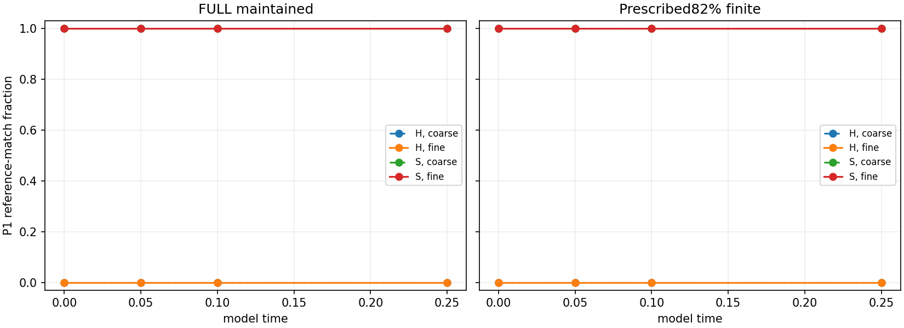

# MG10-P2 model-noise observability and short-horizon match calibration

**SHORT-HORIZON UNSEEDED MATCH CAP SUPPORTED ON TESTED CONDITIONS**. PI closure pending.

1024/1024 paths; production charge1.814736core-hours under4. Stop reason: None.

## Primary unseeded endpoint family

Four one-sided exact Clopper-Pearson upper bounds, groupalpha.0125, simultaneous coverage at least95%; fixed match-frequency cap5%. No primary family is scored for an incomplete batch.

|Condition|Step|Matches/n at.25|Upper bound|Cap met|
|---|---|---:|---:|---|
|c0|0|0/128|0.03365521009360786|True|
|c0|1|0/128|0.03365521009360786|True|
|c1|0|0/128|0.03365521009360786|True|
|c1|1|0/128|0.03365521009360786|True|

## Seeded match retention (descriptive)

A planted shape need not remain stationary, particularly in the prescribed depleted state. These are not sensitivities to a known surviving particle.

|Cell|Matches/n at.25|Descriptive95% interval|
|---|---:|---|
|c0_s1_k0|128/128|[0.9715919465564561, 1.0]|
|c0_s1_k1|128/128|[0.9715919465564561, 1.0]|
|c1_s1_k0|128/128|[0.9715919465564561, 1.0]|
|c1_s1_k1|128/128|[0.9715919465564561, 1.0]|

## Reference contrast / mean unseeded smoothed contrast at.25

This is an observability proxy, not a calibrated physical SNR. TemplateRMS G/X/Y: [0.014652717007426656, 0.6077346339774861, 0.06795987281789236].

|Cell|G|X|Y|
|---|---:|---:|---:|
|c0_s0_k0|0.37499|7.15861|3.57936|
|c0_s0_k1|0.375183|7.12031|3.62706|
|c1_s0_k0|0.417895|7.23404|3.53786|
|c1_s0_k1|0.414846|7.19882|3.51566|

## Scope

FULL is maintained A/B; DEPLETED starts at prescribed82% stocks with original denominators and a rounded effective-rate mass-action background. Seeded initial conditions add the committed G/X/Y reference; they are not assumed stationary depleted solitons. Time.25 is not stationary noise and is below the20-unit persistence criterion. Conditions do not isolate a causal depletion effect.

P1 is unchanged. G/X/Y signed fixed-phase projections, contrasts and residuals with approximate non-simultaneous t intervals are descriptive. Weak G contrast is not particle absence; no X match is not death. No physical particle lineage, coupled-field qualification, stochastic equivalence or prior-study rescoring is inferred. Full per-path inputs/results and eight-cell statistics are in production/evaluation.json; independent audit and upload verification are separate files.

## MG063 inspected result

All1024 paths/128 jobs completed; independent raw/state/seed/integer/instrument/statistical audit PASS,4096 instrument frame comparisons and40 vector-valued cell-metric summaries. No failure/timeout/cap. Elapsed14.223561minutes; production1.814736core-hours below4. Finished2026-11-07 at13:33Mountain Standard Time (20:33UTC). PI closure pending.

Four H groups each0/128 reference matches at.25; each one-sided upper.0336552101 meets the registered.05 cap with simultaneous>=95% coverage. This bounds these short-horizon implemented-sampler match frequencies, not a physical false-particle rate or zero probability. All four S groups128/128 retain an X-reference match at.25, each descriptive95% interval[.9715919466,1]; not a survival estimate or stationary depleted-soliton claim.

G reference contrast/mean unseeded smoothed contrast is.375-.418, versus X7.12-7.23 andY3.52-3.63. This explains why a strict global G-shape residual can be inappropriate. It does NOT make G universally unobservable: known-phase ensemble G projection means are.965-.974 in FULL S versus-.020-.003 in FULL H, and1.013-1.034 in DEPLETED S versus-.024 to-.008 in DEPLETED H, with all signed estimates and approximate non-simultaneous intervals retained. Such ensemble/matched-template information differs from a single-frame global contrast criterion; no new coupled-field decision rule is fitted here.

Depleted S projected X amplitudes about1.051-1.052 andY1.087-1.088 show short shape/amplitude evolution while the X matcher still accepts. Thus match retention alone is not exact shape stationarity. Both numerical steps support the registered cap; this is not proof of continuous-time trajectory-law convergence. No P1/D2 thresholds/outcomes rescored. Future temporal/generalization criteria need separate prospective design; no new production registered by these results.

MG063 retention verified: all128 raw archives/1024 complete paths (54412800bytes) and decision inputs published at9ce8e610538581276e285a15601fef861aca3596; SHA256 and Git-blob sizes match. PI closure pending.

## PI closure — MG064, 2026-11-07

Richard: “I sign off of P2.” **MG10-P2 is CLOSED as SHORT-HORIZON UNSEEDED MATCH CAP SUPPORTED ON TESTED CONDITIONS.** All1024 paths, independent raw/instrument/statistical audit and verified full archive are retained. This closure preserves all short-time/prescribed-state/observability limitations above; it is not a physical-particle survival, stationary-noise or coupled-field equivalence verdict. Earlier studies remain unchanged. No next scientific production is registered by this closure.
