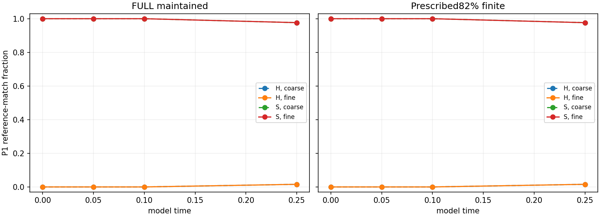

# MG10-P2 model-noise observability and short-horizon match calibration

**MATCH CAP NOT QUALIFIED**. PI closure pending.

1024/1024 paths; production charge0.000000core-hours under4. Stop reason: None.

## Primary unseeded endpoint family

Four one-sided exact Clopper-Pearson upper bounds, groupalpha.0125, simultaneous coverage at least95%; fixed match-frequency cap5%. No primary family is scored for an incomplete batch.

|Condition|Step|Matches/n at.25|Upper bound|Cap met|
|---|---|---:|---:|---|
|c0|0|2/128|0.06195636195230662|False|
|c0|1|2/128|0.06195636195230662|False|
|c1|0|2/128|0.06195636195230662|False|
|c1|1|2/128|0.06195636195230662|False|

## Seeded match retention (descriptive)

A planted shape need not remain stationary, particularly in the prescribed depleted state. These are not sensitivities to a known surviving particle.

|Cell|Matches/n at.25|Descriptive95% interval|
|---|---:|---|
|c0_s1_k0|125/128|[0.9330336979545443, 0.995140296464276]|
|c0_s1_k1|125/128|[0.9330336979545443, 0.995140296464276]|
|c1_s1_k0|125/128|[0.9330336979545443, 0.995140296464276]|
|c1_s1_k1|125/128|[0.9330336979545443, 0.995140296464276]|

## Reference contrast / mean unseeded smoothed contrast at.25

This is an observability proxy, not a calibrated physical SNR. TemplateRMS G/X/Y: [0.014652717007426656, 0.6077346339774861, 0.06795987281789236].

|Cell|G|X|Y|
|---|---:|---:|---:|
|c0_s0_k0|1.54307|64.0002|missing|
|c0_s0_k1|1.54307|64.0002|missing|
|c1_s0_k0|1.54307|64.0002|missing|
|c1_s0_k1|1.54307|64.0002|missing|

## Scope

FULL is maintained A/B; DEPLETED starts at prescribed82% stocks with original denominators and a rounded effective-rate mass-action background. Seeded initial conditions add the committed G/X/Y reference; they are not assumed stationary depleted solitons. Time.25 is not stationary noise and is below the20-unit persistence criterion. Conditions do not isolate a causal depletion effect.

P1 is unchanged. G/X/Y signed fixed-phase projections, contrasts and residuals with approximate non-simultaneous t intervals are descriptive. Weak G contrast is not particle absence; no X match is not death. No physical particle lineage, coupled-field qualification, stochastic equivalence or prior-study rescoring is inferred. Full per-path inputs/results and eight-cell statistics are in production/evaluation.json; independent audit and upload verification are separate files.

