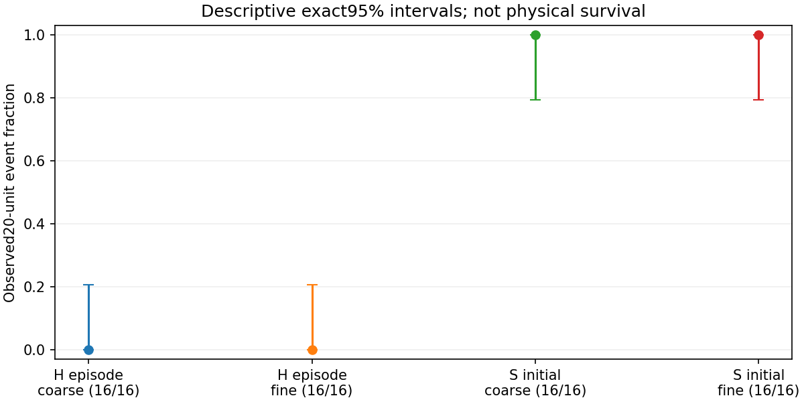
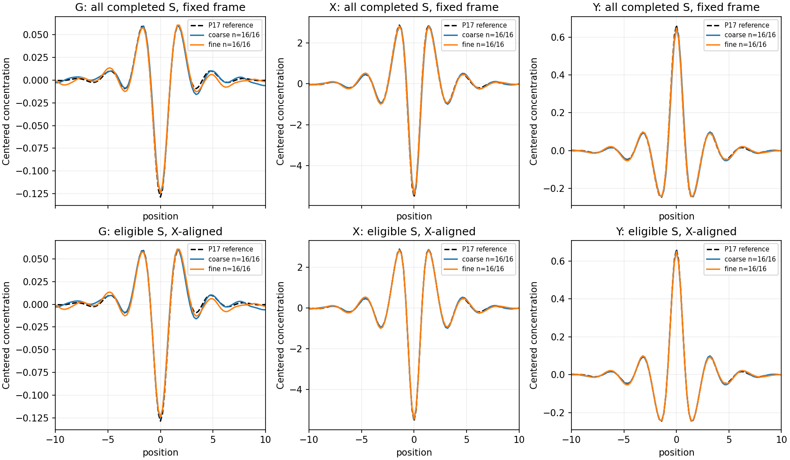

# MG10-P3 sampled temporal persistence and coupled-field averaging

**COMPLETE TEMPORAL ESTIMATION**. PI closure pending.

Completed64/64 registered paths; production11.460091core-hours under24. Stop reason: None.

Full maintained-supply P17 baseline, H/S, two numerical steps,16 independent paths/cell,T25,101 quarter-unit checkpoints. No favorable persistence-rate threshold; completion is not a physical survival verdict.

## Descriptive20-unit observed events

|Start|Step|Events/complete|Original n|95% exact interval|Aligned eligible|
|---|---|---:|---:|---|---:|
|H: any episode|coarse|0/16|16|[0.0, 0.2059072142078227]|0|
|H: any episode|fine|0/16|16|[0.0, 0.2059072142078227]|0|
|S: initial signal|coarse|16/16|16|[0.7940927857921772, 1.0]|16|
|S: initial signal|fine|16/16|16|[0.7940927857921772, 1.0]|16|

S tracks stop at their first unresolved frame; later episodes cannot restore initial identity. H candidates are distinct maximal episodes, never stitched. A gap/mismatch is unresolved, not physical death. Incomplete trajectories are missing, not counted as failed persistence, even when their prefix includes20 units. Descriptive intervals concern completed paths; incomplete runs may be selected by runtime and do not support the full registered population.

## Averaging and eligibility

All completed paths have fixed-frame averages over0..20 (81 frames). Only S paths with initial20-unit continuity also have X-phase-aligned averages of the same window. All three fields use X's phase; G/Y are never independently fitted. Signed projections, residuals, mean individual residuals, observed gains and full profiles are in production/evaluation.json. Undefined gain is missing, never zero/infinity. Conditional alignment and coupled noise can bias profiles; no population-wide coupled-coherence decision follows.

Temporal samples are correlated. No sqrt(81) gain or frame-independent confidence interval is assumed. Approximate non-simultaneous t intervals summarize independent trajectories, with eligible counts explicit. Two finite step sizes are compared descriptively, not declared equivalent. R16 limits rare-event precision; this does not repeat P2's5% match cap. T25 does not answer indefinite survival or depleted/intervention regimes.

Independent audit, full input retention/upload and PI closure are separate records. Earlier P1/P2/D2 results remain unchanged.

## MG067 inspected result

All64/64 paths complete, no failed/nonzero/timeout/cap record. Independent raw/source/seed/state/integer/6464-frame/direct-temporal/statistical audit PASS,96 temporal averages (64 fixed plus32 aligned). Elapsed90.296155minutes; production11.460091core-hours below24. PI closure pending.

Each S step group16/16 initially identified signals reaches20 sampled units (descriptive95% interval[.7940927858,1]); each H group0/16 has any qualifying episode (interval[0,.2059072142]). The32/32 S and0/32 H totals are descriptive counts across steps, not pooled common-probability inference or a5% rare-event result. All32 S paths are eligible for aligned averages in this run, so none was omitted from that cohort.

Coarse S16/16 remain continuously matched through25. Fine S15/16 do; s1_k1_r3 is last matched at22.5, first unmatched at22.75 (NO_REFERENCE_MATCH), hence its initial continuity is censored after already meeting20. This is not physical death or a change to the frozen criterion. No later reacquisition restores initial identity.

X-aligned mean empirical residual-reduction ratios G/X/Y are coarse[4.40501,1.98050,2.58197] and fine[4.50145,1.94907,2.56266]. These measure cancellation of fitted residuals, not a count of independent time samples or proof that every residual is pure noise. They are not assumed sqrt(81)=9. Aligned mean signed template projections are coarse[.978812,.990865,.988821] and fine[.978572,.987022,.984419]. The weak G profile becomes clearer descriptively, but mean per-path averaged G residual remains about.0102-.0104 versus referenceRMS.01465; do not declare perfect per-path G shape or a new coupled-field classifier. Phase alignment mainly reduces X/Y residuals relative to fixed-frame averages; G's major improvement comes from temporal averaging itself.

Both finite step sizes show the registered descriptive behavior; no stochastic equivalence/CTMC-limit proof, indefinite survival, depleted-state/intervention result or physical token lineage follows. All actual profiles/projection series, uncertainty/eligibility and raw inputs retained. Earlier P1/P2/D2 results unchanged; no next production registered. Full archive publication/hash verification follows.

MG067 retention verified: all64 complete raw archives (146550116bytes) and profiles/decision series uploaded atef3b43aecefb2f244da456b47aaec7c0f3386d4b; SHA256 and Git blob sizes match. PI closure pending.
