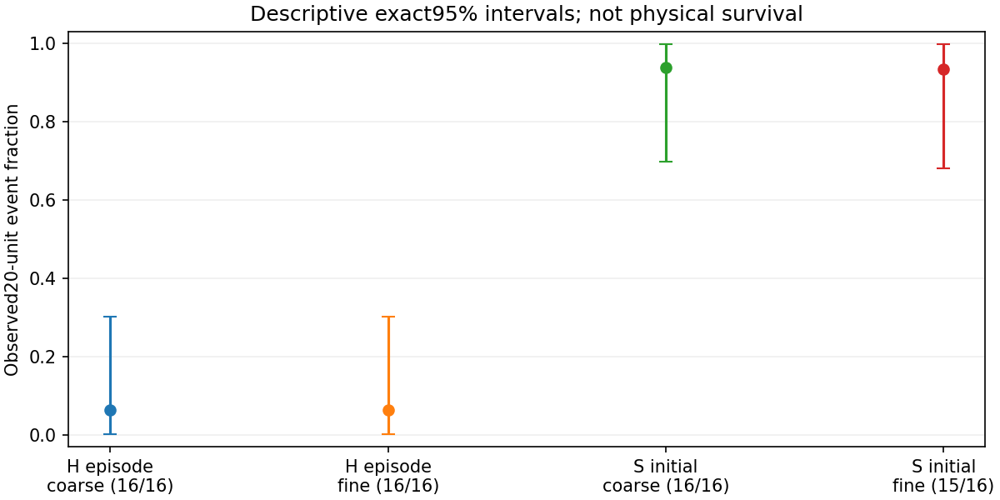
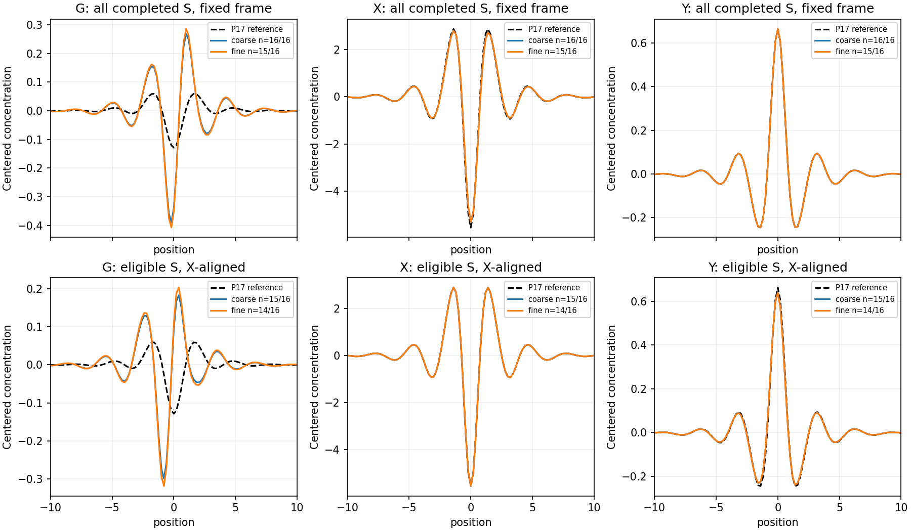

# MG10-P3 sampled temporal persistence and coupled-field averaging

**INCOMPLETE**. PI closure pending.

Completed63/64 registered paths; production0.000000core-hours under24. Stop reason: TIMEOUT.

Full maintained-supply P17 baseline, H/S, two numerical steps,16 independent paths/cell,T25,101 quarter-unit checkpoints. No favorable persistence-rate threshold; completion is not a physical survival verdict.

## Descriptive20-unit observed events

|Start|Step|Events/complete|Original n|95% exact interval|Aligned eligible|
|---|---|---:|---:|---|---:|
|H: any episode|coarse|1/16|16|[0.0015811117227658871, 0.30232073843453194]|0|
|H: any episode|fine|1/16|16|[0.0015811117227658871, 0.30232073843453194]|0|
|S: initial signal|coarse|15/16|16|[0.697679261565468, 0.9984188882772341]|15|
|S: initial signal|fine|14/15|16|[0.6805154334216966, 0.9983135697586473]|14|

S tracks stop at their first unresolved frame; later episodes cannot restore initial identity. H candidates are distinct maximal episodes, never stitched. A gap/mismatch is unresolved, not physical death. Incomplete trajectories are missing, not counted as failed persistence, even when their prefix includes20 units. Descriptive intervals concern completed paths; incomplete runs may be selected by runtime and do not support the full registered population.

## Averaging and eligibility

All completed paths have fixed-frame averages over0..20 (81 frames). Only S paths with initial20-unit continuity also have X-phase-aligned averages of the same window. All three fields use X's phase; G/Y are never independently fitted. Signed projections, residuals, mean individual residuals, observed gains and full profiles are in production/evaluation.json. Undefined gain is missing, never zero/infinity. Conditional alignment and coupled noise can bias profiles; no population-wide coupled-coherence decision follows.

Temporal samples are correlated. No sqrt(81) gain or frame-independent confidence interval is assumed. Approximate non-simultaneous t intervals summarize independent trajectories, with eligible counts explicit. Two finite step sizes are compared descriptively, not declared equivalent. R16 limits rare-event precision; this does not repeat P2's5% match cap. T25 does not answer indefinite survival or depleted/intervention regimes.

Independent audit, full input retention/upload and PI closure are separate records. Earlier P1/P2/D2 results remain unchanged.

