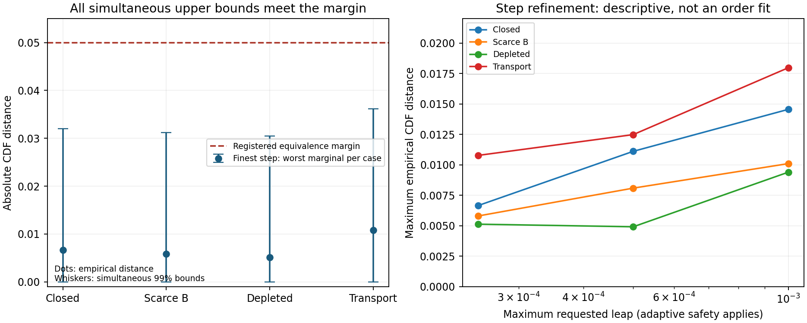

# MG10-S1 — Qualified on tested small systems

MG048, 2026-11-06. **QUALIFIED ON TESTED SMALL SYSTEMS.** All 16 registered
groups completed at 32,768 trajectories/group, 524,288 short trajectories total.
All 96 primary simultaneous distribution bounds meet the frozen .05 margin.
The separately written checker agrees. Every integer transfer ledger balances
exactly, with no negative counts or probability repair. PI closure is pending.

Richard's MG10-C1 sign-off is recorded as MG046; that study is CLOSED with all
three outcomes. Original MG10 remains UNRESOLVED and has not been rescored.

## What was qualified

The new approximation explicitly bounds finite A consumption and joint B/X
consumption. It never spends more stock than is present. Other X exits are
conditioned on the joint draw so their required Euler means are retained.
All reactions/hops use a start-state snapshot; products wait until the next leap.
Count-based R4 catalysis remains the existing P17 convention, not a newly imposed
permanent-token identity or fundamental-tick law.

An independently expressed exact continuous-time SSA is the reference. The noise
law is the specified classical reaction/hopping jump process: numerical qualification
of that assumed law does not establish the physical origin of vacuum fluctuations,
derive A/B from geometry, identify energy, or demonstrate quantum entanglement.

The fixed matrix contains four small fixtures (closed, scarce B, predepleted and
three-node transport), each with SSA and leap maxima .001,.0005,.00025. Omega is 1
or 2, h=1, checkpoints .05,.10,.25. No 500-node particle survey was run. The design,
code, seeds and budget were committed and pushed as **aeb0b39 before production**.
No statistical margin, sample size, fixture, seed or outcome was replaced afterward.

## Registered distribution result

Primary targets are eight marginal observables at each of three times in each of
four cases: total X/B/W, total R1/R3/R4 counts, node0 X/Y. Compare the finest leap
with SSA, using exact empirical-CDF sup distances. The DKW inequality plus triangle
inequality and a union bound gives simultaneous 99% intervals over the 96 distances,
under the stated independent-trajectory/PRNG assumption. Shared SSA samples and
correlated observables do not invalidate the union bound.

The fixed band halfwidth is **0.0253825862**. Qualification requires every primary
upper bound<=.05. The largest observed distance is **0.0107727051** and its upper
bound is **0.0361552912**, below the margin. This worst case is transport, total X,
t=.25. These are absolute CDF units, not relative concentration or particle-rate
errors. A nonsignificant difference was not used as evidence of equivalence.

| Case | Coarse maximum empirical distance | Middle maximum | Finest maximum | Finest simultaneous upper bound |
|---|---:|---:|---:|---:|
| Closed | 0.0145569 | 0.0111084 | 0.00665283 | 0.0320354 |
| Scarce B | 0.0101013 | 0.00808716 | 0.00579834 | 0.0311809 |
| Depleted | 0.00939941 | 0.00491333 | 0.00512695 | 0.0305095 |
| Transport | 0.0179749 | 0.0124817 | 0.0107727 | 0.0361553 |

Coarse/middle distances are descriptive, as registered. They generally decrease
with refinement, but the depleted case is slightly nonmonotonic between the last
two steps. Monte Carlo variation and approximation bias are not separately
identified by those descriptive differences; no convergence-order claim is made.

## Reactant safety and apparatus evidence

All per-site seven-species changes reconstruct exactly from the retained reaction
and directed-hop counts, and every total count is conserved. A/B denominators
remain fixed; depleted fixtures do not reset normalization. R1/R3 stop at zero
stock; scarce B is never overdrawn. Total count conservation is not an energy law.

Safety substeps were used in several coarse/middle groups. They are recorded,
not probability clipping. No finest-step trajectory required a safety reduction;
the largest finest-step exit probability was .189, below the .25 bound. Maximum
observed safety probabilities in all leap groups are at most .2 plus floating-point
roundoff. Physical checkpoint times are exactly the requested observation times.

Five sampler tests and three apparatus tests passed before registration. The
analytic A-death SSA and discrete-leap laws, one-step joint-R3 law/means, all-channel
conditional drift, unchanged IDEAL regression, reproducibility and actual owned
process timeout/cap/interruption/resume were checked. All decision inputs are kept.
The 256-family Bernoulli sanity checks had observed coverage 1.0 in all three tested
settings; qualification frequencies were 1.0 at true distance0, .99609375 at.01,
and0 at.10. These synthetic results check implementation; they are not proof of
universal coverage, which rests on the theorem and sampling assumptions.

## Execution and reproducibility

Sixteen of 16 groups complete, no replacement, production timeout or budget stop.
Production: **176.2166985 worker-seconds =0.04894908 core-hours**, below 3600 seconds.
Qualification/timing/additional checking:77.2601245 seconds, below 360.
Evaluation and separate recomputation:5.0185770 seconds, recorded separately.
At most 8 local workers, numerical-library threads 1. Forecast1032.297616 seconds
was published before production and fit the ceiling with its 25% reserve.

All 1024 chunk seeds are fixed and unique, using the registered seed_for mapping;
worker count cannot change them. Each chunk uses 512 pseudorandom trajectories
from its assigned stream. Statistical interpretation assumes those draws represent
independent trajectories; deterministic PRNG reproducibility is not itself proof
of physical randomness. Every group records OS/Python/NumPy/SciPy/Numba versions.

The 16 compressed scientific NPZ files total **25911541 bytes**, with largest file
4638513 bytes. They retain all trajectories' three population/reaction/hop
snapshots, statistics, initial states, reference stocks and seeds. All files are
below 100MiB and are committed with a SHA-256 manifest, metadata, complete worker
ledger, evaluation, recomputation, analytic fixtures and synthetic counts.
Persistent local retention was verified before registration; repository upload
provides the second retained copy. No full SSA event history was discarded from
a required decision: checkpoint histories suffice, with path replay from chunk seeds.

The checker imports neither the new sampler nor evaluator. It independently checks
registered fixture inputs, exact integer balances, seed arrays, raw hashes, costs,
analytic/synthetic cases and every primary CDF bound using sorted samples rather
than histogram accumulation. Among project helpers, only the original seed helper is shared; both paths also use NumPy. This is
same-author recomputation, not external replication. No external review was requested
with the instruction to proceed.

## Scope and next step

This is qualification of the specified marginals on these small systems/steps/
horizon. It is not full-joint total-variation equivalence, validated spatial noise
correlations at h.2, high-Omega/full-lattice accuracy, a physical noise derivation,
particle persistence or a finite-capacity particle-lifetime result. The smallest
stocks can empty before the first checkpoint, so sub-checkpoint depletion timing
is not fully characterized by these marginal comparisons; the retained one-step
checks give separate local evidence.

Next, validate the sampler at the actual lattice spacing and intended Omega range,
including spatial fluctuation/covariance or mode observables and step refinement.
Then register stochastic recovery and finite-capacity measurements with explicit
particle persistence/identity criteria. Do not use mere contrast minima or sparse
solver roundoff as physical particles/noise. MG10-E interventions do not automatically
follow from this limited sampler qualification; earlier gate outcomes remain frozen.
No further production is launched here. PI sign-off remains the closure step.
