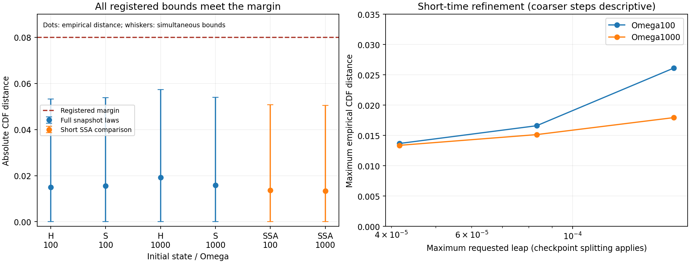

# MG10-S2 — Qualified within registered S2 scope

MG051, 2026-11-06. **QUALIFIED WITHIN REGISTERED S2 SCOPE.** All 88 jobs and
32 logical groups completed, with 16,384 trajectories/group (524,288 total).
The separate checker agrees on both registered family outcomes:

| Family | Outcome | Largest simultaneous upper bound | Margin |
|---|---|---:|---:|
| Full 500-node snapshot law, H/S, Omega 100/1000 | QUALIFIED ON TESTED SNAPSHOT LAWS | 0.0573459 | 0.08 |
| Short 16-node continuous-time spatial law, Omega 100/1000 | QUALIFIED ON TESTED SHORT-TIME SPATIAL LAWS | 0.0507281 | 0.08 |

All 1,280 raw shards, reconstructed populations, seed assignments and 288 primary
CDF comparisons were independently recomputed. There was no timeout, budget stop,
replacement or probability/count repair. S2 PI closure is pending. S1 is PI CLOSED
(MG049), C1 remains CLOSED, and original MG10 remains UNRESOLVED without rescoring.

## What this adds beyond S1

The finite-reactant sampler is tested at the actual lattice spacing **h=.2** and
token densities **Omega 100 and1000**. The full500-node arm includes both homogeneous
and committed soliton-profile starts, rounded to integer counts. Its independent
snapshot oracle uses NumPy multinomials/binomial A, without the sampler's joint-X/B
drawing helper. At these states B is abundant, so the exact conditional law reduces
to ordinary X multinomials. This checks implementation of the snapshot law; it is
not itself a continuous-time SSA reference.

The separate 16-node ring arm uses the unchanged exact SSA and bounded S1 kernels at
the same spacing/densities. It compares evolving states at t=1/8000,1/4000,1/2000.
Its selected wavelengths include 3.2, near the full-ring 3.125 probe, and Nyquist.
The primary comparison is the finest maximum leap 1/24000; larger maxima 1/6000 and
1/12000 are descriptive. Checkpoint remainders can split steps. The finest maximum
divides all three checkpoints exactly, so its main comparison is not made finer
by those checkpoint splits.

Both arms measure species mode powers, real cross-products and X real/imaginary
components. This goes beyond separate population marginals to selected joint
spatial fluctuation observables. It does not characterize all modes, cross-mode
correlations, the full field joint law or long-time particle behavior.

The snapshot innovation subtracts its **known conditional Euler mean**, including
integer rounding, falling-factorial R4 and lattice drift. No fitted sample mean,
phase alignment or later profile selection is used. This is a noise measurement,
not a revision of original MG10's uncentered recovery metric. Canonical real FFT,
scaling and eight-decimal observable rounding are shared measurement dependencies;
Nyquist's imaginary component is exactly zero by definition.

## Prospective design and statistical evidence

Design, code, streams, measured forecast and registration were committed and
pushed as **77eafbf before scientific production**. The initially drafted sample
count 8192 was revised before registration using a static precision allocation:
sampling allowance must use no more than half the .08 margin. This requires about
14928 trajectories for the largest family; the next power of two is 16384.
Draft1, its calibration and timing records remain preserved. No scientific S2
sample or result was used to change the design. Alpha, margins, physical cases,
methods and observables remained unchanged; the existing class timings were
rescaled arithmetically, not replaced with extra physical pilot outcomes.

Primary comparisons number 192 (snapshot) and 96 (short). Each family uses alpha=.005
DKW/triangle/union-bound intervals, giving simultaneous coverage at least 99% across
both families under the stated independent-trajectory/PRNG assumptions. The margin
.08 is an **absolute CDF-distance** margin, not an 8% concentration, covariance or
particle-rate error. It is larger than S1's .05 and is explicitly registered.

The band halfwidths are .03818084 and .03705623. The largest empirical distances
are .01916504 (snapshot: H/Omega 1000, Y power, mode32, delta1/12000) and .01367188
(short: Omega 100, real X, mode1, t1/8000). Every corresponding upper bound is below
.08. This uses equivalence bounds rather than interpreting a nonsignificant
difference as agreement.

| Initial state / density | Maximum empirical distance | Simultaneous upper bound |
|---|---:|---:|
| Full H, Omega 100 | 0.0150146 | 0.0531955 |
| Full S, Omega 100 | 0.0155640 | 0.0537448 |
| Full H, Omega 1000 | 0.0191650 | 0.0573459 |
| Full S, Omega 1000 | 0.0158081 | 0.0539889 |
| Short SSA comparison, Omega 100 | 0.0136719 | 0.0507281 |
| Short SSA comparison, Omega 1000 | 0.0133667 | 0.0504229 |

The short-arm maxima versus SSA decrease with refinement in these data:

| Omega | Maximum1/6000 | Maximum1/12000 | Primary maximum1/24000 |
|---|---:|---:|---:|
| 100 | 0.0261230 | 0.0166016 | 0.0136719 |
| 1000 | 0.0179443 | 0.0151367 | 0.0133667 |

These coarser distances are descriptive, not extra qualification decisions or a
fitted convergence order. The registered success does not automatically endorse
the coarser step for a long rare-event/nucleation study.

## Noise covariance checks and their interpretation

The exact discrete snapshot covariance was checked against explicit Fourier-event
enumeration before production and recomputed independently on the actual cases.
Descriptively, sample diagonal second moments differ by at most 2.43% from those
matrices, and real cross-products by at most 1.96% after normalization by the
corresponding diagonal geometric mean. These are descriptive sample discrepancies,
not new covariance-confidence thresholds.

The snapshot covariance also differs from the **instantaneous CTMC noise matrix**.
Maximum diagonal/cross-entry differences, normalized by instantaneous diagonal
geometric means, are:

| Maximum step | Mode32 | Nyquist mode250 |
|---|---:|---:|
| 1/6000 | 0.0263361 | 0.1205750 |
| 1/12000 | 0.0131681 | 0.0602875 |
| 1/24000 | 0.00658403 | 0.0301438 |

This follows the finite-step multinomial covariance correction. It is **not** the
same as error against a finite-interval SSA covariance, which also includes drift
and repeated events within the interval. The short SSA arm supplies that separate
distributional check. In particular, the high-frequency differences explain why
implementation-level snapshot agreement alone cannot certify CTMC accuracy.

## Execution, raw retention and checks

Production used **1304.9744223 worker-seconds = 0.3624929 core-hours**, below 7200.
Qualification/timing/calibration/checking used 102.7158449 seconds, below 900.
Evaluation and separate raw checking used 111.4507534 seconds, separately recorded.
At most 8 local workers, one numerical-library thread each. Forecast3062.691866
seconds fit the ceiling with its 25% reserve. Maximum observed budget-monitor gap
was **0.2510515 seconds**, within the .5-second requirement. No timeout, missing
job, cap extension or replacement occurred.

Every seven-species change reconstructs exactly from integer reaction and directed-
hop counts; every actual snapshot population hash matches the reconstruction.
The uint32 event packing is checked before conversion, with source-count bounds
well within its range. Short trajectories retain all three full population/event
checkpoints. Fixed A0/B0 denominators and outputs Z/W remain explicit. Conservation
is a token-count identity, not a demonstrated energy law.

The 1,280 compressed scientific shards total **1732753210 bytes** (about 1.61GiB),
largest 2946390 bytes. Complete raw records are retained in the verified persistent
local directory and committed/uploaded in several data batches. All are below
100MiB each. The manifest records every byte hash; completed-shard checkpoints,
actual population hashes, source/spec/reference hashes, all 1280 seeds, worker
metadata and package versions, complete ledger, statistical inputs, evaluation and
recomputation are retained. There is no missing decision array or lossy summary
substituted for the underlying populations/events.

The separate checker imports neither the new sampler nor evaluator. It derives
initial states, means, integer reconstruction, covariance enumeration, hashes,
CDF merging and all decisions independently. It deliberately shares the canonical
spectral measurement/rounding helper and original seed helper; NumPy is common.
This is same-author recomputation, not external replication. No external review
was requested with the instruction to proceed.

## Scope and next stage

S1 plus S2 provide a checked numerical basis for designing a stochastic recovery/
finite-supply experiment at these spacings and densities. They do not establish
T100/T300 accuracy, particle persistence or identity, lifetime/nucleation rates,
all possible depleted states or spatial correlations, a physical fluctuation law,
geometry-derived reservoirs or quantum entanglement. Full-snapshot states have
abundant B; S1 supplies separate scarce-reactant evidence at lower densities.

The next scientific design can address stochastic baseline recovery and independent
A/B capacity effects, with matched control horizons, explicit particle-persistence
rules, uncertainty margins and long-horizon step refinement. Do not import the old
deterministic 1% per-trajectory metric into noisy paths without a power/measurement
design, or treat the contrast-minimum detector as a complete particle definition.
No further production is launched here. PI sign-off remains the closure step.
