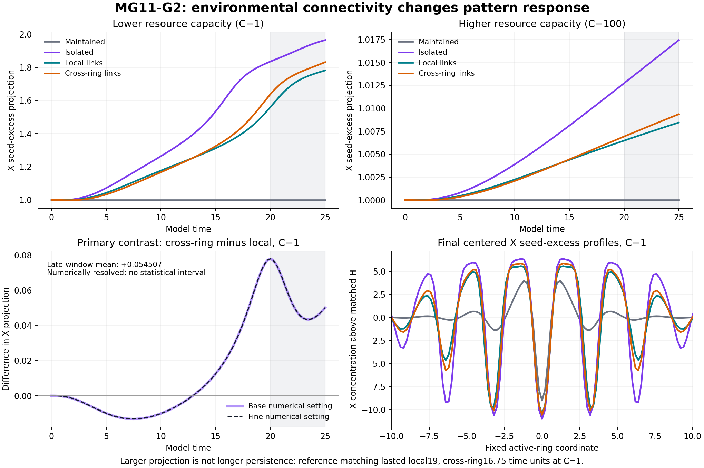

# MG11-G2 Pattern-Response results — MG090

This study established that environmental connectivity changes the nonlinear response of a prescribed Model G pattern even when initial resource stocks, node degree, hopping rate, active lattice and reaction rules are matched. The effect was clearly larger than numerical refinement differences at the lower tested capacity and much smaller at the higher capacity. This extends G1’s delivery-probe result to the full deterministic reaction system. It does not show that cross-ring supply sustains a particle better: both lower-capacity network cases lost reference matching before the primary late window, and the local-link case retained that match longer despite its lower projection. The result concerns the evolution and reorganization of a seeded field within the constructed model, not physical particle death, indefinite persistence, an emergent vacuum or quantum entanglement.

Status: **COMPLETE DETERMINISTIC PATTERN-RESPONSE ESTIMATION**. Registered verdict: **RESOLVED CONNECTIVITY CONTRAST**. Maintained reference-pattern control passed. **PI scientific closure pending.** All28 jobs and the separate raw-data/measurement/budget audit complete.

## Registered primary result

Primary: late20..25 fixed-origin X seed-excess projection, CROSS_RING minus LOCAL, capacityC1. Seed-excess subtracts the matched H response from each S response; means and raw profiles retained separately.

| Numerical setting | G contrast | X contrast (primary) | Y contrast |
|---|---:|---:|---:|
| Base | -0.043125260918 | 0.054506880909 | 0.017502162940 |
| Fine | -0.043125258931 | 0.054506911595 | 0.017502182435 |

Fine X difference **+0.054506911595 reference-amplitude units** (about5.45% of the initial unit-template projection). Both settings positive, refinement difference **3.06858225496e-08**. Registered resolution threshold max(.01,5*refinement difference)=**.01**. Thus the fixed operational numerical criterion is met. G/Y are descriptive secondary contrasts; no inference that all species respond in the same direction.

These are deterministic trajectories, not statistical replicates. No confidence intervals or probabilistic significance are claimed. The refinement guard is operational evidence of numerical resolution, not a rigorous error bound. No post-outcome graph, capacity, horizon, threshold or observable selection.

## Controls, shape changes and capacity dependence

Fine-setting late X seed-excess and sampled reference-match durations:

| Environment | Capacity | Late X projection | Initial-reference matching through |
|---|---:|---:|---:|
| Maintained | Maintained | 1.000000000 | 25 |
| Isolated | 1 | 1.902841085 | 14.5 |
| Local links | 1 | 1.700408236 | 19 |
| Cross-ring links | 1 | 1.754915147 | 16.75 |
| Isolated | 100 | 1.015074040 | 25 |
| Local links | 100 | 1.007468840 | 25 |
| Cross-ring links | 100 | 1.008145788 | 25 |

All maintained controls retain sampled reference continuity throughT25 at both numerical settings, satisfying the20-time-unit prerequisite for interpretation. AtC1, LOCAL matches through19, CROSS_RING through16.75, isolated through14.5; each then becomes NO_REFERENCE_MATCH. These durations are descriptions of a fixed classifier on quarter-time samples, not physical lifetimes. The primary late20..25 window therefore compares changed fields after both finite-network arms have already lost reference matching. Larger projection is explicitly NOT evidence of a more faithful or longer-lived reference-like particle. End profiles show spatial reorganization; no new particle count is inferred from extra extrema.

AtC100 the secondary fine X connectivity contrast is **0.000676948011**, much smaller than theC1 contrast, and all finite arms retain sampled reference continuity throughT25. This is descriptive evidence from two prescribed capacities, not an equivalence test, a general monotonicity law or a separately registered secondary significance claim.

## Resource mechanism and causal scope

Within each capacity the two networks have identical500nodes,750undirected/1500directed unit-weight edges, degree3, outgoing per-token hop hazard1, initial stocks, contact roles and active/reaction laws. Only environmental adjacency changes. The active lattice stays the same periodic1D ring. Links are abstract equal-rate connections: no physical length, transport energy or signal-speed law is modeled. Interpretation is conditional on these two graph embeddings and the fixed seed origin.

A starts spatially uniform, has the same uniform consumption law everywhere and remains graph-independent in this model. The mechanism available to distinguish these cases is B redistribution under spatially varying X demand. The actual total B conversion can change as an outcome/mediator; equal initial resources do not mean equal realized uptake. AtT25 the fine S local-patch B availability is92.275661574% forLOCAL and92.256982589% forCROSS_RING; full means, remote/local stocks and A/B consumption histories are in evaluation.json and raw ledgers. No accounting quantity is identified with physical energy.

H trajectories are integrated in the exact uniform invariant subspace and expanded with directed-flow integrals, as registered and qualified against separate equations. This prevents unspecified numerical roundoff from acting as physical noise; it does not establish homogeneous stability. There is no stochastic experiment in this stage.

## Numerical/accounting audit and execution

All14 condition/start base-fine comparisons pass normalized active-field error<=1e-4. Largest observed **1.46383350356e-07**. Separate audit confirms all28 source/config/reference/job/time grids, initial fields, local reaction/active/environmental transfer/import ledgers, dense real-space projection, late-window trapezoid/contrasts, continuity metadata and refinement/outcome arithmetic. Maximum local normalized ledger residual **2.00400496258e-10** (<1e-7); maximum relative closed/import balance residual **2.34888741593e-15** (<1e-10); recorded minimum component and ledger increment both0. No clipping. Same author/shared constants/NumPy/SciPy and frozen classifier; separate recomputation is not external replication or physical identity tracking.

**28/28 jobs**,101 checkpoints each, all complete; no failures, timeouts, forecast/cap stops, retries or production amendments. Max8localworkers/librarythreads1. Worker charge **142.121898seconds=0.039478305core-hours**, below the approved2core-hour ceiling. End-to-end production plus evaluator/audit **29.463478seconds**. Finished2026-11-09T00:30:33.229072Z, which is2026-11-08 17:30:33Mountain. Worker charge includes startup/writing/check/exit; parent analysis/audit elapsed included in end-to-end time, not worker charge. Forecast was deliberately conservative0.462538core-hours.

PI approval: “Looks good. Approved and continue.” Registration MG089 published at9d41c07 before science started00:30:03Z. Qualified MG088b source/settings/criteria unchanged. The earlier coarse development failure and Step1’s original mixing-range failure remain preserved, not rescored; no production outcome was used to choose the correction.

## Retention and next scientific question

Full28 scientific raw archives (42096175bytes),101frames of all physical populations and reaction/directed-transfer/import ledgers, configs, progress/logs, registration, cost ledger, evaluation and audit published under production/. See production_raw_manifest.json and production_retention_verified.json for post-push hash verification. The separate103-file development archive verification remains in raw_manifest.json/retention_verified.json. The descriptive plotting script only reads audited records and does not alter scoring.

The next question is whether the observed reorganization reflects changes in local reaction demand, transport times and spatial depletion that can be distinguished by matched interventions, and whether the response survives stochastic dynamics. This study alone neither demonstrates autonomous environmental generation nor long-horizon particle support. Any follow-up needs its own scope/criteria/budget and PI authorization. Scientific closure of this result remains PI decision.

MG090 scientific retention verified: all28raw archives (42096175bytes) published atcbecb8ac013b9cfd6f6548f4496110b27cab2b04; every origin/main binary blob matches its audited SHA256/local bytes, including byte-identical figure. Text metadata matches after Git line-ending normalization and JSON parsing (initial raw byte comparison of text correctly exposed CRLF/LF difference, no scientific raw mismatch). Registered sources/preparation/pipeline and original failed-version input hashes unchanged. See production_retention_verified.json, including text-hash reproduction note. No active scientific workers; PI closure pending.
