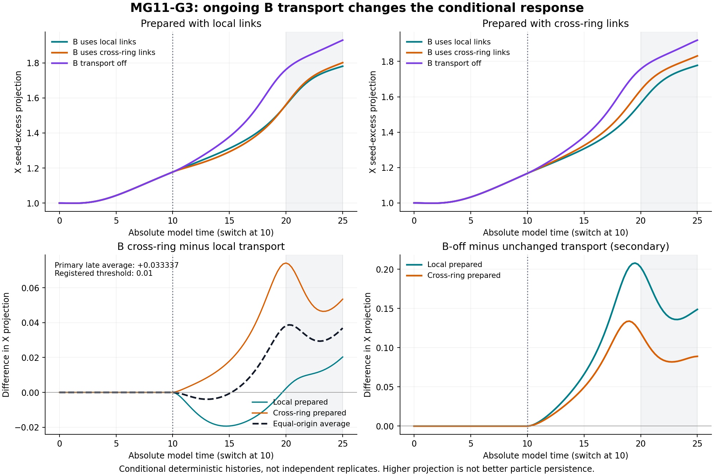

# MG11-G3 B-transport switch results — MG094

MG11-G3 established that ongoing B-resource transport changes the later nonlinear Model G response even when counterfactual branches begin from exactly the same saved fields and resource stores. The effect therefore cannot be attributed entirely to differences already present before the intervention. The response also depends on the chosen prepared state, and turning transport off can increase the signed reference projection rather than simply erase the pattern. This advances the project from comparing fixed environments to a controlled intervention on their operation. It remains evidence within the deterministic constructed model: larger projection is not better particle persistence, the two prepared histories are not independent replicates, and no physical reservoir origin, stochastic robustness or quantum memory is established.

Status: **COMPLETE B-TRANSPORT SWITCH ESTIMATION**. Registered verdict: **RESOLVED ONGOING B-TRANSPORT CONTRAST**. **PI scientific closure pending.** All24 branches,12 numerical refinements,8 sham checks and the separate24-archive audit passed.

## Registered primary contrast

Eight frozen G2C1 donor files supplied exact states at absoluteT10 (LOCAL/CROSS_RING origin, H/S, base/fine). Each forks B transport to LOCAL, CROSS_RING or OFF; A topology/rate, all reaction laws, fixed reference denominators and every physical stock/output store stay unchanged within parent. No parent reintegration, resource reset or source injection. Post counters start0; physical Z/W retain earlier values. Continue15units to absolute25, quarter observations.

For each origin, compare late absolute20..25 X seed-excess under CROSS_RING versus LOCAL B transport. H is subtracted within each destination; primary is the equal-weight average of the two prescribed origin contrasts.

| Setting | LOCAL-prepared X contrast | CROSS_RING-prepared X contrast | Equal-origin X average (primary) |
|---|---:|---:|---:|
| Base | 0.011288162548 | 0.055386425305 | 0.033337293927 |
| Fine | 0.011288177799 | 0.055386434048 | 0.033337305924 |

Primary fine **+0.033337305924 reference-amplitude units**, both settings positive. Refinement difference **1.19968889267e-08**, registered threshold max(.01,5*refinement difference)=**.01**. Numerical and sham qualifications pass, so the fixed operational resolution rule is satisfied. No statistical significance, confidence interval or rigorous error-bound claim: numerical settings are not independent replicates, and two origins are conditional fixed histories.

Fine G/X/Y primary contrasts: [-0.02751759933841258, 0.033337305923648586, 0.009795184595731143]. G/Y and individual-origin contrasts are descriptive secondary outcomes. The origin-specific X responses differ by0.044098256249; this is dependence on different prepared full states, not evidence for memory beyond the current state or quantum entanglement. The new conditional average is not an additive decomposition or replacement of G2's earlier fixed-environment contrast.

## Controls and reference matching

Fine-setting seed-excess late X projection and continuity of the fixed reference instrument over combined saved past/new future:

| Prepared with | B transport afterT10 | Late X projection | Absolute time reference matching lasts through |
|---|---|---:|---:|
| LOCAL | LOCAL | 1.700408236 | 19 |
| LOCAL | CROSS_RING | 1.711696413 | 19 |
| LOCAL | OFF | 1.854190381 | 16.75 |
| CROSS_RING | LOCAL | 1.699528713 | 19 |
| CROSS_RING | CROSS_RING | 1.754915147 | 16.75 |
| CROSS_RING | OFF | 1.844969534 | 16.75 |

OFF means **no B hopping**, not deletion of B stock or suppression of B+X chemistry. OFF-minus-unchanged seed-excess X is+0.153782145729 for LOCAL-prepared and+0.090054386698 for CROSS_RING-prepared. Both OFF records lose reference matching through16.75, illustrating again that increased projection does not establish preservation.

Changing the CROSS_RING-prepared state's B transport to LOCAL extends sampled reference matching from16.75 to19 in this tested case; switching the LOCAL-prepared state to CROSS_RING leaves the recorded matching-through time19. These are quarter-time classifier descriptions, not physical lifetimes, general benefits of local links, new particle counts, or separately registered secondary hypothesis tests. None retains the original reference match into the primary20..25 window; the primary concerns evolved/reorganized seeded fields.

All8same-graph shams reproduce stored G2 active continuations within normalized error **8.4693568958e-08<1e-4**. Thus restarting at the saved time and zeroing only post counters is not a resolved source of the observed transport contrast. All12base-fine branch comparisons pass; largest active error **8.91622541513e-08<1e-4**.

## Mechanism and scope

The within-parent intervention changes only ongoing B transport, so it demonstrates a causal effect of that operation in the implemented deterministic equations, conditional on the chosen states and the matched graphs. A's graph/rate is retained separately and never switched; its initially uniform depletion remains unchanged. There are no external inputs, and all resource use, directed transfers and outputs are accounted.

Spatial redistribution can change later total B uptake, which is a mediator rather than a matched post-intervention dose. This experiment does not separate those downstream uptake changes from spatial delivery. Full stock/uptake means and local-patch histories are retained in evaluation.json and raw files. The original T10 choice was informed by already public G2 trajectories and disclosed before G3 continuation, with no branch eligibility selection based on future outcomes.

All links are abstract equal-rate edges; no physical length/cost/signal law, emergent geometry or physical reservoir origin is modeled. H remains in the exact uniform invariant subspace, not a statement about stability to physical fluctuations. No stochastic simulation or quantum state/process is used.

## Audit, execution and retention

Separate audit passed24/24 full branch archives, donor/source/config/graph/initial-store/time checks, zero initial post counters, B-OFF zero directed flux, zero imports, two-graph local population reconstruction, total closed balance, dense real-space projections, late trapezoids, conditional mean/secondary contrasts, original-continuation shams, refinements and frozen verdict arithmetic. Same author/shared laws/constants/NumPy/SciPy/frozen classifier, different CSR/dense/arithmetic analysis path; not external replication or physical identity tracking.

Maximum normalized local ledger residual **1.81046239405e-11<=1e-7**, total relative balance residual **6.40605658891e-16<=1e-10**. Minimum recorded component and ledger increment both0; no clipping. All8 donor hashes remain unchanged.

24/24scientific branches,61post checkpoints each; all complete. No failures, timeouts, forecast/cap stops, retries or production amendments. Local max8workers/librarythreads1, per-job300seconds, cap3600worker-seconds. Actual charge **100.288289worker-seconds=0.027857858core-hours**, below approved1core-hour cap. End-to-end production/evaluator/audit **24.617782seconds**, finished2026-11-09T01:29:25.365907Z (2026-11-08 18:29:25Mountain). Worker charge includes startup/writing/check/exit; parent analysis elapsed counted in end-to-end time, not worker cap. No parent rerun cost. Environment captured in execution_environment.json.

PI approved the concrete24branch/1core-hour/public raw protocol. MG093 registration published atc1db93b before first branch01:29:00Z. Source/model/criteria/parent hashes unchanged. No earlier study or development failure rescored.

Full24 post-branch arrays (31326153bytes), all populations/directed reaction/transport/import ledgers, original donor provenance, registration/source/config/progress/errors/budget, evaluation/audit/report/figure published here. Eight full G2 donors remain durably public at their registered paths. See production_raw_manifest.json and production_retention_verified.json for post-publication scientific verification. Prior81-file preparation/donor verification remains in raw_manifest.json/retention_verified.json. Plot reads audited records without modifying scoring.

The project now has an explicit within-model intervention showing ongoing environmental B transport matters beyond the initial preparation. Whether the effect survives fluctuations, how to separate transport from total-use feedback, and how an environment or its stocks arise physically remain open. Follow-up needs a separately specified/approved scope and budget. Scientific closure of MG094 remains PI decision.

MG094 scientific retention verified: all24new branch archives (31326153bytes) and8registered closed donor archives published at40ee106f6a6b6c51c8d591ceea07a5a7334ecedc, every binary blob matches audited/registered SHA256 and local bytes. Figure byte-identical; metadata JSON equal after Git line-ending normalization; source/qualification/donor hashes unchanged. See production_retention_verified.json. No active scientific workers; PI closure pending.

## MG095 — MG11-G3 PI closure (2026-11-08 local)

Richard: “I sign off on G3. What's the next step?” CLOSED as COMPLETE B-TRANSPORT SWITCH ESTIMATION; RESOLVED ONGOING B-TRANSPORT CONTRAST under the frozen criteria. Accepts MG09424branch/12refinement/8sham/separate raw audit and verified scientific/donor retention. Conditional deterministic scope only; no better physical-particle persistence, stochastic robustness, hidden-state memory or quantum claim. Source/data/criteria unchanged. Next-stage recommendation requested, not production authorization.
