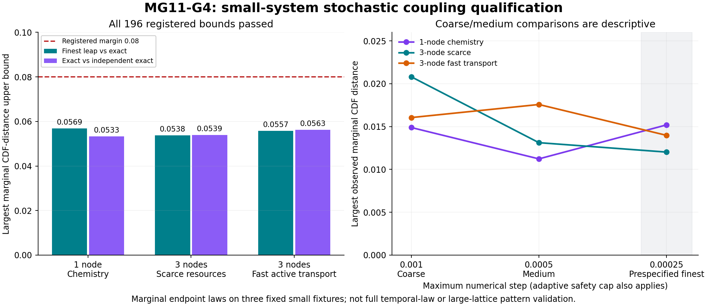

# MG11-G4 Step1 stochastic coupling results — MG098

MG11-G4 Step1 qualified the stochastic resource-network implementation within its registered small-system scope: the selected fine-step approximation reproduced the tested endpoint distributions within the fixed accuracy margin, and the exact simulator agreed with a separately implemented exact reference. All integer resource and event accounting checks passed. This removes a tested implementation obstacle to a later stochastic pattern study, but it does not establish that G3’s pattern response survives fluctuations, that long 500-node trajectories are sufficiently accurate, or that A/B have a demonstrated physical or quantum origin. Those questions remain separate from this numerical qualification.

Status: **QUALIFIED WITHIN REGISTERED SMALL-SYSTEM STOCHASTIC SCOPE**. All120jobs/245760main paths complete;120separate one-path warmups excluded. **196/196 formal marginal endpoint CDF bounds supported**, separate240-archive audit passed. **PI scientific closure pending.** No full pattern-robustness pilot has run.

## Registered endpoint-law result

Three fixed integer fixtures, five methods each: new exact Numba SSA, independent Python/Generator exact SSA and tau maxima.001/.0005/.00025.16384paths per fixture/method, eight2048path chunks. Finest .00025 was fixed before development; no step or sample count selected from outcomes. Every method has49152main paths across fixtures.

Two formal families,98variables each: finest approximation versus new exact; new exact versus independent exact. Variables cover every seven-species/site population at each of two positive endpoints. One-node chemistry has14variables/family, scarce-resource3node42, fast-active-transport3node42. First two endpoints.05,.1; last.01,.02 with per-direction active rates(25,25,300) and different weighted A/B graphs.

| Fixture | Finest vs exact: largest upper | Exact vs independent: largest upper | Registered margin |
|---|---:|---:|---:|
| One-node full chemistry | 0.056927492 | 0.053326418 | .08 |
| Three-node scarce resources | 0.053753664 | 0.053936769 | .08 |
| Three-node fast active transport | 0.055706789 | 0.056256105 | .08 |

For each comparison upperD+2epsilon, with epsilon=sqrt(log(4*196/.0005)/(2*16384))=**0.020864868980**. Largest observed CDF distance **0.015197753906**, largest upper **0.056927491867<.08**. All196criteria supported with nominal99.95% simultaneous confidence for these specified marginal-distance bounds under fixed sampling/PRNG assumptions. Correlated endpoints/shared references are handled conservatively by union bound, not treated as independent observations.

Combined by union with the separately registered development large-count binomial bound (alpha.0005), nominal confidence is at least99.9% for those finite collections of bounds. This does NOT mean99.9% confidence in Model G physics or in the entire stochastic trajectory law. Marginal CDF control is not total variation or a full joint/temporal-law test.

The196coarse/medium comparisons are descriptive. Their observed maximum distances are not required to decrease monotonically with independent Monte Carlo sampling. No coarse/medium result was used to change the registered finest step, margin, sample count or outcome.

## Implementation semantics and accounting

Separate A/B graphs, fixed reference denominators, finite B+X consumption and closed seven-species ledger. All draws read a common step-start snapshot. Joint conversion reserves consumed B/X before conditional remaining exits; reacted resources cannot also hop. Arrivals/products wait until the next numerical step. R4 retains the existing snapshot catalyst convention. This is a controlled approximation to the continuous-time process, not a demonstrated fundamental-tick or token-identity law.

The safety controller can shorten a requested numerical step. For the finest method, **131568 of 14432976 steps (0.9116%)** were adaptive reductions; .00025 is a maximum step, not an assertion that every leap had that exact duration. Largest reported probability across approximation methods **0.200000000000**, below.25guard. Counts/closed totals/reaction, active-hop and both resource-edge histories reconstruct exactly; no negative populations, counter reversals, missing transfers or clipping. Warmup paths are separately archived and never enter CDF denominators.

New exact SSA handles different A/B graphs without calling leap draws; the Python reference has separate propensity/event/update code and RNG. Earlier development established zero-environment byte regressions with frozen MG10-S1, common-graph exact regressions with frozen N1, one-step arrival/conflict checks, large-count binomial behavior, stream continuation and invalid-input/accounting rejection. All original kernels/results unchanged. Exact qualification here is small-system only; huge-stock full-lattice SSA is not claimed practical or tested.

The separate scientific audit recomputed source/reference/config/method/tau/seed/initial/warmup fields, all240integer event balances and total-token identities, all formal/descriptive CDF distances via sorted/searchsorted comparisons, family arithmetic, denominator suppression rules and worker-cost sum. All checks passed. Shared author/laws/constants/NumPy/SciPy/Numba and the explicit raw reconstruction routine are disclosed; the second exact implementation and alternate CDF arithmetic are separate analysis paths, not external replication.

## Execution, registration and retention

**120/120jobs,245760/245760main paths**,120excluded warmups, no incomplete group. No production failure, timeout, forecast/cap stop, retry, seed replacement, sample extension or criterion amendment. Up to8localworkers, numerical-library threads1,180seconds/job. Actual cost **671.003751worker-seconds=0.186389931core-hours**, under approved7200seconds/2core-hours. End-to-end production/evaluation/audit **94.206208seconds** (about1.57minutes). Worker charge includes startup/writing/check/exit; parent analysis/audit elapsed included in end-to-end time but not worker charge.

Finished2026-11-09T02:27:08.860125Z (2026-11-08 19:27:08Mountain). Forecast.522849core-hours was conservative. PI “i approve all. proceed.” approved concrete design/budget/publication; MG097registration published ata305963 before first scientific sampling02:25:34Z. Source/preparation/pipeline/seeds/reference unchanged. Main and warm streams were fixed and disjoint from development before any samples; held regressions deliberately reused development streams only.

Full120main+120warm archives **15146501bytes**, all physical populations/event/edge histories, fixed refs/configs/seeds, requested/completed counts, tau/adaptation stats, progress/logs/failures/budget, evaluation/audit/report/figure are published here. See production_raw_manifest.json and production_retention_verified.json for post-push verification. Development321-input retention remains separately recorded in raw_manifest.json/retention_verified.json; intentional invalid-ledger/synthetic inputs are labeled tests, not production failures. Plot and sampling_summary.json read audited arrays without rescoring.

## What remains before a pattern-robustness claim

This qualification concerns the fixed small systems and short horizons. Its .08CDF margin cannot certify G3’s .0333template-amplitude contrast: observables, units and horizons differ. The later500node pattern pilot needs explicit full-lattice step refinement, independent runs, effect precision, observability/shape controls and a measured local budget. The earlier .002-unit performance microbenchmark gave a simpleT25extrapolation around10–17minutes per path, but that is not a long-run timing or accuracy guarantee. No such pilot has been launched or authorized by this qualification.

Physical supply origins, native/emergent geometry, fundamental tick semantics and entanglement remain additional modeling/evidential questions. PI scientific closure of MG098 is pending; no next scientific batch automatically authorized.

MG098 scientific retention verified: all240main/warm archives (15146501bytes) published at8054121ac74b70bbb5a782bedc3c8a8c70e943de; every blob matches audited SHA256/local bytes. Figure byte-identical; metadata semantically equal after Git line-ending normalization, registered source/preparation/pipeline/reference hashes unchanged. See production_retention_verified.json and its text-hash reproduction note. No active scientific workers; PI closure pending, no pattern pilot authorized.

## MG099 — MG11-G4 Step1 PI closure

Richard: “I sign off on G4. Proceed to next step”. CLOSED as QUALIFIED WITHIN REGISTERED SMALL-SYSTEM STOCHASTIC SCOPE. Accepts MG098120jobs/245760main paths,196marginal CDFbounds,240raw audit and verified public archive. Scope stays fixed small short endpoint laws, not full500node pattern accuracy or physical/quantum claims. Source/data/criteria unchanged. Next-stage pattern-pilot preparation authorized; its concrete model/statistics/measured budget/public retention approval remains before production under protocol.
