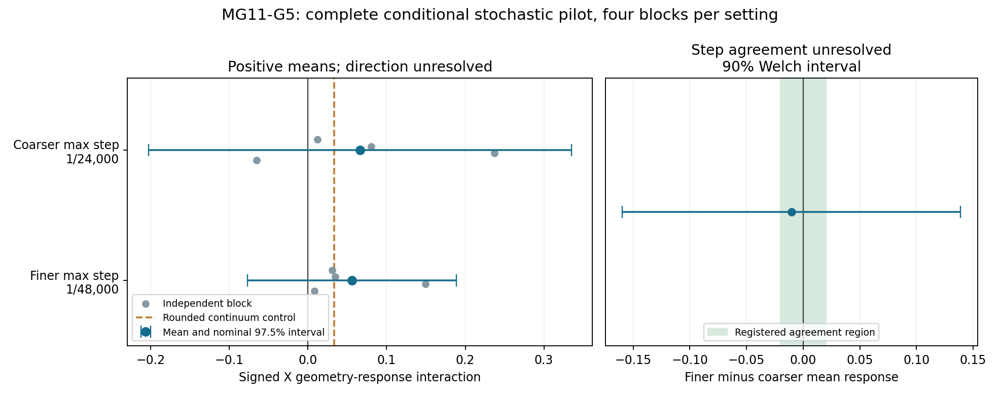

# MG11-G5 results — stochastic geometry-response pilot (MG102)

G5 successfully carried our explicit-resource model onto the full noisy lattice, with all runs completed and all accounting and recomputation checks passed. It did **not yet establish that G3's geometry-dependent response survives token noise**: both estimated responses were positive, but their uncertainty was too large to distinguish them from zero or to establish agreement between numerical step sizes. The deterministic controls remained very close to G3, so converting the initial fields to tokens and adjusting the finite-count reaction law did not remove the deterministic effect in those controls. The project now has a working, measured full-lattice experiment and useful evidence about its sampling variability, but the stochastic robustness question remains open. This is a precision-limited pilot result, not evidence that the geometry mechanism has disappeared, and not a demonstration of particle lifetime or quantum entanglement.

**Registered outcome: COMPLETE PILOT; STOCHASTIC RESPONSE AND STEP AGREEMENT UNRESOLVED.**

All **64 stochastic branches and 16 deterministic controls** completed. The additional 64 short warmups are excluded from the scientific sample. No failure, timeout, budget stop, retry, replacement or production criterion change occurred. **PI scientific closure is pending.**

*Left: each gray dot is an independent balanced block; blue intervals show the uncertainty of the mean. Both intervals cross zero. The dashed line is the rounded deterministic continuum control, not a fitted stochastic target. Right: the numerical-step difference has a wide interval that extends beyond the registered green agreement region.*

## What we tested

G3 showed that changing the network through which reservoir B moves changes the pattern's later field response. G5 asked whether that response remains measurable when resources and reactions consist of randomly moving and reacting tokens.

We started from four already published deterministic states at absolute time 10: two preparation networks, each with a homogeneous background H and a seeded pattern S. All seven species were retained, including spent stores. Concentrations and the original reference denominators were rounded to integer counts at **Omega = 1,000**; those same physical starting states were used across destinations, replicate blocks and numerical settings.

The active lattice remained a 500-node ring. Reservoir A retained its preparation network. Only B's destination network changed between LOCAL and CROSS_RING; their degree, edge weights and total hopping rate were matched. The homogeneous backgrounds were allowed to fluctuate across all 500 nodes, rather than being constrained to remain uniform.

Each branch ran for 15 time units, from absolute time 10 to 25, with observations every quarter unit. Four independent balanced blocks were sampled at each of two maximum numerical steps, **1/24,000** and **1/48,000**. Each block contains eight branches: two preparation origins × H/S × two B destinations. All branches/settings had separate fixed random streams. The 16 deterministic controls cover the same eight contexts under two reaction-drift descriptions.

The outcome is the signed projection of the X field onto the original reference pattern, averaged over absolute times 20–25. For each origin we subtract the homogeneous response from the seeded response, then compare CROSS_RING against LOCAL. The primary block value averages that interaction equally across the two origins. This removes background response from the defined contrast; it does not eliminate its sampling variability.

## Primary results

| Maximum step | Complete blocks | Mean response | Block standard deviation | Nominal 97.5% interval |
|---|---:|---:|---:|---:|
| 1/24,000 | 4 | +0.066094 | 0.128688 | [-0.202641, +0.334829] |
| 1/48,000 | 4 | +0.055711 | 0.063663 | [-0.077235, +0.188657] |

The averages point in G3's positive direction, but **neither interval excludes zero**. The registered requirement for a positive stochastic response therefore was not met. The results also do not establish that noise increased the effect relative to G3; positive point estimates alone cannot support that comparison.

The four actual balanced block values were:

| Block | 1/24,000 | 1/48,000 |
|---|---:|---:|
| 1 | +0.012162 | +0.030472 |
| 2 | +0.080595 | +0.034851 |
| 3 | +0.237114 | +0.149557 |
| 4 | -0.065493 | +0.007964 |

These are future-noise replicates conditional on the same four prepared contexts, not four independently formed particles. Four blocks give limited precision. The intervals use the prospectively specified Student-t approximation with three degrees of freedom. Their nominal 97.5% coverage per setting provides nominal 95% coverage for the two-setting family by Bonferroni, under that approximation. These are not distribution-free guarantees, nor confidence levels for the physical validity of Model G.

## Numerical-step agreement

The finer-minus-coarser mean difference was **-0.010383**, with a **90% Welch interval [-0.159638, +0.138872]**. The registered agreement region was **[-0.02, +0.02]**, and the entire interval had to fit inside it. It did not.

This means **agreement was not established**. It does not demonstrate a numerical bias of 0.16, or prove that the two step sizes produce different answers. The point difference lies inside the agreement region, but the independent noisy samples leave too much uncertainty to certify equivalence. The primary intervals and this agreement interval have separate coverage statements; there is no joint 95% guarantee across all clauses.

## What the deterministic controls tell us

| Calculation | Mean geometry interaction |
|---|---:|
| Closed G3 fine result | +0.033337306 |
| G5 continuum control from rounded parents/references | +0.033333386 |
| G5 finite-count-drift control from those same parents | +0.033021380 |

Rounding changes the deterministic interaction by about **-0.000003920** relative to G3. Replacing the continuum feedback term with the finite-count expression changes it by a further **-0.000312006**. Both controls retain a positive response close to G3.

This narrows one concern: these specific deterministic effects do not explain away G3's geometry response. However, neither deterministic control is the exact stochastic ensemble mean. Nonlinear fluctuations and correlations can affect that mean. Consequently, subtracting either control from a noisy average does not isolate a pure “noise contribution.”

Preparation-origin interactions, stocks, uptake, field means, shape residuals and sampled reference continuity are retained as secondary diagnostics. Among the 64 stochastic branches, all 32 H backgrounds were initially unresolved by the reference classifier and all 32 seeded branches were subsequently censored by it. Loss of reference matching is not physical death. A 15-unit post-switch record also cannot establish the separate 20-unit persistence requirement. No particle-lifetime improvement is claimed from the late projection.

## Validation and reproducibility

The original automatic analysis and separate recomputation passed. Reporting repeated the separate analysis and extended the archive audit to **all 144 scientific/control/warmup files**:

- All 64 main stochastic records and 64 excluded warmups passed exact integer reconstruction of reaction, active-hop and both environmental-edge ledgers, closed totals, nonnegative populations and monotone counters.
- Initial states, reference denominators, graph endpoints/weights, diffusion, coupling, observation grids, numerical steps, masks, seeds and completed counts matched the frozen jobs and source configuration.
- All 16 deterministic controls passed their closed accounting checks and matched their registered job and initial-state metadata.
- A separate dense-projection calculation, differently assembled block algebra and CDF-root confidence calculations reproduced the primary estimates, intervals, completeness and unresolved decision.
- Registered source, donor and qualification hashes remained unchanged. All 80 worker records reported completion with successful exit codes; worker charges were independently summed.

There were **11,521,472 numerical steps** in the coarser main paths and **23,040,800** in the finer paths. Neither setting needed adaptive reductions. Largest recorded probabilities were **0.043611129** and **0.021880566**, respectively, below the inherited 0.25 guard. Correct accounting and safe probabilities support implementation integrity; they do not by themselves establish full-lattice statistical accuracy or replace the unresolved step comparison.

Recomputation is by the same research lead. It shares the raw observations, reference template, mathematical model and some accounting dependencies; it is **not independent external replication**. The original pre-sampling development quantile-check failure and its versioned correction remain preserved. No scientific threshold was changed after production outcomes.

## Execution and archive

PI approval and the frozen MG101 registration were published at commit **c95a090** before production. The run used up to eight local workers with one numerical-library thread each. Actual worker charge was **40,686.768236 seconds = 11.301880 core-hours**, below the approved **24-core-hour** ceiling and the conservative 16.234798-core-hour forecast.

Analysis/audit completion was recorded at **2026-11-09 04:44:37 UTC**, or **November 8, 2026, 9:44:37 p.m. Mountain time**. The launch state observed at 03:19:09 UTC implies approximately **85.5 minutes** to that completion, including parent-side analysis/audit; that elapsed time is distinct from summed worker charge. The run-state file retains completion rather than its overwritten launch timestamp, so the launch time here is attributed to the observed launch record in the chat.

Full retained raw output is **144 archives totaling 163,665,471 bytes**: 64 main stochastic trajectories, 64 excluded warmups and 16 deterministic controls. It includes all recorded physical fields and event/edge histories. Registration, seeds, configurations, progress records, worker logs, budget ledger, primary/secondary analysis, separate audits, this report and its figure accompany the archive. Public publication was explicitly approved; published-byte verification is recorded separately in `production_retention_verified.json`.

Machine-readable inputs for this report are `evaluation.json`, `independent_check.json`, `report_independent_check.json`, `secondary.json`, `sampling_summary.json`, `production_raw_manifest.json` and `production/ledger.json`. The reporting-only script is `src/report_mg11g5.py`. No production kernel or frozen scoring file was modified to produce this report.

## Recommended next decision

Accept G5 as a completed, unresolved pilot rather than a failed implementation or a confirmation of stochastic robustness. Its practical contribution is a functioning full-lattice experiment, measured local cost and an initial estimate of variability. The next design should focus on precision and cost before adding new physical interpretations or mechanisms.

A follow-up could use more independent balanced blocks and a prospectively justified method for comparing numerical steps. G5's observed variability can inform that design, but four-block variance estimates are themselves uncertain; they do not justify a precise sample-size promise. A fresh specification should define the desired uncertainty, numerical agreement test, sample size, budget and stopping rules before any new samples. Do not append favorable extra runs to G5 or rescore it. Parent-formation uncertainty, additional graph families, OFF interventions and any proposed entanglement connection remain separate questions.

**No new scientific run is launched or approved by this report. G5 remains pending PI closure.**
