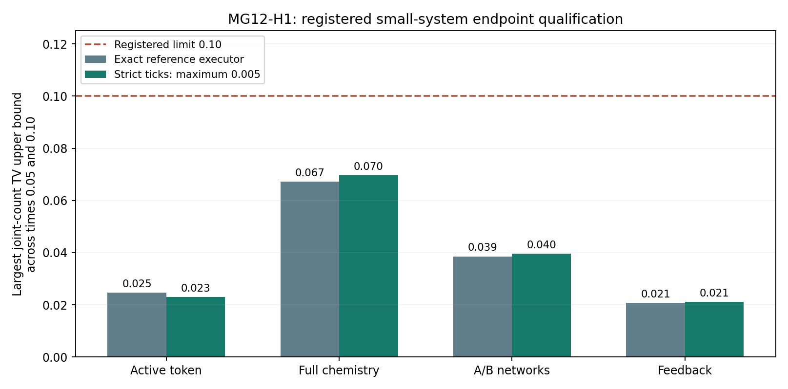

# MG12-H1 formal qualification results — MG108

The explicit hypergraph engine passed its formal small-system qualification. Both its continuous-time executor and the strict-tick executor—with catalysts limited to one participation per tick—reproduced the tested joint species-count endpoint distributions within the registered error bound. All saved event histories and accounting checks passed. This establishes a controlled bridge between our count-based kinetics and explicit relational rewrites on the tested fixed substrates; it supports moving toward more general connectivity. It does not yet establish accurate particle-scale dynamics, evolving geometry, a physical clock, emergent spatial dimension or a quantum vacuum source.

**Outcome: QUALIFIED WITHIN REGISTERED SMALL-SYSTEM ENDPOINT SCOPE. PI scientific closure pending.**

All 16 jobs and 262,144 scientific paths completed. No warmups entered the sample, and no failure, timeout, cap stop, retry, replacement or post-outcome criterion change occurred. Saved-data audit passed for all paths.

## What was tested

The frozen H0/H1 engine represents tokens and sites through typed incidence relations. Chemical events match local participants and replace their state relations; transport changes attachments. Its continuous-time executor re-enumerates after each event. Its separate strict-tick executor freezes tick-start matches, prioritizes exponential proposals, reserves all token participants including catalysts, rejects conflicts without replacement and commits disjoint rewrites together. New products and arrivals wait until another tick. These are distinct finite-time dynamics, not two names for the same algorithm.

The unchanged four fixtures contain at most 6 tokens and 3 sites: one active token with reactions and hopping; six-token full local chemistry; two A plus two B on distinct weighted networks; and two X plus two Y with feedback only. Their finite count generators have 6, 138, 36 and 3 reachable states, respectively. Topology stays fixed. Pairwise transport and a three-participant reaction do not establish any spatial dimension.

Each fixture/method used 16,384 independent fixed seeded paths. Methods were exact continuous time and strict maximum ticks 0.02, 0.01, 0.005, observed at 0, 0.05, 0.1. The finest 0.005 was already designated in the development design. Only exact and finest were formally scored; coarse/medium results are descriptive and were not used to select a setting.

## Registered scientific result

The observable is the **joint species-count distribution across all sites** at each positive endpoint. It is stronger than the earlier arbitrary-state-index CDF diagnostic, but still does not specify the complete temporal or token-identity law. The categorical reference comes from the separately written count-generator master equation.

| Fixture | Exact: largest upper | Finest tick: largest upper | Registered limit |
|---|---:|---:|---:|
| Active token + reactions | 0.024656697 | 0.022998961 | 0.10 |
| Full local chemistry | 0.067204746 | 0.069686321 | 0.10 |
| Separate A/B networks | 0.038559942 | 0.039606969 | 0.10 |
| Feedback catalysts | 0.020678311 | 0.021089137 | 0.10 |

Across 16 formal comparisons, largest observed total variation was **0.012989243465** and largest upper bound **0.069686320645**. Supported comparisons: **16/16**. Total variation measures the maximum probability difference for an event defined by the joint count state. The limit 0.10 is a deliberately coarse ten-percentage-point endpoint-law bound, not a claim of ten-percent error in every reaction rate or concentration.

For each fixture's S reachable states and R=16,384 paths, the registered upper is observedTV+sqrt((S ln2+ln(16/.001))/(2R)). A multinomial L1 concentration bound and union bound give **nominal 99.9% simultaneous confidence** for the 16 specified bounds, conditional on fixed sampling/PRNG assumptions and numerical reference fidelity. Shared trajectories/endpoints do not require independence for the union bound. This confidence is not a probability that Model G physics is correct.

Both sparse and dense matrix-exponential reference calculations agreed within the frozen 1e-11 tolerance; the feedback-only probabilities also matched their analytic three-state chain within1e-11. Probability/row-sum checks passed. These support the computed reference but are not a rigorous floating-point error certificate. No clipping or normalization was used to conceal errors.

The coarser 16 comparisons are retained in evaluation.json for description. Their sampling distances need not decrease monotonically with tick refinement. Passing the finest endpoint bounds does not establish convergence at every population, horizon or substrate.

## Accounting and independent saved-data check

The sampling driver checked causal traces on every path. The saved-data checker then reread all 262,144 paths and re-derived rule effects, catalyst reservations, conflicts, participant histories, closed identity/count totals and observation frames from literal saved relations. It replayed **121,036 accepted events**. All registered seeds, completed denominators, metadata/raw checksums, time grids, fixture definitions and source hashes matched. All path prefixes became complete; no partial jobs were scored as complete.

The checker recomputed categorical frequencies using both bincount and sorted/searchsorted arithmetic, and recomputed concentration margins through two equivalent formulas. It shares the mathematical constants, fixtures and source-hash helper; role replay and count-law analysis are separate from primary incidence matching/execution. This is same-author recomputation, not independent external replication. The master-equation oracle does not call the primary matcher/commit/executors.

## Cost, provenance and retention

Richard's instruction “go ahead with the formal qualification” authorized this bounded qualification. The exact protocol, source hashes, fixtures, all 262,144 seeds and deterministic resolution of 5 uint32 collisions were published before any qualification random draws or reference integrations. Earlier development kernels and data remain unchanged. No external review was requested.

One local worker with one numerical-library thread completed sampling, reference construction and automatic analysis/audit in **304.760835 seconds (5.08 minutes; 0.084656 single-worker hours)**, below the 900-second cap. The prospective measured forecast was 416.12 seconds; neither figure is an estimate for a full-lattice explicit-token simulation. Finished **2026-11-09T18:55:24.205297+00:00** UTC. Reporting and repository publication are separate from that capped run interval.

All 16 count archives, 16 eligible-event trace JSONL files and 4 reference probability archives, reference checks, full seed/config registration, per-job completion/progress records, budget ledger, analysis and this report/figure are retained publicly in this directory. Refer to raw_manifest.json and retention_verified.json for hashes and post-publication verification. Source text hashes normalize LF where specified; working-file and Git text bytes can differ by line endings. No new run is authorized by this result; PI closure is separate.

## Next implication

The next bounded design can extend fixed connectivity beyond the ring and test explicitly higher-arity substrate relations, while retaining the same reaction/causal contract. Known 2D/3D fixtures can validate transport and dimension measurements; arbitrary relational substrates need not have a single dimension. Evolving-topology rules and substrate-generated supply remain later gates. Before particle-scale work, combinatorial matching costs require an optimized representation proven equivalent to the identity-rich reference, plus a separate large-population and longer-horizon qualification. Keep G5 closed with its unresolved stochastic response; this result does not rescore it.

Publication verified at commit8201081: all retained files match published binary bytes, JSON values or line-ending-normalized trace/text content, with audited local hashes checked. Registered source hashes remain unchanged. See retention_verified.json. PI closure remains pending.
