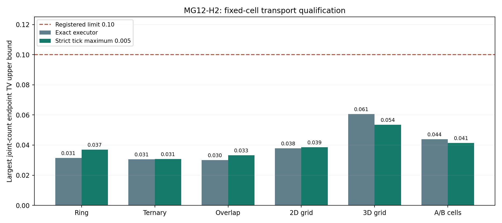

# MG12-H2 formal transport qualification — MG112

H2 passed its formal transport qualification: tokens moving through explicit multi-site relations reproduced the tested joint count distributions within the registered bounds, and every saved event history passed the accounting and one-use-per-tick checks. This extends our validated reference engine beyond binary links to fixed higher-arity connectivity, including transport benchmarks with known two- and three-dimensional geometry. The result establishes the correctness of this transport mapping on the tested small systems; it does not demonstrate a particle in 3D, emergent space or irreducible higher-order dynamics. Chemistry was deliberately switched off, so coupled reaction/transport pattern behavior remains the next bridge to establish.

**Outcome: QUALIFIED WITHIN REGISTERED FIXED-CELL TRANSPORT SCOPE. PI scientific closure pending.**

All **12 jobs and 98,304 paths** completed, with no failure, timeout, cap stop, retry, replacement or post-outcome criterion change. The complete saved-data audit passed.

## Question and scope

Can the explicit incidence engine correctly implement the chosen local transport law on binary, ternary and quaternary fixed relations, including overlapping channels and distinct A/B networks? The six unchanged fixtures carry one G token, or one A plus one B, on at most 27 sites. All chemical reactions are disabled to isolate transport. The 2D and 3D grids are prescribed validation fixtures, not emergent dimensions or particle demonstrations.

For a cell of arity k and weight w, a token has one move opportunity to each other incident site, at species coefficient*w/(k-1). Each incident cell contributes an arity-independent total exit rate; contributions from several cells add. This is equal-volume undirected transport, not a degree-normalized law. Original cell provenance is retained even when overlapping cells offer the same source/destination move.

The exact executor and strict maximum tick 0.005 each used 8,192 independent registered paths per fixture, with observations at 0, 0.05 and 0.1. Tick matches read a common snapshot, competing moves reserve the token once, and arrivals wait until a later tick. Observation boundaries clip ticks. No sample size or setting was selected from qualification outcomes.

## Registered endpoint results

The observable is the categorical **joint species-count state across all sites** at each positive endpoint. It is compared to the independently assembled incidence-matrix dynamics, not to a second sample from the same executor.

| Fixture | Exact: largest upper | Strict tick: largest upper | Registered limit |
|---|---:|---:|---:|
| Binary ring | 0.031461732 | 0.037025213 | 0.10 |
| Ternary cell | 0.030623012 | 0.030710924 | 0.10 |
| Overlapping ternary/quaternary | 0.030096257 | 0.033159639 | 0.10 |
| Known 2D periodic grid | 0.037802637 | 0.038535059 | 0.10 |
| Known 3D periodic grid | 0.060613097 | 0.053548514 | 0.10 |
| Separate A/B cells | 0.043943538 | 0.041392218 | 0.10 |

Supported comparisons: **24/24**. Largest observed total variation was **0.018686252810**; largest upper bound was **0.060613097308**.

For S reference support states and R=8,192, each registered upper is observedTV+sqrt((S ln2+ln(24/.001))/(2R)). The multinomial L1 concentration bound and union bound give **nominal 99.9% simultaneous coverage** for these 24 endpoint bounds, conditional on sampling/PRNG and computed-reference fidelity. Shared endpoints do not require independence for the union bound. A 0.10 total-variation limit is a coarse ten-percentage-point bound on event probabilities in this joint count law, not a ten-percent error guarantee for every reaction rate, concentration, or physical prediction.

This does not bound the full temporal or token-identity distribution, arbitrary larger populations, longer horizons or different substrates. It is not a confidence level for the physical truth of Model G. The finest tick was fixed before development; this two-method qualification does not itself prove a general convergence rate as ticks shrink.

## Independent reference and saved-data checks

Reference matrices are assembled through cell-incidence block algebra without calling the primary matcher or executor. Matrix exponentials agreed with symmetric eigendecomposition within the frozen 1e-11 tolerance. Additional analytic checks passed for the ring and ternary cell, tensor-product transition probabilities on the 2D/3D grids, and independent A/B matrix products. Row sums, symmetry and constant-field checks met 1e-12. No clipping or renormalization hid discrepancies. These numerical checks support reference fidelity without providing a rigorous floating-point certificate.

The sampling driver audited every path. A separate saved-data path reread all 98,304 trajectories, verified registered seeds/configurations/completed denominators/time grids/checksums, reconstructed observations from literal cell-provenanced replacements, and enforced source-snapshot, species, reservation and conservation checks. It replayed **26,720 accepted moves**. Categorical frequencies were recomputed through bincount and sorted/searchsorted arithmetic; the concentration bound was independently recomputed in an equivalent form. Registered source hashes stayed unchanged.

The checks share raw data, fixture constants and some helper functions. The incidence reference and saved literal replay are separate analysis paths, not independent external replication. Earlier development separately checked all 63 fixture generator states, overlap-channel multiplicity, relabeling/corresponding marks, shared-cell access and dimension calibration; those results remain unchanged.

## Interpretation

For this linear single-token law, higher-arity transport is exactly reducible to a weighted pairwise generator. That equivalence is an expected validation control. Explicitly storing multi-site relations does not by itself demonstrate a new collective interaction. Cooperative multi-token transport would require a separately specified kinetic model.

H2's geometry checks mean that the known grids have the expected transport behavior. They do not mean a localized Model G particle has been demonstrated in either grid. They also do not establish a dimension for the small irregular hypergraphs. Development's fixed-radius dimension calibration remains a reminder that finite-scale growth slopes differ from asymptotic dimension.

## Execution and retention

The PI's instruction “go ahead with H2” authorized this qualification after the development report. Source, configuration, protocol and all seeds were published before qualification random draws or matrix integrations. 6 deterministic uint32 seed collisions were resolved prospectively against prior/new manifests. No external review was requested.

One local worker, with one numerical-library thread, completed sampling, reference construction and automatic analysis/audit in **317.248430 seconds (5.29 minutes; 0.088125 single-worker hours)**, below the 900-second cap. The measured forecast was 476.89 seconds. Finished **2026-11-09T21:54:37.868252+00:00** UTC. Reporting/publication are separate from this capped interval. These costs do not predict the cost of expanding particle-scale token populations.

The full 12 count archives, 12 eligible-event trace JSONL files, six reference probability/generator archives, analytic/numerical checks, complete seed/config registration, progress/completion records, budget ledger, evaluation, report and figure are retained in this directory. See raw_manifest.json and retention_verified.json for audited hashes and published-byte/text verification. Text comparisons disclose Git line-ending normalization. PI scientific closure remains separate.

## Recommended next stage

After accepting this bounded transport result, H3 should begin with a controlled **mixed reaction-and-transport bridge** on the new incidence substrates. H1 qualified chemistry on its own tested configurations; H2 qualifies transport on these new fixtures; neither alone establishes the combined law on new substrates. Validate that bridge before particle studies.

Particle-scale work also requires an efficient representation whose match rates and strict participant reservations are proven equivalent to the transparent identity-rich engine. Naive enumeration grows combinatorially with token count. A later pattern protocol needs its own numerical/population limits, meaningful statistical precision and measured local budget. Keep G5 closed and unresolved; this transport qualification does not rescore its noisy geometry response. Topology evolution, substrate-generated A/B supply and any quantum interpretation remain later questions.

Publication verified at commit 3a3305a: every retained binary, metadata record and trace/report matches published bytes or values under the documented text normalization. Audited hashes and registered source hashes match. See retention_verified.json. PI closure remains pending.
