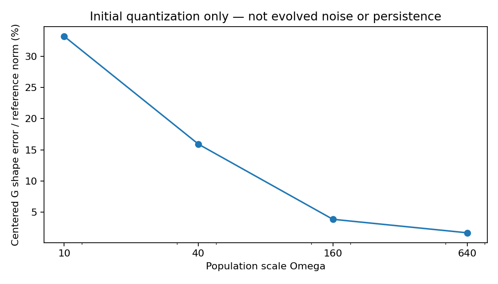

# MG182 G population-scale test readiness

The G-focused test is developed, and its preparation checks passed. The audit found no G count-to-concentration or reaction-drift mismatch in the tested implementation. It did find substantial initial shape quantization at Omega10, which improves with larger populations, while the unrounded deterministic G feature remains nearly unchanged over model time 0.1. These findings support a direct population experiment but do not establish why individual noisy trajectories lose reliable G visibility. A concrete short pilot and budget are proposed below; no scientific production run has started.

## What was verified

Every higher-population state is rebuilt from the unrounded seven-species concentration profile, not by multiplying old rounded counts. All A/B reference count normalizers scale with Omega, preserving normalized source laws and reservoir depletion fractions. Geometry remains 500 sites with the same links and diffusion. Thus the continuum kinetics stay fixed while quantization and finite-population dynamics change. Increasing Omega is not simply making an observer more precise: it can also change whether a noisy structure is dynamically stable.

The compiled generator agrees with an independent continuum implementation plus the known finite-count R4 correction. G changes only through R1, R2, reverse R2 and G transport. Its direct concentration drift agrees with 14A/a_ref-G+0.1X+25 times the ring second difference of G. The nonlinear R4 finite-count correction acts directly in X/Y, with indirect effects on G possible through coupling; it was not silently discarded. Global token conservation and selected chronological reservations were verified.

| Omega | G token range per site | Centered G quantization error / feature norm | Initial G projection / unrounded projection |
|---:|---|---:|---:|
| 10 | 149–152 | 33.2258% | 1.02121 |
| 40 | 596–608 | 15.8932% | 1.0142 |
| 160 | 2385–2432 | 3.83103% | 1.00446 |
| 640 | 9541–9727 | 1.66009% | 1.00144 |

The roughly 33% Omega10 number is a shape-error norm, not 33% loss of G or 33% loss of projected signal. Its matched projection is actually about 2.12% above the unrounded reference. The feature is therefore not absent initially, although its shape is coarsely represented. The unrounded G profile spans about 0.290 concentration units, only about three token increments at Omega10.

Independent continuum integration retains G projection 0.492761 initially and 0.493907 at T=0.1, a change of 0.232411%. This is a deterministic diagnostic, not a statement that individual stochastic paths retain the feature or a proof of stationarity.

## Proposed short pilot: MG183

| Item | Proposal |
|---|---|
| Main population grid | Omega 10, 40, 160 at tick 0.0001 |
| Limited numerical check | Omega160 paired with tick 0.00002 |
| Initial conditions | Prepared pattern and species-mass-matched homogeneous control |
| Replication | Four independent replicates per condition/population |
| Jobs | 24; the eight top-population pairs also supply their coarse primary cell |
| Horizon | T=0.01, observations every 0.001; primary times 0.005 and 0.01 |
| Workers | Eight local workers, one numerical-library thread each |
| Full raw data | Local only, proposed 2 GB cap and at least 8 GB free disk |

G is measured directly with a fixed signed projection onto its unrounded initial profile, plus full G fields and orthogonal shape error. No fitted X/Y observer, alignment search or threshold adjustment is used. Prepared-minus-homogeneous means and control fluctuations are estimated separately. X/Y remain context, never substitutes for G.

The tick check uses the paired fine-minus-coarse mean G projection, separately by initial condition, at both primary times. Its 95% t interval must fit inside ±5% of the fixed initial unrounded G norm. With only four pairs per condition this may be inconclusive; it does not establish all-field or long-horizon equivalence. The population arm estimates effect sizes, uncertainty and noise changes without assuming square-root scaling. Four replicates per condition do not qualify detection error rates or precise variance scaling.

**Scope limit:**T=0.01 is a first feasibility pilot. The earlier difficult G regimes were T=0.1 and later. A short-time population improvement would justify a longer targeted study, but would not settle long-horizon G viability. Omega640 was checked algebraically and timed, but is not included in this first scientific grid.

## Timing and budget

AtOmega10, A/B transport accounts for 97.436% of initial event intensity. Those events are part of the finite coupled model; they cannot simply be removed to make the run cheaper. The actual Omega160 tick-pair probe completed 1,108,300 events over one 0.0001 common interval in about 43.94 seconds, including aggregate ledger checks. Timing samples are development data and will not be reused scientifically.

| Population / job kind | Point forecast per T=0.01 job |
|---|---:|
| Omega10 single | 1.98636 minutes |
| Omega40 single | 10.8419 minutes |
| Omega160 paired | 73.2404 minutes |

Total point forecast: 11.4758 worker-hours, or approximately 1.43448 hours on eight workers. Proposed limits are 24 worker-hours, three hours controller wall time and three hours per job. Slow or failed jobs are retained; the controller stops without replacement if a limit is reached. Analysis has a separate 600-second proposed allowance. Short probes cannot guarantee sustained or parallel throughput; the budget allows roughly twice the point worker estimate.

The same nominal design through T=0.1 projects roughly 14.3448 hours at eight workers before added safety margin. That extension is not proposed for automatic launch.

The approval-gated driver is prepared as `src/run_mg183_gpopulation.py`. It refuses scientific registration without a concrete PI approval record. There is no approval file, production registration or production data. Existing permissions for development covered the deterministic checks and bounded timing probes only.

## Independent checks and numerical note

Separate checking passed 4 scaled drift cases, 5 full single-tick traces (128327 events), sparse reconstruction of both large-pair endpoints and six production-projection identities. An older independent continuum RHS integrated by RK45 agreed with the BDF reference; maximum G difference was 1.16909e-09. Same author and shared Model G equations remain dependencies; this is not external replication.

The first checker attempt stopped on a tiny floating-point projection discrepancy of 1.57e-11 when nearly zero-sum weights multiplied a large uniform background. That failed attempt is retained. The proposed production weights now explicitly remove residual mean before/after normalization; the corrected checker passed without changing a scientific threshold. Original preparation, all timing probes, full checkpoints and hashes remain available locally.

## Next decision

Approve or amend the concrete MG183 short-pilot criteria and budget in `spec/MG183_G_population_pilot_draft.md`. If approved, freeze the final scientific registration and fresh seeds, then run locally on eight workers. Do not infer single-particle G persistence from ensemble visibility alone, or choose another Omega/horizon automatically after outcomes.

G viability remains the blocking scientific question. Earlier X/Y observer studies and MG163 verdicts are unchanged. No G outcome or physical-particle claim is issued by this preparation.

