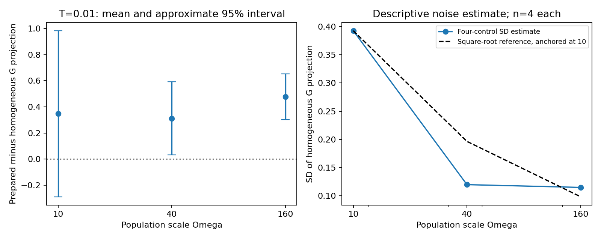
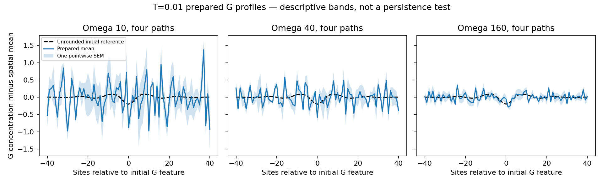

# MG183 G population pilot results

This short pilot supports the population-scale explanation for poor G visibility. With concentrations and kinetics held fixed, the estimated G feature became easier to distinguish from background fluctuations as the token population increased. At model time 0.01, the planned approximate mean-contrast intervals included zero at Omega10 but excluded zero at Omega40 and Omega160. The limited finer-tick check at Omega160 passed its predefined tolerance, so tick size was not the dominant explanation for this short-time result. This does not establish sustained G persistence: there were only four replicates per condition, and the run ended before the previously difficult time 0.1 and later regimes.

## Completion and unchanged design

All 24 registered jobs completed, with no scientific retries, replacements or omitted jobs. Wall time was 2.61408 hours and charged worker time 20.8396 hours, below the three-hour wall and 24-worker-hour caps. Eight workers were used, with one numerical-library thread each. The sampler processed 1,163,461,146 accepted sampling marks, with common paired events counted once. The initial estimate was optimistic under parallel load; the approved caps were retained.

PI approval, source and canonical-input hashes, criteria and collision-checked fresh seeds were published at `7826e67` before scientific draws. The initial sandbox background launcher exited before creating a scientific attempt; its record remains. The persistent launcher started the one scientific attempt, which completed. No criteria changed after outcomes.

The population grid was Omega10,40,160 on the same 500 sites, with four prepared and four species-mass-matched homogeneous replicates per population. Initial integer counts were rebuilt from unrounded concentrations, with A/B normalizers scaled consistently. All species and finite reservoirs were retained; no G reaction rate or measurement amplitude was increased. Omega160 jobs supplied paired ticks 0.0001 and 0.00002; their coarse marginals also supplied that population cell. The common scientific horizon was T=0.01, sampled every 0.001.

## Direct G result

The observable is the signed projection of the centered G concentration field onto its fixed, unrounded initial G feature. It measures a localized spatial contrast, including the reference dip in G, not total G abundance or a newly fitted particle score. The prepared center is known; no alignment search, X/Y substitute or learned observer was used. All population-table results below use the coarse tick 0.0001.

| Omega | Prepared mean G projection | Homogeneous mean | Prepared-minus-control mean, approximate 95% CI | Control SD | Mean contrast / control SD |
|---:|---:|---:|---|---:|---:|
| 10 | 0.559881 | 0.212439 | 0.347442, [-0.288168, 0.983052] | 0.392859 | 0.884393 |
| 40 | 0.438526 | 0.127161 | 0.311366, [0.0316179, 0.591113] | 0.119676 | 2.60174 |
| 160 | 0.401837 | -0.076162 | 0.477999, [0.302267, 0.65373] | 0.114758 | 4.16529 |

These are the registered Welch t intervals for two independent groups of four, with small-sample distribution assumptions. The ratio in the last column is descriptive and estimated from the same small groups; it is not a calibrated single-particle detection probability or a qualified signal-to-noise bound.

The Omega10 interval crossing zero means this pilot did not separate its prepared and control means reliably under that interval calculation; it does not show that G was absent. The Omega40/160 positive intervals support a visible ensemble G contrast in these tested conditions. Mean intervals overlap across populations, so this is not evidence that the underlying G concentration was made larger.

Estimated control dispersion fell from 0.392859 at Omega10 to 0.119676 at Omega40 and 0.114758 at Omega160 at T=0.01. This supports reduced noise overall, but the last two estimates are nearly equal; four controls cannot establish precise inverse-square-root scaling or reliably order their variances. At T=0.005 the corresponding SD estimates were 0.261702, 0.101301 and 0.0436886. The change with observation time is a reason to test the later regime rather than extrapolate this result.

## Initial quantization and mean-field context

| Omega | Initial prepared-minus-control projection |
|---:|---:|
| 10 | 0.540311 |
| 40 | 0.508393 |
| 160 | 0.495635 |

These initial contrasts differ because each population is rounded separately and the mass-matched integer control is not perfectly uniform. They are deterministic initial values, not four independent measurements of an initial fluctuation. Earlier development found centered G shape-rounding error of about 33.2% of the reference norm at Omega10 and 3.83% at Omega160; this was not equivalent signal loss. The actual G projection was present initially at every population.

Increasing Omega changes finite-system fluctuations and the finite-count nonlinear R4 correction, as well as initial quantization. It can therefore affect the dynamics, not merely how well a fixed trajectory is measured. The short pilot does not distinguish an unmeasurable G-bearing core at Omega10 from genuine later stochastic deformation or loss. The independent unrounded continuum reference retained nearly the same G projection through T=0.1, but that is deterministic context, not evidence of noisy-path survival.

## Limited tick check at Omega160

The predeclared tolerance was plus/minus 0.0246381, equal to 5% of the fixed initial unrounded G-feature norm. Each condition used four paired fine-minus-coarse differences and a 95% t interval at the two primary times. All four intervals lie inside that tolerance.

| Condition | Model time | Mean fine-minus-coarse G projection | Approximate 95% paired CI | Registered classification |
|---|---:|---:|---|---|
| prepared | 0.005 | 0.00220656 | [-0.00377125, 0.00818436] | EQUIVALENT IN SCOPE |
| prepared | 0.01 | 0.00459829 | [-0.00522812, 0.0144247] | EQUIVALENT IN SCOPE |
| homogeneous | 0.005 | -0.000721637 | [-0.00388068, 0.00243741] | EQUIVALENT IN SCOPE |
| homogeneous | 0.01 | -0.00132336 | [-0.00507514, 0.00242842] | EQUIVALENT IN SCOPE |

Thus reducing the tick by a factor of five did not materially change the mean G projection at Omega160 within this short-horizon tolerance. This is not proof of exact continuum accuracy, agreement of every field, or tick equivalence at later times or other untested observables. The tick comparison passed; the population arm was an estimation pilot and has no registered binary persistence verdict.

## Verification, resources and data retention

Separate analysis passed 3200 common-boundary marginal endpoint reconstructions, 2400 coarse/single reservation checks, 2400 RNG continuity checks and 6 chronological sentinel traces covering 2,907,624 events. All 33 population/time estimates and four paired tick intervals were recomputed from explicitly centered fields. Maximum mean and CI differences were 2.88658e-15 and 5.66214e-15. Fine reservations were chronologically replayed in sentinel segments; they were not all independently traced. Shared data, model equations, Student references and the same author limit independence; this is not external replication.

Scoring took 38.8031 seconds and separate verification 12.5585 seconds, within the 600-second analysis allowance. Full raw observations, histograms, RNG checkpoints, availability states and sentinel traces occupy 103.359 MB locally in `local_raw/MG183_G_population`. Only compact summaries, mean/SD profiles, source and manifests are public. No full raw archive is uploaded.

## Interpretation and recommended next step

Your population-size suspicion now has direct support from the actual rule engine: larger populations improved short-time G visibility while a finer tick made a comparatively small difference in the specified mean measurement. The implementation audit found no G normalization or instantaneous drift mismatch. That supports investigating population noise before further observer refinement or G-specific kinetic changes.

The next scientific question is whether the improvement survives to T=0.1, the first previously problematic G-noise regime. I recommend preparing a focused later-time comparison of Omega10 and Omega160, retaining prepared/control replication, direct G measurements and an appropriately bounded numerical check. Use the measured parallel costs for its budget; this pilot ran slower than the original one-job forecast. No longer run is started or authorized here.

Even a successful later-time visibility comparison would not by itself prove full G/X/Y particle persistence. Known-center ensemble contrast, individual continuity, spontaneous-core identification and physical interpretation are separate claims. Four replicates do not qualify detection error rates, population variance scaling or rare failures. MG183 short-pilot reporting is complete; PI closure is pending. Earlier MG163 and observer verdicts remain unchanged, and long-horizon G viability remains open.
