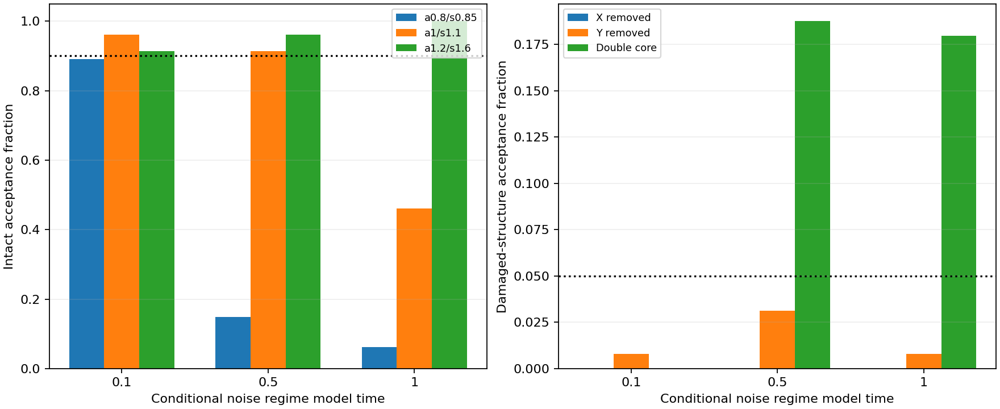

# MG167 - X/Y core detector development

The narrower X/Y detector rejects missing components more reliably, but it still cannot serve as a validated persistence measurement across the tested noise regimes. It misses many weaker intact cores under later noise and accepts too many double cores. The key problem therefore extends beyond the weak G feature: detecting and identifying a single coupled X/Y core against an evolving background remains difficult. The frozen validation failure blocked application to MG163. G remains explicitly unresolved; no complete-particle persistence claim or revised earlier score is issued.

## Candidate and independent test

The X/Y instrument uses a common position, dilation and positive amplitude, two background offsets, and the 2x2 X/Y covariance. Each species must also retain at least half its own initial fitted amplitude, so one cannot disappear behind the other. A new competing-core check subtracts the fitted primary template and searches the remainder beyond 2R95; its threshold is frozen at the largest residual second-core gain in 256 correct-single-core calibration examples. Existing residual/component-consistency guards remain. These are declared operational choices, not physical laws.

Source, specification, seed 16700 and input hashes were published prospectively at be38180 before evaluation. Synthetic draws are new and independent of the MG165 realizations; the estimated noise regimes still come from previously seen MG163 control0/1 and therefore are not independently validated real dynamics. Three regimes T=.1,.5,1 use 256 null/256 intact calibration fields each; validation uses 1024 null and 128 per intact/damaged case perregime. Full fields stay local. No new Model G trajectories were run.

## Frozen development screen: FAILED

Acceptance requirements: intact>=90%, damaged<=5%,null<=1%. These are raw finite-screen criteria. Individual 95% binomial intervals are retained descriptively in benchmark.json; no familywise or population reliability claim. Thresholds were not altered after outcomes.

| Case | T0.1 accepted | T0.5 accepted | T1 accepted |
|---|---:|---:|---:|
| No core | 0/1024 | 4/1024 | 2/1024 |
| Intact a0.8/s0.85 | 114/128 | 19/128 | 8/128 |
| Intact a1/s1.1 | 123/128 | 117/128 | 59/128 |
| Intact a1.2/s1.6 | 117/128 | 123/128 | 128/128 |
| X removed | 0/128 | 0/128 | 0/128 |
| Y removed | 1/128 | 4/128 | 1/128 |
| X displaced by3.2 | 4/128 | 12/128 | 0/128 |
| Y displaced by3.2 | 0/128 | 12/128 | 3/128 |
| Two separated cores | 0/128 | 24/128 | 23/128 |

Missing X was rejected in every validation example; missing Y was accepted in only 1-4 of 128 examples per regime, within the finite 5% screen. This is a useful improvement in component protection, not sufficient overall qualification. The weakest intact case failed even the early screen (114/128=89.0625%,below 90%);13 of those early failures came from the individual-component floor. At T=0.5 and 1, 109/128 and 120/128 weak-intact examples were rejected because total primary evidence did not exceed the frozen detection criterion (gain/amplitude guard), not because G was included. Widening acceptance would need an independently validated tradeoff, not an after-the-fact relaxation.

The residual second-core check rejects 123/128 early split examples directly; all 128 early split examples are rejected by some guard. Later, 24/128 and 23/128 double-core examples remain accepted, exceeding 5%. Mid-regime displaced-X/Y examples also fail the damage screen at 12/128 each. Guard order means a rejection label records the first failed test, not every reason it might fail.

## Saved trajectories and interpretation

The prospectively declared dependency gate blocked saved-MG163 classification because at least one validation screen failed. No new compatible-frame counts or persistence verdict were generated. MG163 remains NOT ESTABLISHED under its original X score; MG165 remains unqualified; G is UNRESOLVED. This failure concerns the measurement candidate and does not demonstrate disappearance of the physical or simulated particle.

## Verification and resources

Separate weighted normal equations reproduced 66selected primary fits/per-species residuals. Independent direct spatial sums reproduced primary maxima and the residual secondary search for 27validation fields across all 23 scales/500 positions. All 6144validation labels, calibration maxima and 27 case verdicts were recomputed. Frozen source bindings were verified. Same-author checks share inputs/templates; not external replication.

Evaluation took 6.26407seconds on one worker/library-thread1, below 600 seconds. Full synthetic payload 59.0366MB remains in local_raw/MG167_XY with a verified SHA-256 manifest; no immutable raw Git commit is claimed. Public fit/label exports are losslessly compressed; no full synthetic fields or event trajectories are published.

## Recommended next step

Before modifying another classifier, quantify the best-case known-position/width X/Y discrimination against damaged and multiple-core alternatives. This separates lack of signal from the penalty of searching the full ring. If informative evidence exists at known geometry, prepare a separately registered temporal tracker with explicit motion/deformation assumptions and control false-track tests. If it does not, temporal tracking cannot simply be presumed to rescue the measurement. Do not change thresholds or launch another long persistence run on the strength of this failed candidate. No further test is authorized by this report.
