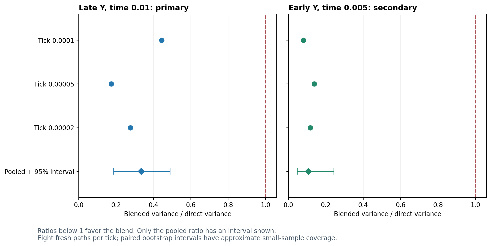

# MG154 — Fixed Y-blend fresh-data validation results

The fixed blend reduced uncertainty in the estimated Y pattern contrast on fresh data, without changing the token rules or reducing the model's genuine stochastic fluctuations. At the final checkpoint, its observed variance was approximately one-third of the direct estimate's variance, and every tested tick group showed an improvement. This confirms that the earlier fitted-pilot benefit carried over to an independent batch under the registered validation criterion. It does not yet establish five-percent contrast accuracy, tick-size equivalence, or particle persistence; the remaining precision and compute requirements still need a separate qualification design.

## Registered outcome

**VARIANCE BENEFIT SUPPORTED IN THIS VALIDATION. Integrity passed; PI CLOSED as MG155 (2026-11-11).** All 24 fresh paths completed: eight each at ticks 0.0001, 0.00005 and 0.00002, on the canonical prepared finite-stock 500-site LOCAL/LOCAL ring at Omega10. Each ran through model time 0.01. Registration MG153 was published as `5288078` before sampling. No weights were refitted, paths removed, margins changed, or failed jobs retried.

The batch covers 6,400 ticks and approximately **166.235 million accepted events**. The existing raw writer, sparse sampler, participant reservation and finite-stock transport remained unchanged. The fixed weights came from the earlier closed precision pilot; none of its paths entered this validation denominator.

## Primary result: Y at model time 0.01

The frozen estimate uses direct weight 0.620838 and integrated weight 0.379162, shared across all three resolutions. Full precision is retained in the registered coefficient file.

| Quantity | Fresh-data result |
| --- | --- |
| Pooled direct variance | 0.000144193 |
| Pooled blended variance | 4.82777e-05 |
| Blended/direct variance ratio | 0.334812 |
| Approximate 95% bootstrap interval for that ratio | 0.186799–0.489462 |
| Direct/blended variance factor | 2.98675 |

Thus observed variance fell by about **66.5188%**. At the same number of independent paths, that corresponds to an estimated standard-error reduction of about **42.1371%**, not a threefold reduction in standard error.

The predeclared primary condition was met: the pooled interval's upper bound is below one and all three tick-specific point ratios are below one. Pooling used variances within each tick group, centering groups separately; differences between tick-group means were not counted as noise.

## Results across resolutions and the earlier checkpoint

Ratios below one favor the blend. Individual tick entries are descriptive point estimates; only the pooled ratios have intervals shown.

| Tick | Ratio at time 0.005, secondary | Ratio at time 0.01, primary |
| --- | --- | --- |
| 0.0001 | 0.07955 | 0.444033 |
| 5e-05 | 0.138092 | 0.174335 |
| 2e-05 | 0.117226 | 0.276269 |

At time 0.005, with frozen direct weight 0.311036, the pooled ratio was **0.10701**, with approximate interval **0.0469438–0.243093**. That is a secondary result, not a second primary qualification gate.

The weights were fixed before these paths were generated. The blend adds only arithmetic to quantities already recorded; it does not modify reactions, transport, model time, or an individual trajectory. It applies to the linear contrast mean. Nonlinear spatial-change power was not blended and receives no automatic precision guarantee from this result.

## Statistical interpretation and limits

The 95% interval used the registered 10,000 stratified paired bootstrap resamples. Whole paths were resampled within tick groups, preserving direct/integrated pairing; sites were not treated as independent samples. There were no nonfinite resamples or dropped data. Indices and all bootstrap ratios are retained.

Coverage is approximate with eight paths per group. The result supports the pooled variance benefit under this validation procedure; it is not a separate 95% guarantee for each individual tick population, nor a guarantee of the same gain on other states or longer horizons. Fixed-weight linearity supplies the expectation identity; sample mean agreement is not being used as a proof of unbiasedness. No tick-equivalence verdict was registered or produced.

## Integrity and separate recomputation

Execution-time rate, drift, count and reservation checks passed. Every path retained source/input and runtime-environment provenance, RNG states, boundary diagnostics, channel histograms and monomial exposures. Three predeclared sentinel paths additionally retained full event order and times; registered ordered exposure replay passed. No raw trajectories were smoothed or suppressed to obtain lower variance.

The [separate recomputation](separate_recomputation.json) independently reconstructed all tick states and observations using sparse integer stoichiometry matrices and exposure arithmetic, then recalculated per-path Y values, scalar sample variances and the bootstrap through separate loops and sorted linear quantiles. It reproduced every stored bootstrap ratio and both intervals within numerical tolerance, and reproduced the primary verdict. Frozen source/input/weight and bootstrap-index hashes are unchanged.

Shared model compilation, contrast coefficients and registered resampling indices are disclosed. This is same-author recomputation, not external replication; the full ordered exposure audit remains the registered sentinel checker. Reproduce with `src/recompute_mg12h3_Y_blend.py`, `src/plan_mg12h3_Y_blend_precision.py` and `src/plot_mg12h3_Y_blend.py`.

A preparation source-binding block was preserved before production: a synthetic test edit had made the original plan stale. The guard stopped preparation before draws, and the corrected prospective plan was published before successful checks. There were no production failures or scientific-result retries.

## Compute and retained archive

Elapsed wall time: **878.909 seconds (14 minutes 39 seconds)**. Charged workers: **5884.04 seconds**; parent audit/analysis: **136.302 seconds**. Total **6020.34 seconds (1.67232 core-hours)**, within the approved 14,400-second (4 core-hour) cap. Up to eight local workers, one numerical-library thread each. No workers remain active.

The production archive contains **441 files**, approximately **355.042 MB**. It follows the approved smaller-payload policy, including estimator exposures and full ordered traces for the three sentinels, not every event trace on every path. Per-path Y values, resampling indices, bootstrap ratios and decision outputs are retained separately. See [raw manifest](raw_manifest.json); publication verification follows upload. Previous archives remain unchanged.

## Recommended next step

Keep these coefficients fixed for future Y-mean work, subject to the scope limits above. The blend's variance benefit is now supported on fresh data, but the old 48-path qualification proposal is still too optimistic for the complete five-percent contrast test.

Point planning from these eight-path variance estimates projects a worst contrast-interval halfwidth about **1.76287 times its margin** at 48 paths per tick, and about **1.05680 times** at 128. These are illustrative future-width calculations, not qualification intervals or reliable sample-size guarantees. Even a halfwidth smaller than the margin does not guarantee equivalence when the true tick effect is nonzero. High-band power has its own unchanged criterion. See [precision planning](precision_planning.json).

Before committing a large independent-path batch, investigate reducing the variance of the **difference between tick resolutions**, for example with a carefully validated shared-randomness coupling that preserves each run's marginal rule law. Merely assigning the same seed is not a validated coupling. Such a method is a numerical comparison technique, not a physical interaction or entanglement between runs. It must retain each chain's separate tick boundaries and reservations. Otherwise prepare a transparent larger-sample cost/precision proposal rather than loosening the five-percent target.

No new qualification or particle run is registered or running. This validation is ready for PI sign-off.

Publication verification passed for all 454 production, decision and frozen-weight files at commit `cce4a94`. Binary archives and the plot PNG match byte for byte. See [verification record](production_retention_verified.json).
