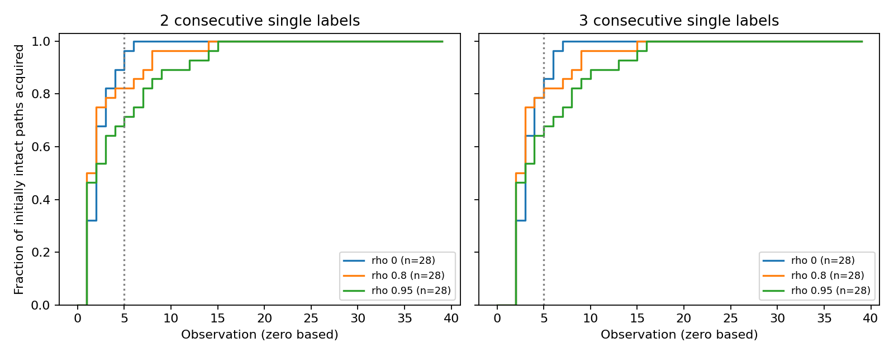

# MG181 acquisition-feasibility study

The fixed MG180 instrument acquired all 84 initially intact fresh paths by observation 15 with two-label confirmation, compared with only 70 by the old deadline at observation 5. All 24 newly appearing cores also acquired. No false acquisition episodes occurred in 60 initially invalid scenes or 32 early-damage paths, and no confirmed single continuation remained after the registered damage-response allowance. Three-label confirmation delayed acquisition without an observed safety improvement in this sample. These findings support separating an explicit evidence-gathering phase from subsequent persistence measurement. They do not select a new deadline or qualify a deployment rule: the false-event confidence intervals remain wide, two paths still missed the later retention summary, and later acquisition never proves earlier persistence.

## Frozen scope and method

Source, inputs, criteria and seed 18100 were published before fresh draws. MG180 classification/background code and its 0.95 conditional weight threshold remained unchanged. The saved-development arm reexamined 296 MG180 primary paths without changing labels or verdicts. The independent arm generated 200 fresh synthetic paths of 40 observations in the late-noise regime: correlations 0, 0.8, 0.95 and noise amplitudes 0.8, 1.25. No Model G trajectories were generated.

The fresh paths include 84 initially intact positive challenges (including 12 weaker cores),24 cores born after observation 7,60 initially invalid scenes, and 32 early-damage paths. Each path has fresh independent spatial and time-ordered background references. Calibration never receives actual correlation, scene type, event time or trajectory; the initial primary search anchor remains supplied as in MG180.

A confirmation occurs when the emitted label has been single for either two or three consecutive observations. The same run produces one episode onset; another requires an intervening non-single label. The study reports acquisition by observations 5, 11, 23 and 39, not a selected best deadline. Reference rejection remains unacquired/censored and stays in every denominator. A valid acquisition requires all confirmation observations to fall in a true aligned-single interval. Boundary-overlapping confirmations are reported separately. Conditional model weights are not calibrated sequential probabilities.

## Saved MG180 development data

Among the 14 frozen MG180 failures with no acquisition by the registered deadline, first confirmed single labels within the saved recording occurred at: {6: 6, 7: 3, 8: 2, 14: 1, 15: 2}. The old results remain failures. Some secondary-vanish paths first confirm single only after the secondary has disappeared, illustrating why a later accepted state cannot certify the earlier interval.

## Fresh initially intact paths

| Required consecutive singles | Valid acquisition by 5 | By 11 | By 23 | By 39 | Total |
|---:|---:|---:|---:|---:|---:|
| 2 | 70 | 80 | 84 | 84 | 84 |
| 3 | 66 | 80 | 84 | 84 | 84 |

| Correlation | Noise amplitude | Confirmation length | By 5 | By 11 | By 23 | By 39 | Total |
|---:|---:|---:|---:|---:|---:|---:|---:|
| 0 | 0.8 | 2 | 13 | 14 | 14 | 14 | 14 |
| 0 | 0.8 | 3 | 13 | 14 | 14 | 14 | 14 |
| 0 | 1.25 | 2 | 14 | 14 | 14 | 14 | 14 |
| 0 | 1.25 | 3 | 11 | 14 | 14 | 14 | 14 |
| 0.8 | 0.8 | 2 | 14 | 14 | 14 | 14 | 14 |
| 0.8 | 0.8 | 3 | 14 | 14 | 14 | 14 | 14 |
| 0.8 | 1.25 | 2 | 9 | 13 | 14 | 14 | 14 |
| 0.8 | 1.25 | 3 | 9 | 13 | 14 | 14 | 14 |
| 0.95 | 0.8 | 2 | 13 | 13 | 14 | 14 | 14 |
| 0.95 | 0.8 | 3 | 13 | 13 | 14 | 14 | 14 |
| 0.95 | 1.25 | 2 | 7 | 12 | 14 | 14 | 14 |
| 0.95 | 1.25 | 3 | 6 | 12 | 14 | 14 | 14 |

For 2-observation confirmation, acquired-time summary among 84/84 acquired paths: {'n': 84, 'minimum': 1, 'median': 2.0, 'maximum': 15}. Geometry was accurate at the first valid confirmation in 84/84 acquired paths. At least 90% later single labels occurred in 82/84 paths with observable post-acquisition true-single frames; this conditional retention summary excludes unacquired paths explicitly, rather than treating them as successes.
For 3-observation confirmation, acquired-time summary among 84/84 acquired paths: {'n': 84, 'minimum': 2, 'median': 3.0, 'maximum': 16}. Geometry was accurate at the first valid confirmation in 84/84 acquired paths. At least 90% later single labels occurred in 82/84 paths with observable post-acquisition true-single frames; this conditional retention summary excludes unacquired paths explicitly, rather than treating them as successes.

Weak-static challenges are included above, not excluded from the denominator. Latency quantiles condition on successful acquisition; paths still unacquired at 39 remain censored, not zero-latency or omitted successes.

## Newly appearing cores

Birth paths are absent at 0–7 and become a moving core at 8. False confirmations before birth and confirmations straddling birth are distinct from valid later acquisition.

| Confirmation length | Valid acquired /24 | Median valid latency after birth | False pre-birth paths | Overlap paths |
|---:|---:|---:|---:|---:|
| 2 | 24 | 1.0 | 0 | 0 |
| 3 | 24 | 2.0 | 0 | 0 |

## False acquisition controls

Intervals below are two-sided 95% Clopper-Pearson intervals for the path-level probability of at least one false confirmation episode. They do not assume successive observations are independent. Small denominators leave wide uncertainty even if no false event is seen.

| Initially invalid case | Confirmation length | Paths with false episode /total | 95% interval |
|---|---:|---:|---|
| absent | 2 | 0/12 | [0, 0.264648] |
| absent | 3 | 0/12 | [0, 0.264648] |
| Xonly | 2 | 0/12 | [0, 0.264648] |
| Xonly | 3 | 0/12 | [0, 0.264648] |
| Yonly | 2 | 0/12 | [0, 0.264648] |
| Yonly | 3 | 0/12 | [0, 0.264648] |
| displaced_initial | 2 | 0/12 | [0, 0.264648] |
| displaced_initial | 3 | 0/12 | [0, 0.264648] |
| split_initial | 2 | 0/12 | [0, 0.264648] |
| split_initial | 3 | 0/12 | [0, 0.264648] |

Pooled initially invalid scenes: 0/60 paths for 2-observation confirmation, 95% interval [0,0.0596295]. This pooling describes this mixture of controls, not a uniform bound for each defect or a qualified safety guarantee.
Pooled initially invalid scenes: 0/60 paths for 3-observation confirmation, 95% interval [0,0.0596295]. This pooling describes this mixture of controls, not a uniform bound for each defect or a qualified safety guarantee.

## Damage arriving during acquisition

Damage begins at observation 3 or 8 after an initially moving aligned core. A pre-damage acquisition is valid only for that earlier state. Reported post-damage false acquisition requires every confirmation observation to be invalid; transition-overlapping episodes are separate. The registered response allowance additionally requires the confirmation window to begin at onset+5 or later.

| Case | Confirmation length | Immediate false-episode paths /8 | After-allowance false-episode paths /8 | Continued confirmed singles after allowance /8 |
|---|---:|---:|---:|---:|
| damage_X | 2 | 0 | 0 | 0 |
| damage_X | 3 | 0 | 0 | 0 |
| damage_Y | 2 | 0 | 0 | 0 |
| damage_Y | 3 | 0 | 0 | 0 |
| damage_displaced | 2 | 0 | 0 | 0 |
| damage_displaced | 3 | 0 | 0 | 0 |
| damage_split | 2 | 0 | 0 | 0 |
| damage_split | 3 | 0 | 0 | 0 |

The continuation column is a supplementary label-derived diagnostic recorded in `continuation_diagnostic_note.md`: a track acquired before damage can continue incorrectly without starting a new episode. It includes such continuations after the same allowance; it does not redefine the frozen acquisition metric. Neither metric alone measures all transient response errors.

After-allowance false episode paths for 2-observation confirmation: 0/32,95%interval[0,0.108881].
After-allowance false episode paths for 3-observation confirmation: 0/32,95%interval[0,0.108881].

Background references qualified in 200/200 fresh paths. Every rejection remained in the unacquired denominator. Longer observation was evaluated only on these fixed emitted labels; no candidate, deadline or reference threshold was chosen after outcomes.

## What the study supports

All 84 initially intact paths acquired with accurate first-confirmation geometry. Two-label confirmation had median observation 2 and range 1-15; three-label confirmation had median observation 3 and range 2-16. The third observation provided no demonstrated safety advantage here because both rules had zero observed false episodes. This is not proof that their risks are equal.

All 24 new births acquired: two-label latency was one or two observations after birth; three-label latency ranged from two to six. Acquisition timing matters independently of later retention: only 82/84 initially intact paths achieved the descriptive 90% post-acquisition single-label summary under either rule. Nothing in this result establishes uninterrupted particle persistence.

Zero false episodes in 60 initially invalid paths gives a pooled two-sided 95% upper probability limit of about 5.96%; zero in 32 early-damage paths gives about 10.9%. The per-defect bounds are wider. Thus this sample cannot establish a 5% bound for each control category, let alone a stronger general guarantee. No maximum latency or confirmation rule is chosen from these outcomes.

## Correlation and information

For a constant Gaussian mean with known AR1 correlation, a useful information reference is n_eff=1+(T-1)(1-rho)/(1+rho). At rho 0.95, six observations provide about 1.12821 independent-observation equivalents and 40 provide 2. This helps explain why observation count alone is a poor evidence budget. It is not a tracker-accuracy formula, does not cover changing geometry, and establishes no conversion of model time to seconds.

## Verification and retention

Separate recomputation checked 8000 frozen labels, 200 fresh path summaries for both confirmation lengths, 296 saved-development records, 96000 pair masses, 15800 real-space reference quadratics and 400 history quadratics. Maximum selected quadratic difference was 2.17191e-06. Driver explicit endpoint checks: 608. The checker used independent run-boundary/episode reconstruction, shared templates and the same author; this is not external replication.

Runtime: main 962.436seconds; checker 20.6347seconds. Full fields, references and beam records remain in `local_raw/MG181_acquisition` (198.595MB), with a hash manifest. Public checkpoints retain calibration, model weights/guards, labels and metrics but omit beam arrays; these were compared exactly against the full local records.

## Next decision and limits

Prepare a prospective acquisition-state layer alongside the unchanged structural labels, with separate ACQUIRING, CONFIRMED and UNQUALIFIED states, no claim about pre-confirmation persistence, and explicit scene-change handling. Specify its false-acquisition and latency targets before a larger independent control test. Preserve the fixed structural instrument and confidence threshold while studying that policy. It does not choose or deploy a new rule, reclassify MG180 as passed, or establish calibrated optional-stopping probabilities. Any prospective acquisition policy needs an explicit safety/error target, sufficiently large independent invalid controls, treatment of scene changes during acquisition, and predictive/structural background-parameter uncertainty.

Keep the structural instrument fixed while deciding that policy; do not simply pick the deadline that rescues the saved failures. The full method still assumes known spectral shape, supplied initial search anchor, externally available reference sets, finite template families and compressed histories. Physical particle persistence and G remain unresolved. MG180 and earlier verdicts are unchanged; no kinetic production or real-data rescore follows, and PI closure is pending.

