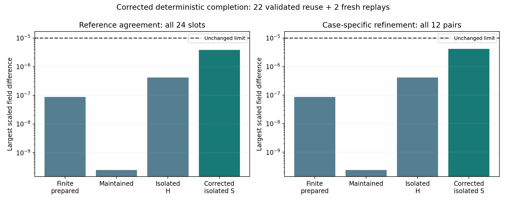

# H3b corrected deterministic completion — MG122

The corrected completion study passed: the incidence-derived population-limit model recovers the tested earlier Model G trajectories and geometry-response measurement within the original accuracy requirements. We retained the 22 validated trajectories and generated two fresh isolated controls at the tighter settings supported by the independent-solver diagnostic. All 24 slots, all 12 refinement pairs and the population/import accounts passed. This completes the corrected deterministic reference bridge on the prescribed ring and resource graphs, while preserving the original stopped batch as failed and incomplete. It does not yet demonstrate particle behavior in the strict finite-tick stochastic engine, a particle on new higher-arity or 3D substrates, emergent space or a physical vacuum supply.

**Outcome: CORRECTED DETERMINISTIC REFERENCE MATRIX COMPLETE; REGISTERED CRITERIA SUPPORTED. PI scientific closure pending.**

## Evidence and provenance

This is the prospectively approved MG121 mixed-provenance matrix: **22 immutable validated original trajectories plus two fresh replays**, not 24 new independent runs. The original failed coarse isolated control is preserved and excluded from this new accepted matrix. The originally unstarted fine job remains unstarted in the original directory. No original result was overwritten or rescored.

The two new slots are isolated seeded controls to T25 at quarter-unit observations. Their BDF settings are rtol1e-11/atol1e-13/maxstep0.05 and rtol1e-12/atol1e-14/maxstep0.025. Reused slots retain their original numerical settings. Thus numerical levels are explicitly case-specific, rather than globally uniform. Physical equations, initial fields, reservoir conditions, archived references and acceptance thresholds remain unchanged.

Both fresh trajectories reproduced their corresponding fixed MG118 diagnostic arrays **exactly** on this platform. This is deterministic replay consistency, not independent physical replication. The separately assembled Radau result remains supporting diagnostic evidence, not an extra completion slot.

## Registered results

| Check | Observed result | Required limit |
|---|---:|---:|
| Largest scaled field/reference difference, all 24 slots | 3.82682446798e-06 | <=1e-5 |
| Largest paired field difference, all 12 context pairs | 4.14493297285e-06 | <=1e-5 |
| Largest relative population/import residual | 2.56242263556e-15 | <=1e-10 |
| Fresh replay difference from diagnostic arrays | 0 for both | <=1e-10 |
| Fine late-X interaction difference from closed G3 | 2.18036588784e-10 | <=1e-5 |

All fields were finite and nonnegative. Closed cases had zero external imports; maintained controls explicitly accounted for A/B replenishment. Z/W remain retained spent products, with no recycling mechanism added. Scaling remains max(1,initial_species_max), including divisor1 for initially absent outputs. No favorable final-Z scaling was introduced.

The completed finite branches gave interaction **0.033337306142**, versus recomputed closed G3 **0.033337305924**. A separate dense projection reproduced the value. This reproduces earlier deterministic evidence; it is not a new stochastic robustness result or an independent discovery of the same physical effect. G5 remains closed and unresolved.

The maintained seeded fine control retained sampled reference matching through **T=25**. Its reservoirs are maintained through recorded external imports, not derived from a physical substrate. Finite prepared branches retain their earlier loss-of-reference-matching behavior; late projection is not physical lifetime, identity or death. The fixed ring is one-dimensional, and resource links are prescribed. No new geometry or quantum behavior is inferred.

## Independent saved-data audit

The complete-matrix evaluator rechecked all24slots with explicit origin/method provenance, archived references, balance/positivity, refinement, projection and held replay guards. A reporting-only second path reread all raw fields, used specieswise maxima and separate population/import summation, recomputed all12pair errors and the finite interaction, verified completion metadata/checksums and confirmed the fresh arrays match the pinned diagnostics exactly. Canonical plan/preparation/source/original/donor/diagnostic/reference hashes stayed unchanged.

Shared dependencies include raw fields, physical inputs, the legacy template/dense projection and some provenance helpers. These are same-author separate analysis paths, not external replication or a rigorous exact-solution error certificate. The archived fine references themselves have finite numerical accuracy, as documented by the preceding Radau diagnostic.

## Execution and retention

Richard approved the concrete reuse/two-fresh plan, numerical correction, unchanged criteria,300second cap and full public raw/provenance/results. Registration was published at **c72e397** before new integration. The source and all preexisting inputs were pinned; no new RNG or stochastic sample selection was involved.

One local worker, numerical-library thread1, completed the two fresh integrations and complete-matrix audit in **13.247616 seconds**, below300seconds and the conservative50.03second forecast. The two fresh solve/IO records sum to **10.169683 seconds**. Original and diagnostic costs remain separately recorded; reused evidence is not newly charged or described as fresh work. Finished **2026-11-10T03:48:04.389013+00:00** UTC. Reporting and publication are separate from the capped execution interval. No failure, retry, unplanned replacement/integration or threshold change occurred.

The complete24slot raw manifest references the22existing public trajectories and two newly published raw files without duplicating/altering the originals. It records each effective method, origin path, bytes and SHA256. Fresh fields/import accounts, prefix/completion metadata, exact plan/preparation/registration, evaluations, audit, report/figure and budget ledger are retained here. See raw_manifest.json and production_retention_verified.json for post-publication verification. OriginalMG117and diagnosticMG119remain separately visible.

## Scope and recommended next stage

This completes the corrected **deterministic population-limit reference experiment**, not all of H3. The mixed-law finite-tick engine still needs formal statistical qualification, and particle-scale execution needs an efficient exchangeable-token representation proven equivalent to the transparent identity-rich reference, including catalyst reservations. A later noisy-pattern study must specify adequate precision and its population/tick/horizon limits before production.

After PI acceptance of this corrected completion, the next useful H3 work is that mixed reaction/transport finite-tick qualification and efficiency bridge. New higher-arity or known-dimensional pattern substrates, spontaneously formed particles, evolving topology and substrate-generated supply require further separate tests. No next run is authorized by this report.

Publication verified at 00a587e: all 24 matrix raw files (22 reused, two new;14,355,714 bytes total,2,607,985 new bytes) match their audited hashes and published binary bytes. Key metadata are semantically equal, the figure is byte-identical, and all registered original/donor/diagnostic/reference/source inputs remain unchanged. See production_retention_verified.json. PI closure remains pending.
