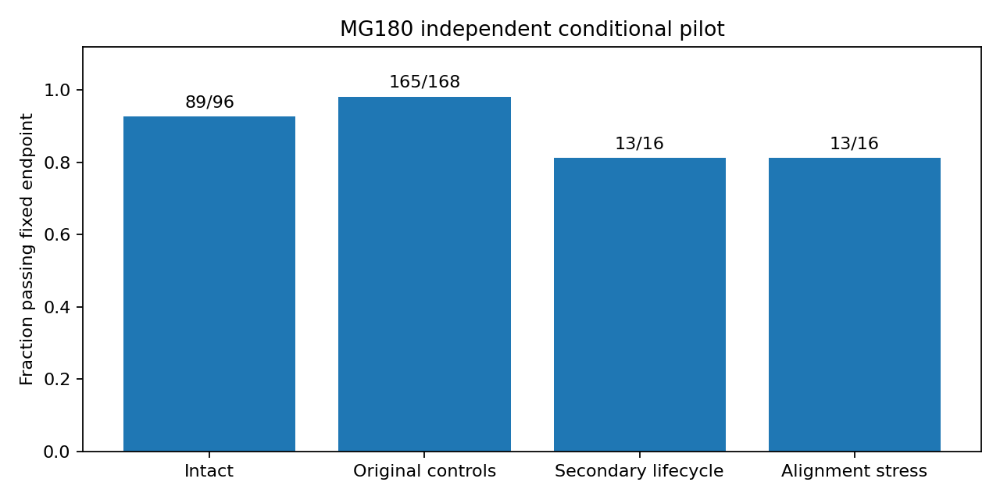

# MG180 integrated component-alignment instrument results

This instrument explicitly distinguishes an intact aligned core from a core whose X and Y features have shifted apart. It combines that alternative with persistent second-core tracking and the joint background-consistency test developed in MG179. In fresh synthetic tests it passed 280/296 primary paths; the registered conditional screen FAILED. All 24 original displaced-Y controls, all 16 added alignment stresses and all 24 split controls received their expected structural labels at the scoring deadlines. All 296 clean primary backgrounds passed. The remaining 16 failures were dominated by acquisition: 14 missed its deadline, one missed post-acquisition retention and one missed an early secondary-detection deadline. Earlier scores remain unchanged, and the complete instrument is not yet qualified to judge particle persistence in actual Model G trajectories.

## Frozen method and scope

Source, input hashes, seed 18000 and criteria were published at `1deeba6` before validation. A deterministic preflight passed eight endpoint/history checks and recognized a shifted-Y field as displaced. The run used one worker and one numerical-library thread, with a 2500-second evaluation cap and 500 MB local full-data reserve. No Model G trajectories were generated.

There are now six structural alternatives: absent, aligned single, X-only, Y-only, multiple full cores, and displaced components. The last alternative integrates 48 possible nonzero Y offsets from -24 to +24 sites. New offsets start uniformly; surviving offsets place half their motion prior on staying still and half on a one-site neighborhood. Primary position and width are inferred, and actual component offsets are never supplied. The offset model shares component width/amplitude; it is not a general species-shape model.

The existing independent secondary-core motion remains. Six structural classes use 0.98 stay and 0.004 per other class; primary stationary/moving modes retain 0.98/0.02 transitions. Eight endpoints per displaced or multiple mode, two per other nonabsent mode and one per absent mode give at most 46 states. Pair mass is preserved before geometry compression, but this is still an approximate temporal distribution.

Background calibration uses 16 independent spatial references plus 64 time-ordered references. MG179 joint-profile likelihood replaces only the plug-in temporal variance-consistency test. Spatial noise-scale and GLS correlation estimates remain the conditional parameters used for tracking; other frequency/channel/mean/lag checks remain. All reference data are independent of tracking fields and fixed thereafter.

The 0.95 structural-weight cutoff, geometry spread guards and finite-reference F innovation guard remain. Structural weights condition on estimated rho/scale; their uncertainty is not fully marginalized. The predictive fit guard is also approximate with fitted rho. One-parameter endpoint sensitivity below assesses selected paths only and does not establish full confidence-region coverage. This limitation blocks real-data readiness even if the conditional screen passes.

## Primary results

The 296 primary paths comprise 264 original controls,16 secondary-motion/lifecycle paths and16 alignment-stress paths; two paths per case. Positive paths must acquire two consecutive single labels by observation 5, then meet 90% single and 90% accurate geometry requirements. Absence must never acquire. Original damage/split controls must acquire by 5 and avoid single at 15; uncertainty can satisfy that negative endpoint and is not necessarily correct structural identification. All acquisition and reference failures stay in the denominator.

| Group | Successful / total |
|---|---:|
| Intact original paths | 89 / 96 |
| Original negative controls | 165 / 168 |
| Secondary motion/lifecycle | 13 / 16 |
| Added alignment stress | 13 / 16 |
| Primary references adequate | 296 / 296 |

| Noise regime | Rho | Noise amplitude | Original successful paths / 22 |
|---:|---:|---:|---:|
| 0.1 | 0 | 0.8 | 22 |
| 0.1 | 0 | 1 | 22 |
| 0.1 | 0 | 1.25 | 22 |
| 0.1 | 0.95 | 0.8 | 22 |
| 0.1 | 0.95 | 1 | 21 |
| 0.1 | 0.95 | 1.25 | 21 |
| 1 | 0 | 0.8 | 22 |
| 1 | 0 | 1 | 22 |
| 1 | 0 | 1.25 | 21 |
| 1 | 0.95 | 0.8 | 22 |
| 1 | 0.95 | 1 | 20 |
| 1 | 0.95 | 1.25 | 17 |

The secondary tests require multiple at 15for stationary/counter-moving secondaries, early multiple acquisition for two cores present initially, and multiple at 12 then single at 20 for a disappearing secondary. Added alignment stresses use offsets -16, 8, 24,and one changing from 10 to 23 sites after onset at 10; they require prior single acquisition and displaced at 15, rather than merely uncertainty.

| Added case | Rho | Successful / 2 |
|---|---:|---:|
| secondary_static | 0 | 2 |
| secondary_counter | 0 | 2 |
| secondary_initial | 0 | 2 |
| secondary_vanish | 0 | 1 |
| align_negative | 0 | 2 |
| align_small | 0 | 2 |
| align_edge | 0 | 2 |
| align_drift | 0 | 2 |
| secondary_static | 0.95 | 2 |
| secondary_counter | 0.95 | 2 |
| secondary_initial | 0.95 | 2 |
| secondary_vanish | 0.95 | 0 |
| align_negative | 0.95 | 0 |
| align_small | 0.95 | 2 |
| align_edge | 0.95 | 2 |
| align_drift | 0.95 | 1 |

Original displaced-Y deadline labels: {'displaced': 24}. Original split deadline labels: {'multiple': 24}. These retain the full denominator, including unqualified references.

Primary failures retained:
- regime 0.1, rho 0.95, noise 1.25, static, replicate 1: acquisition 5, reference adequate True, label at 15 `single`, label counts {'uncertain': 6, 'single': 18}.
- regime 0.1, rho 0.95, noise 1, stop_start, replicate 1: acquisition None, reference adequate True, label at 15 `single`, label counts {'uncertain': 5, 'single': 19}.
- regime 1, rho 0.95, noise 1.25, align_drift, replicate 0: acquisition None, reference adequate True, label at 15 `displaced`, label counts {'uncertain': 7, 'single': 3, 'displaced': 14}.
- regime 1, rho 0.95, noise 1.25, align_negative, replicate 0: acquisition None, reference adequate True, label at 15 `displaced`, label counts {'uncertain': 5, 'single': 5, 'displaced': 14}.
- regime 1, rho 0.95, noise 1.25, align_negative, replicate 1: acquisition None, reference adequate True, label at 15 `displaced`, label counts {'uncertain': 5, 'single': 5, 'displaced': 14}.
- regime 1, rho 0.95, noise 1.25, moving, replicate 1: acquisition None, reference adequate True, label at 15 `single`, label counts {'uncertain': 5, 'single': 19}.
- regime 1, rho 0.95, noise 1.25, secondary_vanish, replicate 0: acquisition None, reference adequate True, label at 15 `single`, label counts {'uncertain': 5, 'single': 11, 'multiple': 8}.
- regime 1, rho 0.95, noise 1.25, secondary_vanish, replicate 1: acquisition None, reference adequate True, label at 15 `single`, label counts {'uncertain': 6, 'multiple': 8, 'single': 10}.
- regime 1, rho 0.95, noise 1.25, static, replicate 0: acquisition None, reference adequate True, label at 15 `single`, label counts {'uncertain': 5, 'single': 19}.
- regime 1, rho 0.95, noise 1.25, static, replicate 1: acquisition None, reference adequate True, label at 15 `single`, label counts {'uncertain': 17, 'single': 7}.
- regime 1, rho 0.95, noise 1.25, stop_start, replicate 0: acquisition None, reference adequate True, label at 15 `single`, label counts {'uncertain': 6, 'single': 18}.
- regime 1, rho 0.95, noise 1.25, vanish, replicate 0: acquisition None, reference adequate True, label at 15 `absent`, label counts {'uncertain': 7, 'single': 3, 'absent': 14}.
- regime 1, rho 0.95, noise 1, missingX, replicate 1: acquisition None, reference adequate True, label at 15 `Yonly`, label counts {'uncertain': 5, 'single': 5, 'Yonly': 14}.
- regime 1, rho 0.95, noise 1, static, replicate 0: acquisition None, reference adequate True, label at 15 `single`, label counts {'uncertain': 6, 'single': 18}.
- regime 1, rho 0, noise 1.25, missingX, replicate 0: acquisition None, reference adequate True, label at 15 `Yonly`, label counts {'uncertain': 7, 'single': 4, 'Yonly': 13}.
- regime 1, rho 0, noise 1.25, secondary_vanish, replicate 1: acquisition 3, reference adequate True, label at 15 `single`, label counts {'uncertain': 7, 'single': 14, 'multiple': 3}.

## What the remaining failures mean

The original negative controls produced no false single labels at their damage deadlines. All 16 added alignment-stress paths were internally labeled displaced at observation 15, but three failed prior acquisition and therefore remain failures. Both negative-offset correlated paths and one drifting-offset path fall in this category. Similarly, correct later lifecycle labels do not erase early acquisition or detection failures.

Across all 2304 observations of the 96 original intact paths, emitted labels were 2201 single and 103 uncertain; none was displaced, multiple, absent or a missing-species label. Uncertainty and acquisition are therefore distinct from a wrong structural class in this batch. The fixed six-observation acquisition window was the dominant remaining bottleneck, but it cannot be waived after seeing these data.

The 16 parameter-endpoint reruns below changed no raw labels on the four selected independent-noise paths. That limited stability does not establish robustness for correlated paths, weak signals or joint parameter changes.

## Separate assumption checks

| Sensitivity | Generic tracking endpoint success / 2 | Reference adequate / 2 |
|---|---:|---:|
| weak_static | 2 | 2 |
| weak_moving | 2 | 2 |
| actual_rho | 2 | 2 |
| shape_X | 0 | 0 |
| contaminated_reference | 0 | 0 |
| temporal_shift | 0 | 2 |

Weak-core amplitude is 0.8; actual-rho references and tracking use 0.8 without supplying it to calibration. Shape-X changes X-noise amplitude by 1.5. Reference contamination adds a stationary core. Temporal-shift uses 0.95 in reference and 0.8 while tracking. Rejecting the defective shape/contaminated references is intended, even though the generic positive tracking endpoint then fails. Reference acceptance cannot certify unchanged later conditions.

## Parameter-uncertainty endpoint diagnostic

Four saved late-iid/noise 1.25 moving/displaced-Y paths were rerun at lower/upper spatial-scale 95%interval endpoints and lower/upper approximate correlation 95%interval endpoints, varying one parameter at a time. No new fields were drawn, no best variant was selected, and primary labels were not replaced.

| Case | Replicate | Parameter endpoint | Changed raw labels | Deadline15 | Endpoint success |
|---|---:|---|---:|---|---|
| moving | 0 | scale low | 0 | single | True |
| moving | 0 | scale high | 0 | single | True |
| moving | 0 | rho low | 0 | single | True |
| moving | 0 | rho high | 0 | single | True |
| moving | 1 | scale low | 0 | single | True |
| moving | 1 | scale high | 0 | single | True |
| moving | 1 | rho low | 0 | single | True |
| moving | 1 | rho high | 0 | single | True |
| displacedY | 0 | scale low | 0 | displaced | True |
| displacedY | 0 | scale high | 0 | displaced | True |
| displacedY | 0 | rho low | 0 | displaced | True |
| displacedY | 0 | rho high | 0 | displaced | True |
| displacedY | 1 | scale low | 0 | displaced | True |
| displacedY | 1 | scale high | 0 | displaced | True |
| displacedY | 1 | rho low | 0 | displaced | True |
| displacedY | 1 | rho high | 0 | displaced | True |

This sensitivity does not integrate nuisance parameters or bound all combinations of uncertainty. It cannot turn conditional model weights into calibrated survival probabilities.

## Verification and retention

Separate recomputation passed 7392 labels, 308 path outcomes, 88704 pair-mass checks, 24332 real-space reference quadratics, joint-profile likelihood checks and 616 selected-history quadratics. Maximum selected quadratic difference was 6.61549e-06. Driver direct multiple/displaced endpoint checks: 1232. Shared input/template/noise assumptions and same author limit independence; this is not external replication.

Main runtime 866.911seconds; checking 29.3138seconds; endpoint sensitivity 43.5926seconds. Full fields, references and beam histories remain in `local_raw/MG180_alignment` (258.81MB), with hashes in the manifest. Public compressed checkpoints omit beam arrays but retain weights, log masses, calibration, geometry/innovation guards and labels; the checker verified them against full local records.

## Interpretation and next step

Prioritize a separate acquisition-feasibility study: determine how much evidence is needed at each noise/correlation level, with acquisition failures and false acquisition retained. Use an evidence-based stopping rule rather than choosing a longer warm-up to rescue these paths. Test damage or a second core arriving during acquisition. Keep the structural and background improvements fixed while studying this bottleneck. Do not relax acquisition or alignment thresholds after seeing these results. Before applying this to actual trajectories, address predictive/structural nuisance uncertainty and qualify reference selection on held-out Model G background data, with richer covariance, non-Gaussianity and contamination controls.

A limited hypothesis family and compressed geometry histories can still produce confident weights under unmodeled defects. This study assumes externally available clean reference sets, a supplied initial primary seed, known spectral shape and ordinary template amplitude. G remains unresolved. MG178/MG176/MG163 verdicts are unchanged. No new kinetic production or real-data rescore follows, and PI closure is pending.

