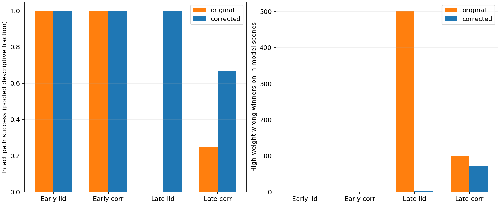

# MG172 - corrected model-selection tracker validation

The registered corrections remove the major spurious-multiple pathology on independent synthetic validation sequences and substantially improve tracking: the corrected version succeeds on 44/48 intact paths versus 27/48 for MG170. All late independent-noise intact paths pass, and no negative case has a false-single output at its predefined deadline. However, the full screen still fails: all four late, highly correlated static-core paths fail, accumulating 73 false-absent observations despite a core being present. This is meaningful progress on the audited inference error, not a qualified particle-persistence instrument. Model-relative weights can still be confidently wrong under the remaining assumptions; G stays unresolved and MG163 is unchanged.

## Corrections and remaining approximation

At each step the corrected version integrates the entire declared secondary-location/width prior, sums incoming history weights at equal endpoints, and calculates class weights before compressing geometry histories. The secondary grid contains 13 widths and 435 allowed positions outside 2R95 for a designated primary. No observation-selected two-peak average or arbitrary fixed penalty is used. Stationary template cross-correlations accelerate the likelihood calculation; direct residual calculations check their equivalence.

For propagation it still retains only two geometry endpoints per nonabsent class and one absent anchor. It rescales the retained within-class weights to preserve the complete class mass. This preserves class totals, not the full geometry distribution, so it remains an approximate filter. The no-core hypothesis keeps an anchor for future primary motion; the secondary prior is globally redrawn each frame and does not track a separate secondary identity.

Same assumptions as MG170: known ordinary amplitude 1, known conditional spectral covariance and temporal rho, five structural hypotheses, bounded primary motion/width increments, fixed class-transition priors, normalized-weight cutoff 0.95 and the conditional innovation fit guard. The fit guard uses the most-likely incoming history for the representative endpoint, not a mixture confidence interval. The comparison tests the three corrections together; it does not isolate their individual contributions. For a nonabsent prediction, geometry weight is spread uniformly over available neighboring states (normally 15, or 10 at a width boundary); remaining exactly still receives no special preference. Class-transition probability is 0.98 for staying in the same class and 0.005 for each other class. These are declared modeling choices, not measured Model G properties. Their role in the static correlated failure has not yet been isolated.

## Prospective independent test

Seed 17200/source/input hashes were published at 0f577e2 and upload completion confirmed before draws. New synthetic sequences are independent realizations conditional on the same previously estimated regimes, not new Model G trajectories or independent real-vacuum validation. Each of 160 paths has 24 observations: four replicates for 10 cases in early/late regimes with rho0/.95. Both trackers see identical fields and the same initial seed; no future truth is given. Motion, deformation, damage at frame 10 and the path/deadline criteria were frozen before outcomes.

Positive success requires >=22/24 single labels and >=22/24 estimates within 2 sites/.125 width of truth. Four of four paths are needed to meet each raw 90% screen. Negative success requires no single output at its fixed deadline: frame 5 for absent-from-start, frame 15 for other damage. Zero of four is the raw <=5% false-single screen, not certification of a population rate. No saved-MG163 application was performed because the combined screen failed.

## Intact paths

| Regime | rho | Static corrected/original | Moving corrected/original | Deforming corrected/original |
|---|---:|---:|---:|---:|
| 0.1 | 0 | 4/4 / 4/4 | 4/4 / 4/4 | 4/4 / 4/4 |
| 0.1 | 0.95 | 4/4 / 4/4 | 4/4 / 4/4 | 4/4 / 4/4 |
| 1 | 0 | 4/4 / 0/4 | 4/4 / 0/4 | 4/4 / 0/4 |
| 1 | 0.95 | 0/4 / 0/4 | 4/4 / 0/4 | 4/4 / 3/4 |

Under late independent noise, the original version labels 277 of 288 known intact observations multiple; the corrected version labels 279 single and 9 uncertain, with no false-multiple intact labels. That is a replication of the audited pathology on new fields and a substantial correction. The four late correlated static paths instead have only 5, 3, 3, 4 single observations out of 24 and 73 absent labels between them. Their final model-relative absent weights are numerically indistinguishable from 1 at report precision. The corrected tracker still gives strong support to a known wrong explanation in this case.

## Damage/no-core deadlines

| Regime | rho | Absent | Vanish | X removed | Y removed | Y displaced | Split | Jump |
|---|---:|---:|---:|---:|---:|---:|---:|---:|
| 0.1 | 0 | 0/4 | 0/4 | 0/4 | 0/4 | 0/4 | 0/4 | 0/4 |
| 0.1 | 0.95 | 0/4 | 0/4 | 0/4 | 0/4 | 0/4 | 0/4 | 0/4 |
| 1 | 0 | 0/4 | 0/4 | 0/4 | 0/4 | 0/4 | 0/4 | 0/4 |
| 1 | 0.95 | 0/4 | 0/4 | 0/4 | 0/4 | 0/4 | 0/4 | 0/4 |

All 112 negative-path deadlines avoid a single label. This does not mean immediate damage recognition or zero population false continuation: a deadline allows delay, intermediate labels can be wrong, and positive sensitivity is assessed separately. The new fields also produce four transient high-weight wrong class assignments in late independent-noise change cases before the deadline. All frame histories are retained.

## Weight calibration diagnostics

| Regime | rho | Corrected high-weight wrong winner / modeled frames | Original high-weight wrong winner / modeled frames |
|---|---:|---:|
| 0.1 | 0 | 0/848 | 0/848 |
| 0.1 | 0.95 | 0/848 | 0/848 |
| 1 | 0 | 4/848 | 502/848 |
| 1 | 0.95 | 73/848 | 99/848 |

These are diagnostic error counts on a deliberately balanced stress set, not a posterior-calibration guarantee for an assumed natural class distribution. The scenes used here have a known structural label among single/absent/X-only/Y-only/multiple; displaced-Y and post-jump model-violation frames are excluded from this particular table and reported in the endpoint tests. Frames within a path are correlated. In late correlated noise the remaining 73 wrong high-weight winners are all on the static intact cores. Thus preserving mass and integrating the prior fixes a major error without making 0.95 weights trustworthy confidence levels.

## Correctness checks, compute and retention

No-draw deterministic fixtures preceded validation. Explicit endpoint history sums passed 252 checks during execution. A separate residual-FFT calculation, instead of the optimized cached cross-correlation formula, reproduced 614 full secondary grids across 24 saved snapshots and 1929 scalar endpoint history sums. Representative innovation quadratics matched in 24 snapshots. Independent replay verified 19200 class-mass checks, 7680 frame labels and 320 path outcomes. Shared covariance/templates and same-author work remain dependencies, not external replication.

Evaluation took 177.056 seconds on one worker/library-thread1, within 600 active seconds; separate checking took 5.48753 seconds. Full independent synthetic fields and audit snapshots total 58.2709 MB locally in local_raw/MG172_corrected, below the 100 MB reserve. The SHA-256 manifest verifies physical files. Public records are compact lossless gzip outputs, checks and source, not full fields; no immutable raw Git archive is claimed.

## Frozen verdict and next step

**Overall independent conditional feasibility screen: FAILED.** The correction set has a clear verified benefit, but the static correlated case blocks qualification and any real-trajectory persistence application. No criteria were relaxed and no earlier result was rescored.

Next, audit the stationary-core motion prior and correlated-innovation history treatment against a small exact static-versus-absent reference calculation. Determine whether false absence comes from motion-prior mismatch, geometry compression or the available conditional evidence before changing priors or widening gaps. A known-static oracle is a diagnostic, not a replacement tracker; any new rule needs prospective independent validation. No new tracker revision or kinetic allocation is authorized by this report.
