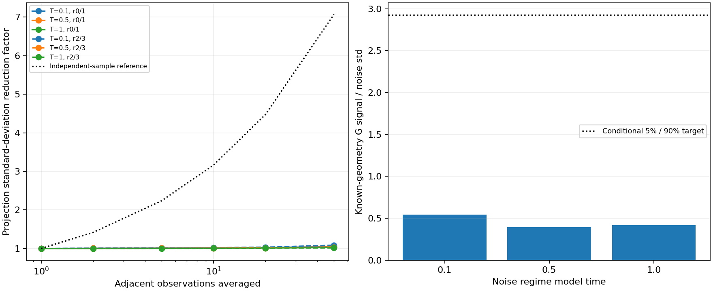

# MG166 - G detectability, averaging and competing-core check

The saved-data study explains why adding G has not made the particle measurement reliable: its reference feature is small relative to the observed background, and nearby time samples do not average that background away efficiently. In a favorable known-position/width calculation, G reaches only about 0.4-0.55times the single-frame fluctuation level; covariance weighting adds little. Fifty adjacent observations improve the measured background-projection dispersion by only about 1-8%, instead of the sevenfold independent-sample expectation. The competing-core veto works on early synthetic examples but fails the later-noise screen. These findings argue against another long run merely to collect denser snapshots or loosening thresholds; the complete particle remains unresolved, not disproved.

## Scope

No new Model G trajectories or synthetic fields were generated. Inputs are previously seen MG163 homogeneous coarse observations and MG165 v2 synthetic benchmark fields. The specification/source/input hashes were published before this calculation. One worker/library-thread1; original criteria and earlier results remain unchanged. A pre-evaluation code review corrected the signal-difference formula to use G-only contrast, not the intact G/X/Y profile; original registration and correction are preserved in Git, with no evaluated attempt discarded.

## G detectability under the conditional noise model

The contrast is intact versus G removed, with the same known position, width 1 and known other-species signal. It projects on the reference G feature, comparing G-only weighting and full 3x3 covariance weighting. The latter uses X/Y to condition noise, not to count their unchanged signal as evidence for G. First 512 null fields set noise dispersion; last 512 check it. This fixed-geometry calculation avoids a search penalty, but is not a proof of an optimal spatial estimator or a universal information bound.

| Noise regime T | G-only signal/noise | Covariance-weighted signal/noise | Ideal independent observations needed |
|---|---:|---:|---:|
| 0.1 | 0.539672 | 0.545292 | 29 |
| 0.5 | 0.396674 | 0.395887 | 55 |
| 1 | 0.414997 | 0.416922 | 50 |

The last column is a conditional Gaussian planning calculation: known-geometry one-sided false-positive probability 5% and power 90% requires signal separation 2.92641 noise standard deviations. Independent averaging reduces noise by sqrt(M), yielding 29-55 observations for this covariance-weighted projection. It is not a measured number of independent frames, a registered production sample size, or a claim that the actual state stays unchanged while collecting them. Conditional synthetic noise and estimated variance are assumptions, not independently validated real-field coverage.

## What adjacent-time averaging actually does

For each of four homogeneous coarse paths, project the processed G/X/Y field on the G contrast at 16 fixed global centers. Use 101-frame windows T=.05-.15,.45-.55,.9-1, and fixed nonoverlapping averages M=1,2,5,10,20,50, dropping only incomplete tails. No Xtracking/recentering or temporal detrending is introduced. Pooled dispersion includes persistent spatial structure and heterogeneous positions, not merely independent random error. Thus these ratios describe the fields actually present; they do not isolate a stationary temporal noise autocorrelation.

| Regime T | M50 std reduction, r0/r1 | M50 std reduction, previously seen r2/r3 | Independent reference |
|---|---:|---:|---:|
| 0.1 | 1.05094 | 1.0839 | 7.07107 |
| 0.5 | 1.04175 | 1.03 | 7.07107 |
| 1 | 1.02758 | 1.01397 | 7.07107 |

M50 uses fifty observations spaced 0.001 apart (a 0.049 span). It reduces temporal resolution and can blur evolving structures; it is not 50 independent realizations. Time-persistent structure or correlated fluctuations can survive averaging. The check paths r2/r3 are excluded from the noise-regime estimation but already inspected in earlier stages: they are not fresh validation. Mean changes between window halves are exported, so drift is retained rather than silently subtracted.

## Competing-core veto: development screen NOT PASSED

The frozen veto searches a second gain maximum farther than 2R95 from the best center. It rejects if that second gain exceeds the existing null threshold and is at least half the first. Thresholds and distances were not retuned. This is a separate candidate check, not a repair that qualifies MG165.

| Regime T | Intact cores falsely vetoed (all 3 cases) | Double cores caught | Required double-core fraction |
|---|---:|---:|---:|
| 0.1 | 0/384 | 128/128 (100%) | >=90% |
| 0.5 | 0/384 | 67/128 (52.3438%) | >=90% |
| 1 | 0/384 | 55/128 (42.9688%) | >=90% |

The weak later cores may not generate a detectable second peak. Zero observed false vetoes in these finite examples is not a population-zero error rate. Tests reuse the old conditional synthetic validation fields and cannot certify generalization to new noise or real trajectories. All intact cases met the <=5% false-veto screen, while the split cases failed at T=0.5 and T=1.

## Checks and retention

The primary analysis passed 54direct spatial projection checks. Separate cumulative-sum aggregation/verdict checks passed 48records; independent full-bank direct spatial searches passed 12veto examples. The Gaussian target was checked separately with erfc. Shared input arrays/templates remain dependencies; same-author checks are not external replication. Analysis elapsed 2.21991seconds. Compact projection histories/veto flags, input hashes, full precision summaries and timings are retained; original full fields remain local. No complete particle score or persistence rescore was issued.

## Recommended next step

Prepare a narrowly defined X/Y core detector, retaining G as a separately reported unresolved component rather than forcing weak G into a particle pass/fail average. First quantify X/Y intact-versus-damaged and single-versus-double detectability across the same evolving-noise regimes, including spatial covariance and shape families; use new independent validation fields after freezing choices. If a full G/X/Y claim remains essential, estimate the cost of genuinely independent realizations or a validated dynamical/time-series inference model. Do not substitute adjacent frames for independent replicates. Any fresh kinetic allocation requires its own concrete budget. No new simulations are started or authorized by this report.
