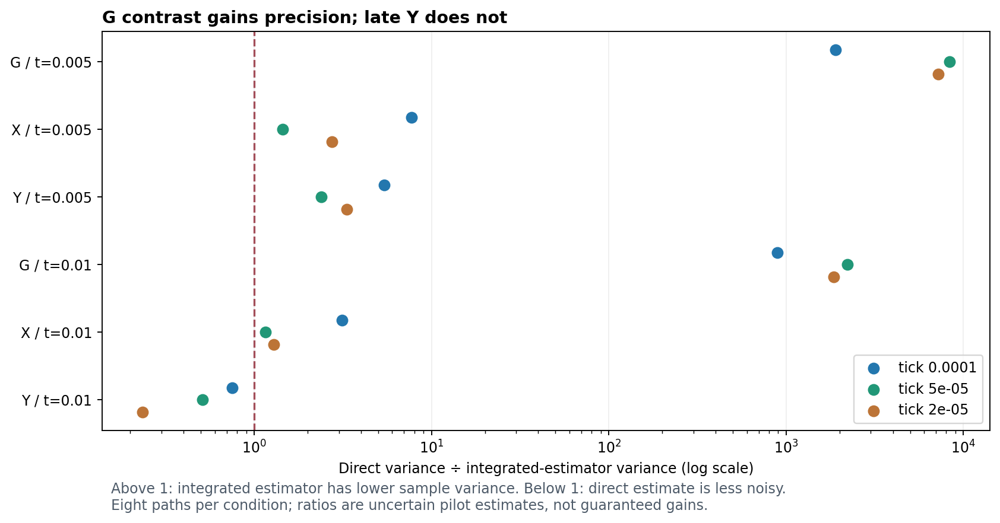

# MG149 — Finer-tick precision-pilot results

The pilot completed successfully and showed that the integrated-rate estimator makes the weak G pattern substantially easier to measure without changing the token dynamics. Its benefit is not universal: it helped X more modestly and helped Y at the earlier checkpoint, but increased Y variance at the later checkpoint. The compact archive retained the approved decision data and sentinel traces. These results identify how to improve the next experiment; they do not establish that any tick size meets the five-percent contrast target or that a particle persists.

## Registered outcome

**PRECISION/COST PILOT COMPLETE; integrity checks passed; PI closure pending.** All 24 paths completed, eight each at ticks 0.0001, 0.00005 and 0.00002, on the canonical prepared finite-stock 500-site LOCAL/LOCAL ring at Omega10. Every path ran through model time 0.01, with observations every 0.001. Registration MG148 was published as `383f09b` before sampling. There were no failures, retries or budget stops.

The archive covers **6,400 ticks** and approximately **166.212 million accepted events**. No reservoirs, reaction rules, reservations, initial counts or tick semantics were changed. Products and arrivals become eligible only in the next tick. The existing five-percent initial projected-contrast target remains unchanged. By design this pilot has **no equivalence verdict**; its samples are excluded from a future qualification denominator.

## What the estimator accomplished

The direct estimate reads contrast from a terminal token state. The integrated estimate uses the accumulated conditional event-rate drift to estimate the same ensemble mean. Its exposure arrays allow independent reconstruction from the compact archive. The two estimates need not agree on an individual random path.

The table reports the observed direct sample variance divided by the integrated-estimator sample variance, spanning the three tick sizes. Ratios above one favor the integrated estimate; below one favor the direct estimate. Eight paths per condition make these ratios uncertain.

| Species | Model time | Observed variance ratio range |
| --- | --- | --- |
| G | 0.005 | 1902.69–8356.09 |
| X | 0.005 | 1.44905–7.73453 |
| Y | 0.005 | 2.38255–5.38655 |
| G | 0.01 | 892.403–2214.28 |
| X | 0.01 | 1.15217–3.13908 |
| Y | 0.01 | 0.233598–0.751592 |

G variance was hundreds to thousands of times lower, addressing the precision obstacle that motivated the estimator. This is a variance ratio, not an equally large improvement in standard error; standard error scales with the square root of variance. X gains were smaller. At time 0.01, Y's ratio was below one at every resolution, so simply using the integrated estimator for every species and time would be a mistake.

## Mean contrasts are not qualification results

For context, these are final-time pilot means, using the integrated estimate for G/X and the less noisy direct estimate for late Y. This illustrative selection does not register a future estimator or create a post-hoc pass/fail rule.

| Tick | G contrast, integrated | X contrast, integrated | Y contrast, direct |
| --- | --- | --- | --- |
| 0.0001 | 0.00145462 | 0.0660293 | 0.0629156 |
| 5e-05 | 0.00145022 | 0.0668556 | 0.062809 |
| 2e-05 | 0.0014463 | 0.066348 | 0.0564607 |

The values are normalized projections on the frozen prepared pattern, not concentrations in physical units or particle-detection scores. Tick differences include sampling uncertainty. Some mean differences are substantial relative to planned margins; extra precision might establish incompatibility rather than produce a pass. Neither a small point difference nor a large variance-reduction factor establishes tick convergence. The finest tick remains an operational reference, not exact continuum truth.

## What this means for sample size

The former 48-path-per-tick proposal should **not** be launched unchanged. Using pilot variance point estimates, nominal planned interval halfwidths at 48 paths would be about 0.288 times the G margin and 0.300 times the X margin with the integrated estimator. For Y, using the integrated estimate early and direct estimate late, the worst halfwidth is about **2.23209 times its margin**. These are planning calculations, not confidence intervals or verdicts on this pilot. See [precision planning](precision_planning.json).

Each variance estimate has only seven degrees of freedom. The actual required replicate count could be larger, and differences near a margin require more precision than a zero-difference planning calculation. High-band power also has its own uncertainty and unchanged margin; improved G measurement alone cannot qualify the whole test family. The five-percent pattern target must not be weakened just to fit a chosen sample count.

## Integrity and separate recomputation

Execution-time checks compared leaf rates, cumulative totals and factored drift with fresh calculations. All passed their registered tolerances. The maximum saved absolute factored-versus-full drift difference was **3.37508e-14**. All states and reservations remained nonnegative with exact integer token conservation. Per-tick RNG provenance, boundary diagnostics, source/input hashes and runtime environment records were retained; all frozen source/input hashes remain unchanged.

The [separate recomputation](separate_recomputation.json) used sparse integer stoichiometry matrices, independent exposure/statistic arithmetic and saved histograms to reconstruct every tick and observation frame. All direct/integrated means, variances, ratios and high-band powers matched the evaluator. Sentinel event counts/times were additionally checked; full ordered exposure replay was performed by the registered sentinel audit. Shared compact model compilation and coefficients are disclosed. This is same-author recomputation, not external replication or an independently rewritten full sampler audit.

Reproduce with `src/recompute_mg12h3_finer_precision.py`, `src/plan_mg12h3_precision_from_pilot.py` and `src/plot_mg12h3_finer_precision.py`.

## Compute and archive

Elapsed wall time: **731.577 seconds (12 minutes 12 seconds)**. Charged workers: **4699.47 seconds**; parent audit/analysis: **138.15 seconds**. Total **4837.62 seconds (1.34378 core-hours)**, below the approved 21,600-second (6 core-hour) cap. Up to eight local workers, numerical-library threads one. No workers remain active.

The production archive contains **441 files**, approximately **354.835 MB**. Every path retains approved count/histogram/exposure/diagnostic/RNG decision data. Full accepted event/time records are retained for the three predeclared replicate-zero sentinel paths, not for every path. This is the approved smaller-payload policy; no historical full archives were deleted. See [raw manifest](raw_manifest.json); publication verification follows upload.

## Recommended next step

Freeze a species/time-aware estimation strategy before fresh qualification. At minimum, retain the integrated G estimate and avoid blindly using it for late Y. The pilot also found negative within-condition correlation between direct and integrated estimates. A fixed weighted combination may reduce Y noise further without changing trajectories. Coefficients fitted on this pilot show promising in-sample variances, but those gains are optimistic and **not validated performance**; exploratory coefficients are retained separately in the recomputation record.

Validate any such combination analytically and on disjoint implementation checks, freeze its coefficients before qualification, then recompute precision, power and budget for the full primary family. Do not tune to qualification outcomes, pool pilot paths into qualification, or assume the finest tick is exact. If the target remains unaffordable, report that and redesign prospectively. No new qualification or longer particle run has started.
