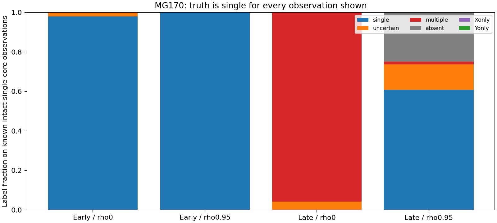

# MG170 - uncertainty and competing-hypothesis tracking diagnostic

Explicit alternative hypotheses did not produce a reliable tracker in this development test. The prototype handles early-noise examples well, but under late independent noise it wrongly labels nearly every intact single-core observation as multiple cores. Under late correlated noise it also mistakes some intact cores for absent ones. Its high normalized weights can therefore accompany a known wrong answer: adding an uncertainty label and competing models does not automatically calibrate uncertainty. The overall screen failed, and several late positive cases perform worse than the old local tracker on the same short paths. This is an inference-method failure on planted examples, not evidence of particle death or multiplication. G remains unresolved and MG163 is unchanged.

## Frozen prototype and scope

Five hypotheses are considered: no coherent core, one X/Y core, X-template-only, Y-template-only, and two X/Y cores. These concern template structure, not disappearance of all species tokens. The beam retains up to two histories/geometries per nonabsent class and one absent history, with bounded primary motion/width changes and no forced three-failure termination. A global secondary-core discovery step proposes competing structures. Secondary discovery does not establish an independently tracked second identity.

The procedure uses the full spatial/cross-species conditional Fourier covariance and the supplied synthetic AR correlation in innovation likelihoods. Ordinary amplitude 1 is known. Those are additional assumptions/information relative to MG169; any gain cannot be attributed solely to retaining hypotheses. Transition odds, model-weight threshold 0.95, geometry-spread guard and conditional chi-square residual check were fixed before evaluation. Weights are normalized over data-selected, pruned proposals; they are not calibrated probabilities or physical confidence levels.

No new random fields or Model G trajectories were generated. The first four previously seen MG169 paths per case and their first 24 observations are used, for early/late regimes 0.1/1 and rho0/0.95: 160 sequences, 3840 frames. Initial geometry is supplied to every case, including no-core controls; the tracker receives no injected future position, width or case label. All comparisons are small development diagnostics, not independent real-noise validation.

## Intact-path results

Positive success requires >=22/24 single labels and >=22/24 estimates within 2 sites and 0.125 width of injected truth. Four of four paths are needed for the raw 90% screen; this denominator cannot certify a population recall rate. The old local comparator is recomputed on the same four-path/24-frame subset, not copied from its original 16-path/40-frame verdict.

| Regime | rho | Static new/old successes | Moving new/old | Deforming new/old |
|---|---:|---:|---:|---:|
| 0.1 | 0 | 4/4 / 4/4 | 4/4 / 4/4 | 4/4 / 4/4 |
| 0.1 | 0.95 | 4/4 / 4/4 | 4/4 / 4/4 | 4/4 / 4/4 |
| 1 | 0 | 0/4 / 4/4 | 0/4 / 3/4 | 0/4 / 4/4 |
| 1 | 0.95 | 0/4 / 2/4 | 2/4 / 1/4 | 3/4 / 4/4 |

Early examples meet the intact and negative endpoint screens in this small subset. Under late independent noise, all 12 intact paths fail:276 of 288 frames are wrongly labeled multiple, the other 12 uncertain, and none single. Under late correlated noise, the 288 intact frames receive175 single, 72 absent, 37 uncertain and 4 multiple labels. Only 5 of 12 intact paths meet the whole-path criterion. The absent/multiple alternatives are demonstrably wrong on those planted intact frames, regardless of their numerical weight.

## Damage/no-core endpoint

A negative fails if the output is single at onset+5 (frame 5 for initially absent, frame 15 for damaged cases). All four paths must avoid that false-single deadline. This endpoint is not identical to the original MG169 alive/stop deadline; the comparator here uses its accepted-frame label at the same observation. Full post-deadline histories are retained because a single deadline can hide later false continuation.

| Regime | rho | Absent | Vanish | X removed | Y removed | Y displaced | Split | Jump |
|---|---:|---:|---:|---:|---:|---:|---:|---:|
| 0.1 | 0 | 0/4 | 0/4 | 0/4 | 0/4 | 0/4 | 0/4 | 0/4 |
| 0.1 | 0.95 | 0/4 | 0/4 | 0/4 | 0/4 | 0/4 | 0/4 | 0/4 |
| 1 | 0 | 0/4 | 0/4 | 0/4 | 0/4 | 0/4 | 0/4 | 0/4 |
| 1 | 0.95 | 0/4 | 0/4 | 0/4 | 0/4 | 0/4 | 1/4 | 0/4 |

Most negative endpoints avoid a single label, but this is not evidence of a generally improved instrument when intact positives are also called absent/multiple. The late correlated split case retains one false-single deadline. No damaged/no-core result overrides the failed intact screen.

## What this failure diagnoses

The global secondary peaks are chosen using the same observation being scored. Assigning weight to a few best proposals is not the same as integrating over the full secondary-position/width prior. Beam pruning also changes retained class mass. These are plausible contributors to the spurious multiple-core preference and overconfident normalized weights; this study does not isolate their individual causal contributions. Model-relative weights can be high even when the entire comparison is poorly calibrated. More hypotheses alone are not a substitute for testing false assignments on known single cores.

## Independent checks, provenance and resources

Independent replay reproduced 3840frame labels, 34560beam motion/weight checks and 160path outcomes/comparator counts. Componentwise real/imaginary spectral sums reproduced 160selected innovation quadratics, with valid parent histories. Deterministic Parseval and saved pure-noise scale checks preceded classification. Same author/reference/noise inputs remain dependencies; this is not external replication.

Prospective source and primary raw input hashes were published and upload confirmed before evaluation. A provenance omission was found during review: MG169 seed/truth/comparator JSON metadata and case-denominator summary were not listed in the prospective manifest. Their byte-for-byte agreement with previously published lossless gzip exports was verified afterward, and true motion plus comparator outcomes were independently reconstructed. Supplemental metadata hashes are retained without rewriting the original plan. No outcomes were retuned.

Evaluation took 93.499seconds on one worker/library-thread1 within 600 active seconds. Full original fields remain in local_raw/MG169_tracking; no new full-field archive was created. Public compact beam/label/score/truth records are losslessly gzipped. G is UNRESOLVED; no persistence verdict or MG163 rescore.

## Recommended next step

Audit the single-versus-multiple model-selection calculation before building another tracker: compare proposal selection with integration over an explicit spatial/width prior or an independently calibrated search-volume penalty. Include known single-core and no-core cases specifically to measure false-multiple/false-absent assignments. Reassess beam-mass truncation and probability calibration separately from trajectory tracking, then test any correction on independent validation realizations. Do not loosen the 0.95 cutoff or reinterpret these high weights as physical evidence. No new tracker revision or kinetic run is authorized by this report.
