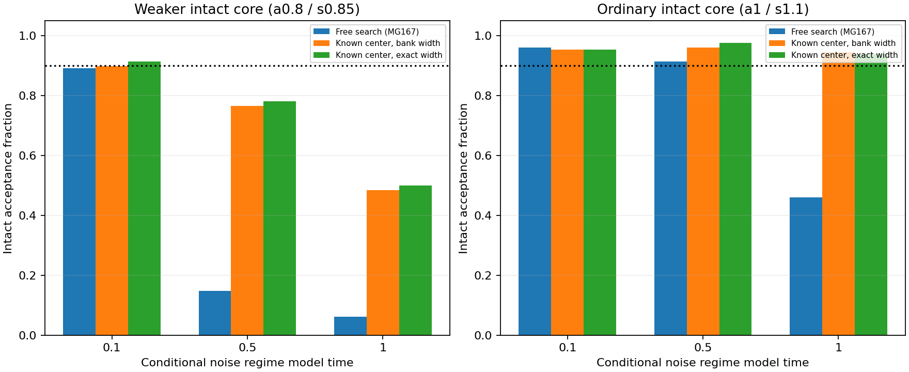

# MG168 - known-position/width X/Y discrimination

Supplying the true core position and width substantially improves X/Y detection, showing that searching the ring is a major part of the measurement difficulty. Ordinary-strength intact cores pass the finite recall screen in every tested noise regime under exact geometry. Weaker intact cores improve substantially but still fail under middle and late noise, and displaced-Y/double-core exclusions remain inadequate there. Search uncertainty is therefore important but not the whole problem. These oracle results motivate a carefully bounded tracking feasibility study, not a persistence claim: a real tracker must estimate geometry and cannot be handed the synthetic truth. G remains unresolved and all prior verdicts are unchanged.

## What was held fixed and changed

The same saved MG167 synthetic fields are used in all three procedures. Baseline is the original free 23-scale/500-position search. The two new procedures are supplied the original injected center and either the nearest width on the frozen scale bank or the exact injected width. They retain the same X/Y covariance, window, common amplitude, two background offsets, component floors/consistency checks, residual check and residual second-core search. Each known-geometry procedure calibrates its own thresholds from the existing calibration fields before validation; comparison therefore includes the reduced search penalty in calibration, not solely changed fitted coordinates. No threshold was tuned to improve validation counts.

This is a descriptive procedure comparison on already-seen conditional Gaussian fields, not fresh real-noise validation or a rescore of MG167. Null fields get prescribed coordinates independent of their noise realization; those coordinates would not be available for free in a real detector. Damaged cases retain the intended original coupled geometry, rather than separately realigning species. No new random draws or Model G trajectories.

## Intact-core acceptance

| Regime T | Intact case | Free search | Known center / bank width | Known center / exact width |
|---|---|---:|---:|---:|
| 0.1 | a0.8/s0.85 | 114/128 | 115/128 | 117/128 |
| 0.1 | a1/s1.1 | 123/128 | 122/128 | 122/128 |
| 0.1 | a1.2/s1.6 | 117/128 | 116/128 | 116/128 |
| 0.5 | a0.8/s0.85 | 19/128 | 98/128 | 100/128 |
| 0.5 | a1/s1.1 | 117/128 | 123/128 | 125/128 |
| 0.5 | a1.2/s1.6 | 123/128 | 123/128 | 122/128 |
| 1 | a0.8/s0.85 | 8/128 | 62/128 | 64/128 |
| 1 | a1/s1.1 | 59/128 | 121/128 | 120/128 |
| 1 | a1.2/s1.6 | 128/128 | 128/128 | 126/128 |

The raw intact-recall requirement is >=90% (at least 116 of 128). Exact geometry lifts the ordinary case at T=1 from 59/128 to 120/128 and the weaker case from 8/128 to 64/128. Most improvement is already present when the nearest bank width is supplied; correcting the small width-grid mismatch adds relatively little. This comparison does not separately isolate unknown-center versus unknown-width search penalties.

## Damage rejection and remaining limits

| Regime T | No core accepted | X removed accepted | Y removed accepted | X displaced accepted | Y displaced accepted | Double cores accepted |
|---|---:|---:|---:|---:|---:|---:|
| 0.1 | 0/1024 | 0/128 | 1/128 | 0/128 | 0/128 | 0/128 |
| 0.5 | 3/1024 | 0/128 | 5/128 | 0/128 | 12/128 | 21/128 |
| 1 | 2/1024 | 0/128 | 2/128 | 1/128 | 13/128 | 37/128 |

Exact geometry passes all nine finite case screens under early noise. Both known-geometry modes fail the combined screen across all regimes. Under later noise, the exact procedure still accepts 21/128 and 37/128 double cores, and 12/128 and 13/128 displaced-Y cases, above the damaged acceptance limit 5%. Knowing the primary core position does not make a weak second core or a damaged component reliably identifiable by these checks.

For the weaker intact exact-geometry case at T=0.5, 20/128 fail the evidence-gain threshold and 21/128 fail the component amplitude floor. At T=1, 62/128 fail evidence gain and 27/128 fail the component floor. These failures overlap; full nonexclusive guard counts are retained in analysis.json and compressed case exports. This is not a proof of universal information impossibility: it identifies limitations of this detector, thresholds and conditional noise model. The individual-component floor remains an engineering safeguard, not a physical law.

## Verification, provenance and resources

Primary weighted normal equations independently agreed on 132selected fits during analysis. Separate primary normal equations plus full direct spatial residual secondary searches agreed for 54validation examples. All 12288guard vectors/accepted labels, 54 case summaries and paired baseline changes were recomputed. Source/input bindings are frozen. Shared template generation/fields and same-author work remain dependencies; no external replication.

The source/specification and inputs were committed before evaluation and the registration upload was initiated before calculation. Upload completion was confirmed afterward rather than awaited before calculation, a publication-verification sequencing deviation. No source, criteria or inputs changed after outcomes. Prospective local registration and the completed public registration are retained in Git.

Analysis took 4.48283seconds on one worker/library-thread1, below 600 active seconds. Full input fields remain local_raw/MG167_XY, verified against the registered SHA-256 input manifest. Public exports contain compressed fit/guard decisions and summaries, not full trajectory or synthetic-field arrays. The supplied truth geometry is available only for these planted tests; MG163 was not classified with it and no new persistence verdict was generated.

## Recommended next step

Prepare a small tracking-feasibility study for ordinary-strength X/Y cores. Specify allowable displacement/width changes and predictive uncertainty before testing; compare it with the free detector on intact moving/deforming cores, missing/displaced species, competing cores, and no-particle controls using independent validation noise. Retain weak-core states as explicitly unresolved rather than forcing a pass/fail particle story. The oracle gap is a reason to test tracking, not evidence that tracking will work. Do not launch another long persistence simulation until that feasibility question is resolved. No tracker or fresh kinetic production is authorized by this report.
