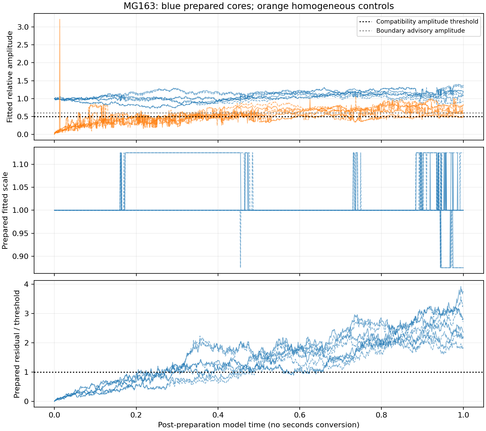

# MG163 - longer-horizon pattern-persistence results

The tenfold-longer test did not meet the frozen clear-case separation criterion: 0 of eight prepared marginal paths remained core-compatible at every observation, 0 prepared frames carried boundary warnings, and 7 of eight homogeneous marginal paths produced at least one compatible detection. All prepared paths first failed the shape-residual requirement between T=0.205 and 0.460, while their fitted amplitude remained above the minimum throughout. The core therefore did not simply fade away: agreement with the fixed template became inadequate under the longer evolving dynamics. This identifies a limit or complication that the short pilot could not expose. The retained labels and first-loss brackets distinguish loss of template compatibility, uncertain boundary fits and control detections; none automatically establishes physical particle death or creation. Four independent pairs per condition cannot establish a population lifetime.

## Frozen outcome

**Clear-case finite-cohort separation: NOT ESTABLISHED.** PI closure pending. Approved registration `0000067` was published before draws. All eight registered jobs completed; no retries, replacement paths, exclusions or threshold changes.

Four fresh prepared and four mass-matched homogeneous independent seed pairs, each at ticks 0.0001 and 0.00002, were run for post-preparation T=1 with 1001 observations at 0.001 spacing. Sites = 500, Omega=10, finite local A/B supplies and retained Z/W products remain unchanged. There is no conversion of model time or length to physical seconds or metres. Within-pair tick paths and within-path frames are correlated.

| Pair | Tick | Compatible frames | Boundary warnings | First sampled noncompatible bracket | First noncompatible label |
|---|---:|---:|---:|---|---|
| prepared_r0 | 0.0001 | 324/1001 | 0 | (0.204, 0.205] | shape_mismatch |
| prepared_r0 | 2e-05 | 359/1001 | 0 | (0.204, 0.205] | shape_mismatch |
| prepared_r1 | 0.0001 | 295/1001 | 0 | (0.289, 0.29] | shape_mismatch |
| prepared_r1 | 2e-05 | 306/1001 | 0 | (0.292, 0.293] | shape_mismatch |
| prepared_r2 | 0.0001 | 257/1001 | 0 | (0.235, 0.236] | shape_mismatch |
| prepared_r2 | 2e-05 | 262/1001 | 0 | (0.234, 0.235] | shape_mismatch |
| prepared_r3 | 0.0001 | 450/1001 | 0 | (0.437, 0.438] | shape_mismatch |
| prepared_r3 | 2e-05 | 482/1001 | 0 | (0.459, 0.46] | shape_mismatch |
| homogeneous_r0 | 0.0001 | 16/1001 | 16 | initially noncompatible | absent_or_weak |
| homogeneous_r0 | 2e-05 | 7/1001 | 7 | initially noncompatible | absent_or_weak |
| homogeneous_r1 | 0.0001 | 0/1001 | 0 | initially noncompatible | absent_or_weak |
| homogeneous_r1 | 2e-05 | 3/1001 | 3 | initially noncompatible | absent_or_weak |
| homogeneous_r2 | 0.0001 | 42/1001 | 40 | initially noncompatible | absent_or_weak |
| homogeneous_r2 | 2e-05 | 59/1001 | 21 | initially noncompatible | absent_or_weak |
| homogeneous_r3 | 0.0001 | 54/1001 | 51 | initially noncompatible | absent_or_weak |
| homogeneous_r3 | 2e-05 | 25/1001 | 24 | initially noncompatible | absent_or_weak |

All first prepared noncompatible labels were `shape_mismatch`, rather than weak amplitude, excessive dilation or a boundary warning. Prepared relative amplitudes stayed between 0.725182 and 1.40089, fitted scales between 0.875 and 1.125. Those ranges alone do not establish shape retention because residual and competing-core requirements also apply. The plot uses solid lines for coarse ticks and dashed lines for fine ticks; a prepared residual/threshold ratio above 1 fails the shape requirement. No threshold was changed after seeing these outcomes.

A boundary warning is the frozen engineering sensitivity rule (relative amplitude <= 0.6 or fitted scale within 0.125 of 0.5 or 2), not a confidence interval or a hidden label change. First loss is bracketed between sampled observations, and loss/recovery between observations cannot be excluded. Initial absence in controls is not a post-initial loss. `decision_summary.json` preserves first advisory times, label counts and fitted ranges; `candidate_scores.json.gz` retains all fitted values, point labels and advisory frame indices losslessly.

## Checks, dynamics and inference limits

The saved-data audit passed 16000 marginal checkpoint endpoints, checked exact RNG chains/count reconstruction/channel histograms and source/spec bindings, and verified source/product reaction accounts. It replayed 138,372,030 events in the fixed 200 sentinel segments (100 each in prepared/control replicate 0). Other segments retain checkpoint/histogram/RNG verification but not full causal event replay. This is the approved 10% sentinel coverage, not a full-history event audit.

Separate direct spatial weighted sums checked all 16016 fitted fields over the 23-scale, 500-position bank, including global maximum, secondary score, residual, classification, warnings and final verdict. Both checks passed. Shared input fields/templates/smoothing and same-author work remain dependencies; this is not external replication.

Finite-source depletion remains part of the model, with no replenishment. Initial/final A/B stocks and Z/W increases are exported per path in `decision_summary.json`. Conservation bookkeeping is not a demonstrated mapping to physical energy or a vacuum field. Agreement in this operational criterion at two ticks is not a new quantitative tick-equivalence or continuum-convergence result. The historical whole-domain metric was audited descriptively; MG160-P1 and MG162 outcomes remain unchanged. Near-boundary instrument qualification and wider physical interpretation remain unresolved.

## Runtime and retention

Wall time 16.0254 hours; charged worker time 460029 seconds (127.786 core-hours), below 800000 seconds. Longest charged job 57691.6 seconds, below 100000. At most 8 workers, with one library thread each. No failed scientific jobs or budget stops. Causal audit 226.743 seconds; independent fit recomputation 22.9025 seconds. Preparation and analysis attempt records retain active timings; waiting is excluded.

Verified local full raw payload at report generation: 1.74145 GB, below 4 GB. Full arrays/checkpoints/sentinel event histories remain in `local_raw/MG163_long_horizon`; public package contains compact decisions, summaries, hashes, source and plots only. `local_raw_manifest.json` records every retained filename, size and SHA-256. Physical files were checked, not merely their earlier hashes; no immutable Git archive is claimed. Full causal reproduction needs the local archive.

## Recommended next step

Inspect the already-saved first noncompatible/advisory/control-crossing neighborhoods to distinguish template mismatch, boundary sensitivity, competing cores and depletion. Treat this as diagnostic analysis, preserving the frozen negative/incomplete separation verdict. Propose any instrument change or new dynamical intervention as a separate registered study; do not tune this test into a pass.

No further simulations are authorized or started by this report.
