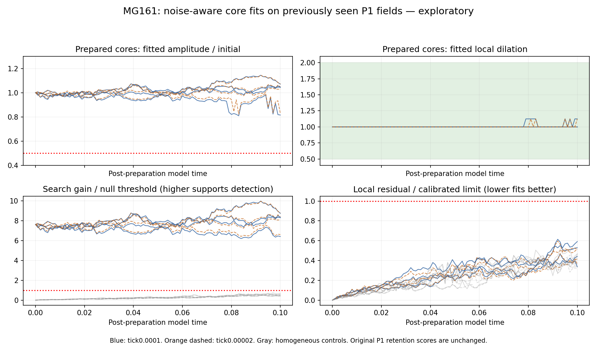

# MG161 — noise-aware local shape measurement results

The new measurement passed all 15 requirements of its prespecified synthetic-noise benchmark. It fits the central pattern's amplitude and local dilation while allowing the amount of background noise observed in homogeneous controls, rather than judging shape from whole-ring spread. Used exploratorily on the saved P1 trajectories, it finds compatible central cores in every prepared frame at both tick sizes and no compatible detections in the homogeneous controls. This strengthens the interpretation that noise-sensitive global measurements contributed to P1's apparent loss of shape. It does not prove physical-particle survival: the benchmark assumes a stationary Gaussian noise model estimated from two paths, the real P1 fields were already seen, and the original P1 negative retention result remains unchanged.

## Registered benchmark outcome

**QUALIFIED WITHIN THE PRESCRIBED CONDITIONAL SYNTHETIC BENCHMARK.** All 15 primary case requirements passed. This is an instrument-development result, not a new stochastic Model G persistence qualification. Source, specification and seeds were published before synthetic-noise draws at `3209a9b`. No benchmark cases, thresholds, sample counts or outcomes were changed after validation. A missing CLI import was corrected before plan generation/noise draws; no scientific retry occurred.

There were 13824 independent synthetic test fields across separate calibration, validation and sensitivity cases. The null validation produced 5/4096 core-compatible false detections (0.12207%). Its family-adjusted exact upper bound is 0.00359526, below the registered 0.01 limit. Across nine retained-core cases, point acceptance ranged from 98.6328% to 100%; every adjusted lower bound exceeded 0.90. Weak signals produced 2 compatible labels out of 512; inverted, narrow, broad and split controls produced zero. The double-noise case was descriptive and did not affect the primary verdict.

| Known-truth case | Core-compatible classifications | Adjusted bound | Result |
|---|---:|---|---|
| null | 5 / 4096 | upper 0.00359526 | PASS |
| retain_a0.8_s0.75 | 505 / 512 | lower 0.965641 | PASS |
| retain_a0.8_s1 | 511 / 512 | lower 0.984696 | PASS |
| retain_a0.8_s1.5 | 512 / 512 | lower 0.988922 | PASS |
| retain_a1_s0.75 | 512 / 512 | lower 0.988922 | PASS |
| retain_a1_s1 | 512 / 512 | lower 0.988922 | PASS |
| retain_a1_s1.5 | 512 / 512 | lower 0.988922 | PASS |
| retain_a1.2_s0.75 | 511 / 512 | lower 0.984696 | PASS |
| retain_a1.2_s1 | 511 / 512 | lower 0.984696 | PASS |
| retain_a1.2_s1.5 | 512 / 512 | lower 0.988922 | PASS |
| weak | 2 / 512 | upper 0.0189443 | PASS |
| narrow | 0 / 512 | upper 0.0110784 | PASS |
| broad | 0 / 512 | upper 0.0110784 | PASS |
| inverted | 0 / 512 | upper 0.0110784 | PASS |
| split | 0 / 512 | upper 0.0110784 | PASS |
| double_noise_sensitivity | 503 / 512 | descriptive only | secondary |

Each primary bound uses alpha 0.05/15 and exact Clopper–Pearson construction. The15 one-sided requirements have nominal simultaneous 95% conditional-binomial coverage. This covers independent draws from the fixed synthetic model, not uncertainty in the estimated spectrum, nonstationary/non-Gaussian real fluctuations or arbitrary deformation families. Max-score calibration covers the complete position/scale search under that same null; its rank interpretation is not a real-vacuum probability statement.

## How the measurement differs

The reference is the original unrounded X profile. A fixed initial core-energy radiusR95=3.2 model-lengths defines Gaussian spatial weighting with sigma 6.4. The method tries 23dilations from 0.25 to 3 and all 500cyclic locations, fitting positive amplitude plus a local constant background. It records the best location, amplitude, dilation, search gain, residual and a distant second-core score. A bank-edge fit or multiple compatible cores is treated as deformation/ambiguity rather than quietly accepted as one persistent object. The amplitude and dilation limits are operational shape-family criteria, not physical particle identity.

Noise power was estimated only from the final coarse-tick homogeneous P1 fields of replicates 0/1. Both had previously been seen; they are calibration inputs, not unseen test data. Fresh independent Gaussian fields were generated from the frozen smoothed periodogram with a fixed spectral floor. Independent calibration draws set maximum null-gain and correct-shape-residual thresholds. Separate validation draws then tested known retained/lost/split/inverted shapes. No kinetic equations, reservoirs, ticks, Omega or token states were changed and no new Model G trajectories were run.

## Saved P1 application — exploratory only

The new instrument labels all 101frames compatible in each prepared marginal path: four independent seed pairs at each tick. Homogeneous paths have zero compatible frames. This is a post-result application of a newly tested instrument to previously inspected data, not independent real-trajectory validation and not a replacement survival score.

| Existing P1 path | Tick | Compatible frames | Final relative amplitude | Final fitted dilation | Final label |
|---|---:|---:|---:|---:|---|
| prepared_r0 | 0.0001 | 101 / 101 | 1.04317 | 1 | core_compatible |
| prepared_r0 | 2e-05 | 101 / 101 | 1.04852 | 1 | core_compatible |
| prepared_r1 | 0.0001 | 101 / 101 | 0.815584 | 1.125 | core_compatible |
| prepared_r1 | 2e-05 | 101 / 101 | 0.827548 | 1.125 | core_compatible |
| prepared_r2 | 0.0001 | 101 / 101 | 1.04682 | 1 | core_compatible |
| prepared_r2 | 2e-05 | 101 / 101 | 1.03012 | 1 | core_compatible |
| prepared_r3 | 0.0001 | 101 / 101 | 1.0708 | 1 | core_compatible |
| prepared_r3 | 2e-05 | 101 / 101 | 1.07196 | 1 | core_compatible |
| homogeneous_r0 | 0.0001 | 0 / 101 | 0.264227 | 0.875 | absent_or_weak |
| homogeneous_r0 | 2e-05 | 0 / 101 | 0.293575 | 0.875 | absent_or_weak |
| homogeneous_r1 | 0.0001 | 0 / 101 | 0.540045 | 0.625 | absent_or_weak |
| homogeneous_r1 | 2e-05 | 0 / 101 | 0.511686 | 0.625 | absent_or_weak |
| homogeneous_r2 | 0.0001 | 0 / 101 | 0.500155 | 0.625 | absent_or_weak |
| homogeneous_r2 | 2e-05 | 0 / 101 | 0.503913 | 0.625 | absent_or_weak |
| homogeneous_r3 | 0.0001 | 0 / 101 | 0.355563 | 0.875 | absent_or_weak |
| homogeneous_r3 | 2e-05 | 0 / 101 | 0.332362 | 0.875 | absent_or_weak |

The original P1 rule still has 0/4prepared pairs retaining its global extent/coherence criterion continuously through 0.1 at each tick. The new local model estimates the central structure separately from diffuse background fluctuations; its different answer concerns a different measurement. The fitted dilation is a point estimate on a 0.125 grid, not a confidence interval on physical width. P1's four pairs cannot establish population survival, low real false-positive rates, long lifetimes or unique identity. A template-family test also leaves blind spots for other kinds of deformation and interference. The primary known-shape dilations lie on the fitted bank grid; off-grid shapes and cases near the decision boundaries still require validation.

## Verification, cost and storage

Noiseless translation/scale recovery, constant-offset and flat-field controls passed;92direct dot-product checks agreed with the FFT implementation before noise draws. Afterward,54direct weighted fits/residual sums agreed with stored features, all classifications were separately recomputed, and all 15bounds were verified by inverting binomial tails rather than reusing beta quantiles. Calibration maxima and every input hash were rechecked. These are separate computations by the same author, sharing fields, the template bank and statistical libraries; no external replication is claimed.

The benchmark used 5.03528 seconds against its 300-second, one-worker/thread-one cap. Benchmark, verification and saved-field application used 6.09516 recorded seconds in total. Full synthetic fields occupy 52.2201 MB under `local_raw/MG161_noise_shape`; they remain local and ignored by Git. Public artifacts contain only compact features, thresholds, seeds, spectrum/template configuration, source/input hashes, report/figure and exact-bound summaries. The full P1 archive remains local and unchanged. The publication-size guard remains enabled.

## Recommended next step

Freeze this instrument as a candidate for a separately planned test on fresh real trajectories, including independent homogeneous and deformed/removed-core controls where their construction is scientifically appropriate. Quantify sensitivity to the estimated spectrum, Gaussian/stationary assumptions and the discrete fitted scale before treating its labels as survival evidence. Real-noise validation and any longer T=1/T=15 run require their own prospective scope and measured budget. Do not alter or reopen P1's frozen negative result to obtain a favorable score. MG160-P1 closure remains pending; no new model runs were launched.

Specification: `spec/MG161_noise_aware_shape.md`. Model/benchmark: `src/mg 161_local_shape.py`, `src/run_mg161_shape.py`. Separate check: `src/check_mg161_shape.py`. Exploratory application: `src/apply_mg161_saved.py`. Compact features and local raw manifest support recomputation; full scalar-field checks use the local synthetic archive.
