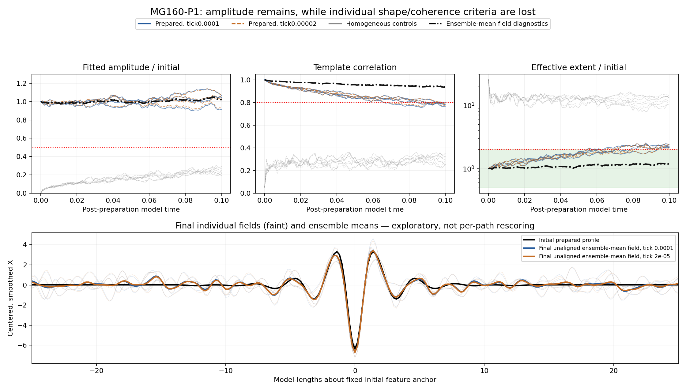

# MG160-P1 — first pattern-persistence pilot results

The pilot completed successfully as a run, but it did not demonstrate uninterrupted retention of the prepared pattern under the criteria approved in advance. Every prepared trajectory at both tick sizes crossed the shape-retention limit before model time 0.1, while all homogeneous controls remained below the detection criteria. Importantly, the fitted pattern amplitude stayed near its starting value: the first failures came from the global effective-extent measurement, followed later by reduced template correlation. Averaging the four prepared fields still reveals a recognizable feature, suggesting that background noise is an important measurement issue rather than establishing physical disappearance. The next step should separate noise-sensitive measurement from genuine deformation before funding a much longer run; this pilot neither proves particle death nor demonstrates long-lived stochastic particles.

## Registered findings

**PILOT COMPLETE; NO CONTINUOUS SAMPLED INITIAL-PATTERN RETENTION THROUGH T=0.1 IN THE OBSERVED PREPARED TRAJECTORIES.** No failed/replaced/retried jobs. No scoring thresholds, observation times or denominators changed. PI closure is pending.

| Tick | Prepared pairs retaining the criterion at every frame | Homogeneous pairs ever triggering the criterion |
|---|---:|---:|
|0.0001|0 / 4|0 / 4|
|0.00002|0 / 4|0 / 4|

Each condition has four independent seed pairs; the two tick paths within a pair are correlated. They are not eight independent replications. Nor are the 101 snapshots per path independent survival trials. Four nulls do not establish a low false-detection rate. For scale, a descriptive exact two-sided 95% binomial interval after 0 successes in 4 independent trials has upper endpoint about 0.602365, assuming the corresponding Bernoulli model; the zero count alone is weak population-level evidence.

## First sampled losses

The initial-pattern rule requires amplitude>=0.5 of initial, correlation>=0.8, and effective extent within[0.5,2] times initial. The first crossing was the upper extent bound in every prepared marginal path. Each bracket ends at the first failed sampled frame and begins at the preceding observed pass. Unobserved earlier losses/recoveries remain possible; these are not measured continuous-time lifetimes.

| Prepared pair | First sampled loss bracket, tick 0.0001 | First sampled loss bracket, tick 0.00002 |
|---|---|---|
| prepared_r0 | (0.07, 0.071] | (0.079, 0.08] |
| prepared_r1 | (0.057, 0.058] | (0.058, 0.059] |
| prepared_r2 | (0.054, 0.055] | (0.054, 0.055] |
| prepared_r3 | (0.093, 0.094] | (0.093, 0.094] |

At the final frame the prepared-path amplitude ratios ranged from 0.911147 to 1.06933, correlation from 0.766986 to 0.798523, and extent ratios from 2.08955 to 2.38275. Amplitude did not cross its failure threshold anywhere. Some paths subsequently crossed back into the combined criterion temporarily; their first loss is retained and is not erased by later recovery. All final prepared frames failed both the extent and correlation thresholds. Both ticks gave the same overall retention count, but their crossing times sometimes differed; no formal T=0.1 tick-equivalence qualification was registered here.

The bottom figure panel displays the central 50 of the 100 model-length ring. Correlation and effective extent are calculated on the entire ring.

## What the exploratory field average suggests

After preserving the negative per-path outcome, we averaged raw fields across the four prepared pairs separately at each tick, without phase-aligning individual paths. These are post-result diagnostics with a different estimand, not substitute survival outcomes. At T=0.1 the ensemble-mean fields give:

| Tick | Relative amplitude | Template correlation | Relative effective extent |
|---|---:|---:|---:|
| 0.0001 | 1.01777 | 0.932011 | 1.16825 |
| 2e-05 | 1.01931 | 0.935552 | 1.15657 |

Thus the prepared feature remains visible in the ensemble mean even though the individual-path criterion is lost. This is consistent with noise outside the core inflating a global participation-length statistic and reducing cosine similarity. It does not uniquely separate noise from genuine deformation, prove that every original feature survives, or justify rescoring the registered result. The homogeneous ensemble fields also remain below the detection rule.

Bulk prepared A/B depletion through this interval was small: at most 0.0337395% of initial A and 0.0326206% of initial B across the prepared paths. That makes wholesale stock exhaustion an unsupported explanation for these early crossings; local stock redistribution and stochastic dynamics are not ruled out. Complete resource accounting is retained.

The earlier accuracy study tested ensemble-mean agreement between resolutions at 0.005/0.01. This pilot tests an individual-path rule through 0.1. Pairing improves the precision of a difference while leaving each individual path's stochastic fluctuations intact.

## Scope and reproducibility

The frozen pilot has four prepared and four mass-matched homogeneous pairs, 16 marginal paths, Omega=10, 500 sites, fixed ring/environmental links and finite A/B with retained Z/W. The initial state is a rounded prepared donor from historical absolute time 10. Post-preparation time 0.1 corresponds to a short continuation, not a newly formed particle or a 20-unit lifetime experiment. Every 0.001 segment continues the RNG state and ends at common tick boundaries. Approval and source/seed registration were published at `d73f1ef` before sampling; no later stage is authorized.

All 1600 chain checkpoint endpoints passed histogram reconstruction, nonnegativity and conservation checks. Both full numeric sentinels replayed, covering 138.557 million joint events and every retained reservation/reset boundary. RNG continuity, seeds, source hashes and full observation records passed. Separate Fourier smoothing/cross-correlation, amplitude/extent calculation and independently implemented sampled-loss classifications matched every stored metric/outcome. A/B depletion and Z/W production matched reaction counts exactly.

The compiled replay validates integer reservations, event ordering, enabled participants, boundary state and histograms; it does not resample random clocks. Positivity of channel rates follows here from the checked equality of reservation and falling-factorial requirements and positive coefficients. Shared frozen channel/initial definitions and same-author analysis are disclosed; this is not external replication. The registered per-path result and exploratory ensemble-field analysis are retained separately. Earlier closed accuracy results remain unchanged.

## Compute and retention

All eight jobs completed in 77.9605 minutes (1.29934 hours) wall time, using 36912.7 charged worker-seconds (10.2535 core-hours) against the 100000-second ceiling. At most eight workers ran with numerical-library threads 1. Audit and exploratory diagnostic analysis used 36.7842 measured seconds; the active parent/control/audit allowance is 1800 seconds. Every analysis attempt records elapsed time, including failures. Production processed 554.257 million joint events (a shared event counts once). Full selected sentinels and raw decision records occupy about 1.26 GB locally, within the 2 GB storage reserve. At the PI's instruction, the large upload was canceled before GitHub accepted it. Full raw data and exploratory mean-field arrays remain in the verified local archive; only this report, figures, code, compact decisions, small plot exports and hash manifests are public. See P1_local_archive.json for the durable local location and immutable local Git commit. Full raw-field/causal recomputation requires that local archive.

## Recommended next step

Qualify a noise-aware shape measurement before extending this pilot to much longer horizons. Use preserved fields and held-out synthetic/noisy controls to distinguish background noise, local core deformation, phase movement and actual disappearance. Keep the present criteria and negative result intact; any revised localization/filter/threshold is a separate prospectively validated version with its own control requirements. Only then decide whether T=1 or the historical T=15 window warrants its cost, whether finer-tick checks need expansion, and whether exact-law engine acceleration is necessary. No new simulations, particle-identity claim, or physical-vacuum interpretation is introduced by this report.

Specification: `spec/MG12H3_pattern_persistence_plan.md`. Causal/measurement audit: `src/check_mg160_pilot.py`. Exploratory diagnostics: `src/diagnose_mg160_pilot.py`. Raw decisions: `P1_analysis_results.json`, `P1_exploratory_diagnostics.json`, `P1_outcome_summary.json`, `P1_budget_summary.json`. Do not rerun production to replace paths.
