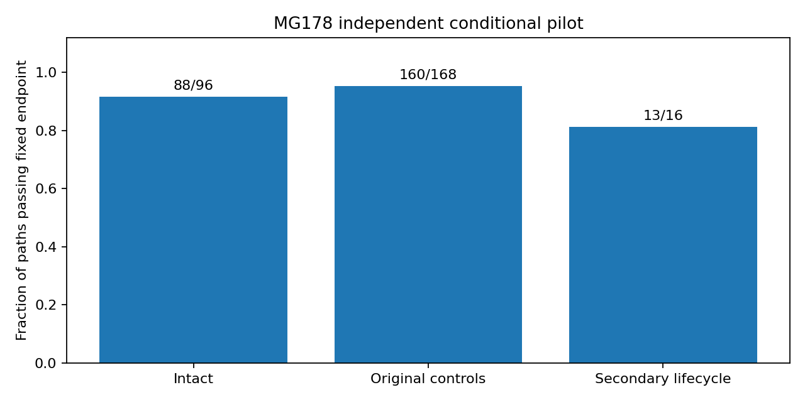

# MG178 persistent-secondary tracker development results

The new tracker carries possible second-core locations forward and lets the two cores move independently. It also estimates noise strength and time correlation from separate background references, with checks for species imbalance and persistent contamination. In fresh synthetic tests it passed 261/280 primary paths; the registered overall screen FAILED. This tests the complete method beyond MG177’s known-primary diagnostic. All 24 original split controls were identified as multiple cores at their deadline. However, 13 primary paths were rejected by a noise guard that did not adequately handle uncertainty in estimated correlation, and acquisition/component failures remain. These are conditional engineering tests, not evidence of physical particle survival, and the method is not qualified to score the actual persistence trajectories.

## Frozen method

Source/specification/input bindings and seed 17800 were published at `65ff1bb` before independent validation draws. Deterministic preflight passed four direct endpoint checks with primary and secondary moving in opposite directions. No Model G trajectories were generated. One worker, with one numerical-library thread; 2000-second evaluation cap, 400 MB full raw reserve.

The primary retains stationary/moving modes. A surviving secondary has half its motion prior on exact stay and half uniformly over legal positions within two sites and one 0.125 width step, independently of the primary. New secondary births integrate the full 5655-position/width prior. Death and species-loss alternatives remain explicit structural transitions. Only the initial primary center is supplied; neither actual primary trajectories nor secondary coordinates are passed to the tracker.

Geometry histories are compressed to eight endpoints per multiple/primary-mode pair, two for other nonabsent pairs and one for absent pairs, at most 30 states. Full pair masses are computed first and preserved during compression. This preserves probability mass but can discard useful geometry; it is not exact full-grid temporal inference. If no bounded secondary proposal is legal, the model resets its secondary prior uniformly and counts that operation. It is not a physical merger model.

Each path has 16 independent spatial background fields for scalar noise strength and separate 64 time-ordered fields for GLS AR1 correlation estimation. Spatial and temporal references are independent of tracking data, and estimates remain fixed while tracking. The gate combines 8 frequency bands, channel balance, coherent mean, temporal innovation variance and correlation at lag two, with total nominal alpha 0.001 across 12 checks. Some reference distributions are approximate because rho is fitted. Likelihoods plug in estimated scale/rho; their uncertainty is not fully integrated, so weights remain approximate model weights. Known spectral shape, ordinary core amplitude and Gaussian/AR1 structure remain assumptions.

## Primary tests

The original 264 paths span two noise regimes, two time correlations, three noise amplitudes and 11 cases, two paths/case. Acquisition requires two consecutive single labels ending by observation 5. Intact paths then need at least 90% single labels and 90% accurate single geometry after acquisition. Absence must never acquire; damaged and split controls must acquire by observation 5 and avoid a single label at 15. Reference rejection counts as failure rather than removing a path. Negative-control success can include uncertainty; it is not necessarily correct structural identification. These endpoints are retained from MG176, but different random fields and other method changes prevent attributing differences solely to secondary memory.

| Group | Successful / total |
|---|---:|
| Intact static/moving/deforming/stop–start | 88 / 96 |
| Original negative controls | 160 / 168 |
| Added secondary-motion/lifecycle tests | 13 / 16 |
| Primary references adequate | 267 / 280 |

| Noise regime | Rho | Noise amplitude | Successful original paths / 22 |
|---|---:|---:|---:|
| 0.1 | 0 | 0.8 | 22 |
| 0.1 | 0 | 1 | 22 |
| 0.1 | 0 | 1.25 | 21 |
| 0.1 | 0.95 | 0.8 | 19 |
| 0.1 | 0.95 | 1 | 21 |
| 0.1 | 0.95 | 1.25 | 19 |
| 1 | 0 | 0.8 | 22 |
| 1 | 0 | 1 | 22 |
| 1 | 0 | 1.25 | 22 |
| 1 | 0.95 | 0.8 | 21 |
| 1 | 0.95 | 1 | 20 |
| 1 | 0.95 | 1.25 | 17 |

Sixteen added primary paths test a stationary secondary, a counter-moving secondary, two cores present initially, and a secondary that appears at 6 and disappears at 14. The first two require multiple at 15; the initially split case requires two consecutive multiple labels by 5 and multiple at 15; appearance/disappearance requires multiple at 12 then single at 20. All require the specified acquisition. Primary moves independently by one site per observation.

| Added case | Rho | Successful / 2 |
|---|---:|---:|
| secondary_static | 0 | 2 |
| secondary_counter | 0 | 2 |
| secondary_initial | 0 | 2 |
| secondary_vanish | 0 | 2 |
| secondary_static | 0.95 | 2 |
| secondary_counter | 0.95 | 1 |
| secondary_initial | 0.95 | 2 |
| secondary_vanish | 0.95 | 0 |

Primary failures (zero-based replicate and observation indexing):
- regime 0.1, rho 0.95, noise 0.8, missingY, replicate 1: acquisition None; reference adequate False; deadline15 `noise_unqualified`; label counts {'noise_unqualified': 24}.
- regime 0.1, rho 0.95, noise 0.8, moving, replicate 0: acquisition None; reference adequate False; deadline15 `noise_unqualified`; label counts {'noise_unqualified': 24}.
- regime 0.1, rho 0.95, noise 0.8, stop_start, replicate 0: acquisition None; reference adequate False; deadline15 `noise_unqualified`; label counts {'noise_unqualified': 24}.
- regime 0.1, rho 0.95, noise 1.25, displacedY, replicate 0: acquisition None; reference adequate False; deadline15 `noise_unqualified`; label counts {'noise_unqualified': 24}.
- regime 0.1, rho 0.95, noise 1.25, missingX, replicate 0: acquisition None; reference adequate False; deadline15 `noise_unqualified`; label counts {'noise_unqualified': 24}.
- regime 0.1, rho 0.95, noise 1.25, stop_start, replicate 0: acquisition None; reference adequate False; deadline15 `noise_unqualified`; label counts {'noise_unqualified': 24}.
- regime 0.1, rho 0.95, noise 1, stop_start, replicate 1: acquisition None; reference adequate False; deadline15 `noise_unqualified`; label counts {'noise_unqualified': 24}.
- regime 0.1, rho 0, noise 1.25, displacedY, replicate 1: acquisition 1; reference adequate True; deadline15 `single`; label counts {'single': 11, 'uncertain': 6, 'Xonly': 7}.
- regime 1, rho 0.95, noise 0.8, missingY, replicate 0: acquisition None; reference adequate False; deadline15 `noise_unqualified`; label counts {'noise_unqualified': 24}.
- regime 1, rho 0.95, noise 1.25, jump, replicate 0: acquisition None; reference adequate True; deadline15 `absent`; label counts {'uncertain': 5, 'single': 5, 'absent': 14}.
- regime 1, rho 0.95, noise 1.25, missingX, replicate 0: acquisition None; reference adequate False; deadline15 `noise_unqualified`; label counts {'noise_unqualified': 24}.
- regime 1, rho 0.95, noise 1.25, missingY, replicate 0: acquisition None; reference adequate False; deadline15 `noise_unqualified`; label counts {'noise_unqualified': 24}.
- regime 1, rho 0.95, noise 1.25, secondary_counter, replicate 0: acquisition None; reference adequate False; deadline15 `noise_unqualified`; label counts {'noise_unqualified': 24}.
- regime 1, rho 0.95, noise 1.25, secondary_vanish, replicate 0: acquisition None; reference adequate True; deadline15 `single`; label counts {'uncertain': 6, 'multiple': 8, 'single': 10}.
- regime 1, rho 0.95, noise 1.25, secondary_vanish, replicate 1: acquisition None; reference adequate True; deadline15 `single`; label counts {'uncertain': 6, 'multiple': 8, 'single': 10}.
- regime 1, rho 0.95, noise 1.25, static, replicate 0: acquisition 3; reference adequate True; deadline15 `single`; label counts {'uncertain': 8, 'single': 16}.
- regime 1, rho 0.95, noise 1.25, stop_start, replicate 0: acquisition None; reference adequate True; deadline15 `single`; label counts {'uncertain': 8, 'single': 16}.
- regime 1, rho 0.95, noise 1, moving, replicate 1: acquisition None; reference adequate False; deadline15 `noise_unqualified`; label counts {'noise_unqualified': 24}.
- regime 1, rho 0.95, noise 1, stop_start, replicate 0: acquisition None; reference adequate False; deadline15 `noise_unqualified`; label counts {'noise_unqualified': 24}.

## What the failures mean

All 24 original split controls emitted multiple at their scoring deadline. The added secondary tests met their internal classification deadlines in all 16 paths, but the full registered acquisition/reference criteria passed only 13/16: one reference was rejected and two correlated secondary-vanish paths had not acquired before the secondary appeared. Correct later labels do not erase those acquisition failures.

Of 19 primary failures, 13 were valid generated backgrounds rejected by the temporal-variance check. In a post-run diagnostic, every one passed that variance check when recomputed with the known injected reference correlation instead of its fitted estimate. This is a diagnostic comparison only, not an alternative accepted result. The nominal F guard does not adequately account for correlation-estimation uncertainty in this setting; a wider scalar-noise interval alone does not fix it.

The other six primary failures comprised a displaced-Y false single at the deadline, one intact static path below its post-acquisition requirement, and four acquisition failures (jump, stop-start, and two secondary-vanish paths). The displaced-Y mistake is a separate structural validity issue and must not be hidden behind a successful split-core result. Primary results remain failed with every path retained.

## Background and assumption checks

| Separate sensitivity | Tracking endpoint success / 2 | Reference adequate / 2 |
|---|---:|---:|
| weak_static | 2 | 2 |
| weak_moving | 2 | 2 |
| actual_rho | 2 | 2 |
| shape_X | 0 | 0 |
| contaminated_reference | 0 | 0 |
| temporal_shift | 0 | 2 |

Weak cores have amplitude 0.8. Actual-rho uses 0.8 in both references and tracking without supplying it to the estimator. Shape-X increases X-noise amplitude by 1.5 in reference and tracking. Contamination adds a stationary core to both background references. Temporal-shift uses 0.95 in reference and 0.8 in tracking. Reference rejection on shape/contamination is the intended adequacy response; it causes the generic positive tracking endpoint to fail, so that column is not itself a verdict on these defect checks. A successful reference check does not guarantee the later tracking background is unchanged.

For shape_X, reference rejection occurred in 2/2 paths.
For contaminated_reference, reference rejection occurred in 2/2 paths.
For temporal_shift, reference rejection occurred in 0/2 paths.

On primary paths, estimated rho minus injected rho ranged from -0.00979175 to 0.00834592. Approximate 95% rho intervals covered injected rho in 263/280 paths. Coverage is descriptive, not population calibration. Total secondary-kernel reset operations across primary observations: 0; repeated parent/proposal operations are counted, not unique physical events.

## Compression sensitivity

Saved late-iid/noise 1.25 moving and split paths were rerun with 4, 8 and 16 retained multiple endpoints per mode. No new fields were generated and no best setting was selected. The eight-endpoint version replayed its original labels/weights.

| Case | Replicate | Keep | Changed raw labels versus8 | Multiple weight at 15 | Endpoint success |
|---|---:|---:|---:|---:|---|
| moving | 0 | 4 | 0 | 0.00318178 | True |
| moving | 0 | 8 | 0 | 0.00299577 | True |
| moving | 0 | 16 | 0 | 0.0029037 | True |
| moving | 1 | 4 | 1 | 0.00032467 | True |
| moving | 1 | 8 | 0 | 0.000326585 | True |
| moving | 1 | 16 | 0 | 0.000324868 | True |
| split | 0 | 4 | 0 | 0.999946 | True |
| split | 0 | 8 | 0 | 0.999938 | True |
| split | 0 | 16 | 0 | 0.999938 | True |
| split | 1 | 4 | 0 | 0.999993 | True |
| split | 1 | 8 | 0 | 0.999996 | True |
| split | 1 | 16 | 0 | 0.999996 | True |

This limited sensitivity is not convergence proof. The primary eight-endpoint result is unchanged regardless of the alternatives.

## Verification and retention

Separate recomputation passed 7008 labels, 292 acquisition/outcomes, 70080 retained pair-mass checks, 23068 spatial/temporal reference quadratics and 584 selected-history quadratics. Maximum selected quadratic difference was 3.57112e-06. Driver explicit endpoint/history checks: 584. Shared templates/precision and same author limit independence; this is not external replication.

Evaluation took 454.524 seconds; separate checking 15.488 seconds; beam sensitivity 19.0555 seconds. Full fields/reference samples remain local in `local_raw/MG178_persistent` (233.486 MB), with a hash manifest. Public outputs are compact compressed decisions, source and summaries.

## Interpretation and next decision

Keep the persistent-secondary design as a promising but unqualified development result. First correct the statistical treatment of estimated time correlation in background qualification and predictive uncertainty, with an analytical or separately calibrated null check. Audit the displaced-Y false-single case before broader validation. Retain the fixed acquisition failures and do not tune a warm-up to these paths. The beam comparison can guide an audit but must not select a favorable result after the fact. Wider qualification needs independent background defects, richer noise spectra, non-Gaussian fields, weak/moving/merging cores, and reference-selection feasibility on saved Model G data.

The method requires external signal-free spatial and temporal samples; this study does not establish that the available Model G observation stream provides those samples. Temporal reference adequacy cannot certify that conditions remain unchanged in the tracking scene. Initial-primary seed and fixed template amplitude remain assumptions. No MG163 rescoring or new kinetic production follows. MG176 remains FAILED, G remains unresolved, real-persistence readiness is false and PI closure is pending.

