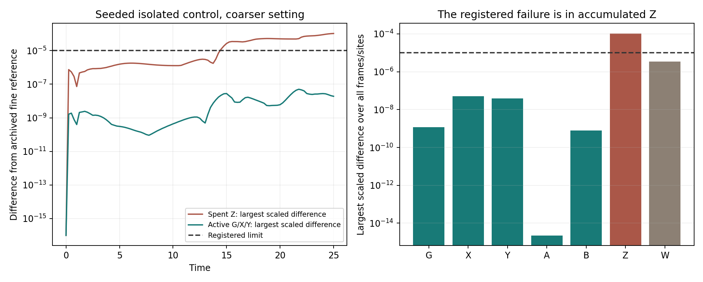

# MG12-H3b deterministic reference bridge — stopped result (MG117)

The deterministic reference experiment recovered the earlier finite-reservoir trajectories and geometry-response measurement in the completed cases, but it did not pass the whole registered test. It stopped when one coarser isolated seeded control exceeded the accuracy limit for accumulated spent product Z. The active G/X/Y fields in that case remained close to the reference, and all retained trajectories passed positivity and population/import balance checks. This points to a numerical accuracy issue in an accumulated output rather than an observed loss of the pattern mechanism, but a tighter independent calculation is still needed to confirm the cause. The failed result is preserved: H3b is incomplete and is not qualified, and no automatic rerun has been made.

**Registered outcome: NUMERICAL REFERENCE CRITERION FAILED; STUDY INCOMPLETE. PI disposition pending.**

There are **22 validated jobs, one full trajectory that failed its reference check, and one job not started**. No source, threshold or numerical setting was changed after the failure.

## What stopped the run

The failed case was **ISOLATED_C1_s1_v0**: isolated finite reservoirs, seeded pattern, coarser numerical setting. Its trajectory reached T=25 and was retained. The next fine-setting seeded isolated job was not launched.

The registered criterion compares every species/frame/site against its archived fine reference, dividing by max(1, that species' maximum initial concentration). The limit is 1e-5. Z starts at zero, so its divisor is 1 and its criterion is effectively an absolute 1e-5 concentration difference, even after it accumulates substantially.

At T=25, site 218, Z was **9126.899344673393**, versus reference **9126.899240480718**. The difference was **0.000104192675**, above 1e-5 by a factor of 10.42. It is about **1.14e-08 of the local final Z value**. These are different normalizations: the latter small relative discrepancy does not override the frozen initial-scale criterion. The first saved observation exceeding the criterion was T=14.5.

The largest scaled active-field difference in the failed case was **4.99226907516e-08**, below 1e-5. W also stayed below the limit. Balance residual was **8.54140859962e-16**, and all fields were nonnegative. Accumulation of a small rate/integration difference is consistent with the increasing Z discrepancy; it has not been established by a new tighter-tolerance solve. No negative resources, lost tokens or physical sink interpretation is inferred.

## Supported completed components

All 16 finite prepared branches passed their reference checks, as did all four maintained-control jobs and both homogeneous isolated controls. Eleven available base/fine pairs passed the refinement criterion. The seeded isolated pair is unavailable because its fine job did not start.

The eight completed fine finite branches give the late-X interaction **0.033337306142**, compared with recomputed closed G3 value **0.033337305924**. Difference **2.180364847e-10** is within the registered 1e-5 component margin. A separate dense projection gives **0.033337306142**. This is a supported component of an incomplete deterministic reference study, not a global pass, new stochastic evidence, or a rescore of closed G3/G5.

The maintained seeded fine control retained sampled reference matching through T=25. Their A/B supplies are explicitly maintained through recorded external imports; this does not explain their physical source. Z/W remain outputs. Pattern projection or classifier loss is not physical particle death. All these trajectories are mathematical population-limit fields, not strict finite-tick token histories.

## Audit, execution and limitations

The independent reporting audit reread all **23 full raw trajectories**, checked canonical job/time metadata and starting states, compared all seven fields to frozen archives, reconstructed population-minus-import balance by a separate summation, verified positivity, paired the 11 available refinements and independently recomputed the finite response. Source/reference/preparation hashes match MG116 registration. The failed trajectory was included in the audit and retained rather than deleted or treated as absent.

The original driver recorded 22 completed jobs and **41.340675 seconds** through the last validated job. It did not write a performance-counter record for the failed case or replace its RUNNING status on the exception. The original failure traceback and run-state snapshot are preserved. Canonical run status is now explicitly stopped. From the failure file's UTC modification timestamp and recorded start, elapsed time is approximately **45.716 seconds**; this is a reconstructed wall-time figure, not an exact final worker-charge ledger. The run was far below the approved 3,600-second cap. One local worker and one numerical-library thread were used; no timeout or budget stop occurred.

Registration/source/criteria were published at b42ab16 before new integrations. Richard approved the 24-job deterministic reference experiment, one-hour cap and full public raw/results. The new report/evaluation/figure are reporting-only; frozen execution code and scientific criteria remain unchanged. All raw/reference provenance, failed output, logs/metadata, source and numerical evidence are published and verified separately in production_retention_verified.json. Same-author separate arithmetic and archived references are not independent external replication.

## Recommendation

Preserve this run as failed/incomplete under its registered criteria. A separately registered numerical follow-up should first test tighter integration tolerances for the isolated seeded control against an independent high-accuracy solver, keeping the same output-error threshold. If that resolves the discrepancy, a continuation or replacement experiment must explicitly specify treatment of the 22 validated jobs, the failed trajectory and the unstarted fine job. Nothing is silently retried or rescored.

The evidence currently supports recovery of the completed deterministic finite-branch response and maintained pattern controls. It does not yet qualify the entire deterministic reference batch, the strict finite-tick stochastic particle process, a new higher-arity/3D particle or a vacuum supply mechanism. Formal mixed-law accuracy and efficient stochastic representation remain further H3 work. **No follow-up integration has been launched.**
