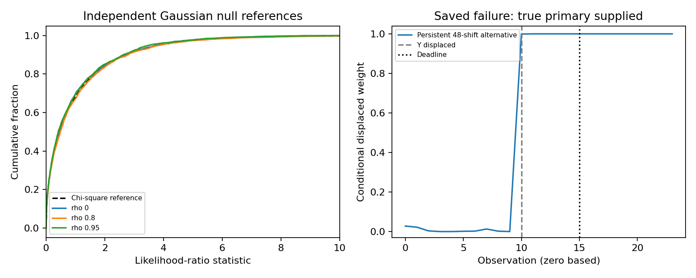

# MG179 correlation correction and displaced-Y audit

This stage resolved two different measurement problems at the design level. A new background diagnostic fits time correlation and noise variance together, removing the excessive clean-background rejections seen in MG178 and passing a predefined check on independent Gaussian references. The displaced-Y audit found useful alignment information in the saved field, but the current tracker does not explicitly represent a core whose X and Y features have separated. That incomplete hypothesis set can produce a confident-looking single-core label. The next instrument should combine the corrected background test with an explicit component-alignment alternative. No earlier labels or persistence verdicts changed, and a revised complete tracker is not yet qualified.

## Scope and prospective record

Source, seed, inputs, budgets and criteria were published at `93d2d07` before independent validation. Deterministic expected-statistic checks passed at correlations 0, 0.8 and 0.95. Work used one worker and numerical-library thread, within the 600-second main and 120-second check limits. No Model G trajectories were generated. The new Gaussian samples are a statistical calibration of background references, not particle simulations.

## Correlation-uncertainty correction

MG178 estimated correlation first and then treated that estimate as fixed when comparing temporal noise variance with an independent spatial reference. A small correlation error changes the conversion from innovation variance to stationary variance, especially near correlation 0.95. Its nominal F test did not account adequately for that effect.

The new `mg179_profile.py` diagnostic uses the full stationary Gaussian AR1 likelihood, including the first observation and covariance determinant. It compares a shared spatial/temporal stationary variance with separate variances, fitting correlation separately under each alternative. This allows correlation to adjust within both hypotheses instead of substituting one fixed estimate. The likelihood-ratio reference is asymptotic chi-square with one degree of freedom, not an exact finite-sample distribution.

The validation used 3000 independent references at each true correlation 0, 0.8 and 0.95: 9000 total. Each has the same 998 whitened dimensions, 16 independent spatial samples and 64 time-ordered samples as the intended reference design. For each correlation, tail counts at 5%, 1% and 0.1% were checked by a predefined two-sided binomial test with threshold 0.01/9. The scientific threshold was not fitted to these outcomes.

| Correlation | Tail probability | Observed /3000 | Expected count | Binomial p |
|---:|---:|---:|---:|---:|
| 0 | 0.05 | 145 | 150 | 0.706249 |
| 0 | 0.01 | 24 | 30 | 0.312203 |
| 0 | 0.001 | 2 | 3 | 0.775846 |
| 0.8 | 0.05 | 154 | 150 | 0.737451 |
| 0.8 | 0.01 | 35 | 30 | 0.357586 |
| 0.8 | 0.001 | 4 | 3 | 0.551767 |
| 0.95 | 0.05 | 125 | 150 | 0.0361206 |
| 0.95 | 0.01 | 26 | 30 | 0.520796 |
| 0.95 | 0.001 | 1 | 3 | 0.383652 |

**Predefined coarse null-calibration screen: PASS.** At the much rarer intended temporal-gate threshold 0.001/12, 1/9000 clean references were flagged. This count is descriptive; 9000 trials cannot establish precise calibration at that rare tail. The unadjusted 5% check at correlation 0.95 showed 125 versus 150 expected flags, consistent with some conservatism; it did not fail the predefined multiplicity-adjusted screen.

A separate variance-mismatch check increased only temporal noise amplitude to 1.25 at correlation 0.95. The test detected 256/256 cases, passing the predefined 90% power screen. This tests one defect size, not arbitrary background changes.

On the saved MG178 primary references, the old method rejected 13/280 valid backgrounds. None of those 13 is flagged by the new temporal diagnostic, and the new temporal diagnostic flags 0/280 in total. This is a diagnostic application to development data, not a new accepted-path denominator or a rescore of MG178.

The new variance-consistency test does not replace species, coherent-mean or spectral checks. The shape-X and contaminated-reference cases can have consistent spatial and temporal scalar variance while violating other assumptions. A valid reference also cannot certify that tracking-time conditions will remain unchanged. Joint profiling here does not yet propagate correlation uncertainty through tracker likelihoods, geometry selection or predictive fit guards.

## Displaced-Y false single

The target is MG178 early regime 0.1, independent-time noise amplitude 1.25, displaced-Y replicate 1, observation 15. Y had been shifted by 16 sites beginning at observation 10.

| Frozen target quantity | Value |
|---|---:|
| Single-core model weight | 0.985067 |
| X-only model weight | 0.0149323 |
| Innovation quadratic / limit | 1039.34 / 1146.93 |
| Selected / true primary center | 186 / 186 |
| Selected width | 1 |
| Center spread / allowed | 1 / 4 |
| Width spread / allowed | 0.25 / 0.25 |

The primary location was correct, both spread guards passed, and the global noise-fit quadratic was below its limit. However, the alternatives were absent, intact aligned single, X-only, Y-only and two separated full XY cores. None explicitly describes a surviving X feature with a displaced Y feature. X-only omits Y rather than representing its shifted location; the two-core model adds an entire second XY structure and requires wider separation. A high normalized weight among these alternatives therefore does not establish that X and Y remain aligned.

The conditional audit supplied the true primary center and width and compared aligned X/Y with 48 possible nonzero relative Y shifts from -24 to +24 sites. The shift alternative integrated all 48 possibilities uniformly; it was not told the actual shift of 16. Known-shift results below are separate oracle diagnostics. All fields and labels were saved MG178 data.

| Target conditional diagnostic | Value |
|---|---:|
| Known shift 16 log likelihood ratio versus aligned | 8.18807 |
| Full uniform 48-shift log likelihood ratio | 4.96545 |
| Squared noise-weighted difference, shift 16 versus aligned | 30.1001 |
| Redrawn shift filter: displaced weight | 0.999964 |
| Persistent shift filter: displaced weight | 0.999999 |

Both conditional filters strongly favor misalignment at the failed deadline. Across all 12 displaced-Y paths in this audit, the persistent-shift diagnostic exceeded 0.999994 at observation 15. None of the 12 matched moving aligned controls reached 0.95 displaced weight anywhere; the largest weight was 0.111108. These results show useful information under supplied primary geometry, not performance of a deployable alignment classifier. The audit covers only independent-time noise and a finite displacement family.

The global residual safeguard measures fit across 998 noise dimensions. A localized, scientifically important species mismatch need not exceed its overall tolerance. That is why explicit component alternatives or a separately validated local component safeguard are needed; simply tightening the global threshold could reject many intact noisy cores.

## Verification and retention

Separate checking passed 1078 independently bracketed profile fits, 9256 fitted p-values and all calibration-tail decisions, 12 selected Gaussian-generator/dense covariance checks, 576 full 48-shift grids, 1152 probability-domain filter steps and 576 frozen labels. Maximum profile LR difference was 3.92902e-10. Main analysis also passed 27648 real-space shift checks; maximum difference 1.0787e-06. These share input/template models and the same author, and are not external replication.

Analysis took 20.8768 seconds; separate checking 3.43393 seconds. Gaussian calibration sufficient statistics and fit results are losslessly compressed in `calibration_statistics.json.gz`; the sufficient statistics preserve the full information used by this Gaussian likelihood. Full coordinate draws were transient and were not retained, as specified; deterministic seeds permit regeneration. All actual MG178 full field inputs remain local in `local_raw/MG178_persistent`. No bulk fields were uploaded.

## Recommended next step

Specify a new complete instrument with an explicit displaced/partially aligned species alternative, including persistent component offsets and shared-primary geometry uncertainty. Integrate the profile-based background correction and define how estimation uncertainty enters predictive and structural tests. Then use fresh aligned, displaced, missing, split and weak-core controls, including motion during acquisition and correlated noise. Do not count this known-primary audit as qualification or choose an alignment threshold from its failed path.

The background profile prototype passed its limited statistical screens. The complete tracker remains unqualified, MG178 remains FAILED, earlier MG176/MG163 results are unchanged, and G remains unresolved. No new kinetic production is authorized by this result. PI closure is pending.

