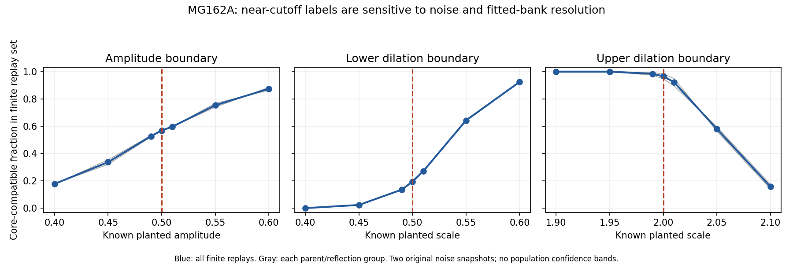

# MG162A — empirical-noise/off-grid challenge and fresh-pilot readiness

The frozen noise-aware measurement handled clear, off-grid cores well in this additional challenge using actual control-noise snapshots, while revealing important limits near its decision cutoffs. All 15primary finite-replay requirements passed, but fields close to the amplitude or dilation boundaries frequently changed label, and the 0.125-wide fitted scale grid cannot sharply distinguish widths just below and above 2. This supports a carefully scoped new-data pilot on clear core-versus-control separation, not a claim that noisy boundary decisions are exact. No new Model G trajectories were run; MG161 and the original P1 outcome remain unchanged.

## What passed, and what did not become qualified

**The prescribed finite interior challenge is supported. Sharp near-boundary classification remains unqualified.** The method, window, bank, noise calibration and classification rules were frozen throughout. Source/design were published before evaluation at `93b28d8`. No cases were removed or thresholds refitted after seeing these results.

The challenge exhaustively combined 500rotations and both reflections of two final homogeneous P1 noise fields (replicates 2/3). They were excluded from MG161 calibration but had previously been inspected; they are not unseen real trajectories. These transformations preserve their empirical values/tails and circular spatial structure. Every case has 2000finite replays; they are not 2000independent physical replications. No binomial/population confidence interval is claimed for their fractions.

Nine known retained-core cases used amplitudes 0.8/1/1.2 and off-grid scales 0.85/1.1/1.6. Five rejected shapes tested weak, narrow, broad, inverted and split features. The null had 0/2000compatible labels. Retained-case aggregate acceptance ranged from 99.6% to 100%; every individual parent/reflection group met the registered 90%criterion. The weak case had 8/2000compatible labels; all other primary rejected shapes had zero. All rejected/noise group limits were met.

| Primary case | Core-compatible / finite replays | Fraction range across four groups | Result |
|---|---:|---:|---|
| null | 0 / 2000 | 0–0 | PASS |
| interior_a0.8_s0.85 | 1992 / 2000 | 0.994–0.998 | PASS |
| interior_a0.8_s1.1 | 2000 / 2000 | 1–1 | PASS |
| interior_a0.8_s1.6 | 2000 / 2000 | 1–1 | PASS |
| interior_a1_s0.85 | 2000 / 2000 | 1–1 | PASS |
| interior_a1_s1.1 | 2000 / 2000 | 1–1 | PASS |
| interior_a1_s1.6 | 2000 / 2000 | 1–1 | PASS |
| interior_a1.2_s0.85 | 2000 / 2000 | 1–1 | PASS |
| interior_a1.2_s1.1 | 2000 / 2000 | 1–1 | PASS |
| interior_a1.2_s1.6 | 2000 / 2000 | 1–1 | PASS |
| weak | 8 / 2000 | 0.002–0.006 | PASS |
| narrow | 0 / 2000 | 0–0 | PASS |
| broad | 0 / 2000 | 0–0 | PASS |
| inverted | 0 / 2000 | 0–0 | PASS |
| split | 0 / 2000 | 0–0 | PASS |

## Boundary sensitivity matters

A true amplitude 0.4, below the nominal 0.5cutoff, was labeled compatible in 17.8% of these replays. A true dilation 2.01, just above 2, was labeled compatible in 92.3% because the fitted width commonly lands on the accepted 2.0bank point. These are expected manifestations of noisy estimation and discrete resolution, but they prevent treating the point label as an accurate sharp test of a true parameter. The descriptive boundary cases were fixed before evaluation and are all reported; they do not count as passing interior cases.

| Boundary case | Compatible / finite replays | Conditional finite fraction |
|---|---:|---:|
| boundary_amplitude_0.4 | 356 / 2000 | 17.8% |
| boundary_amplitude_0.45 | 675 / 2000 | 33.75% |
| boundary_amplitude_0.49 | 1055 / 2000 | 52.75% |
| boundary_amplitude_0.5 | 1138 / 2000 | 56.9% |
| boundary_amplitude_0.51 | 1194 / 2000 | 59.7% |
| boundary_amplitude_0.55 | 1508 / 2000 | 75.4% |
| boundary_amplitude_0.6 | 1749 / 2000 | 87.45% |
| boundary_scale_0.4 | 2 / 2000 | 0.1% |
| boundary_scale_0.45 | 48 / 2000 | 2.4% |
| boundary_scale_0.49 | 272 / 2000 | 13.6% |
| boundary_scale_0.5 | 391 / 2000 | 19.55% |
| boundary_scale_0.51 | 541 / 2000 | 27.05% |
| boundary_scale_0.55 | 1286 / 2000 | 64.3% |
| boundary_scale_0.6 | 1850 / 2000 | 92.5% |
| boundary_scale_1.9 | 2000 / 2000 | 100% |
| boundary_scale_1.95 | 2000 / 2000 | 100% |
| boundary_scale_1.99 | 1968 / 2000 | 98.4% |
| boundary_scale_2 | 1932 / 2000 | 96.6% |
| boundary_scale_2.01 | 1846 / 2000 | 92.3% |
| boundary_scale_2.05 | 1161 / 2000 | 58.05% |
| boundary_scale_2.1 | 316 / 2000 | 15.8% |

No confidence interval on a real physical width follows from the fitted bank index. The later pilot therefore records boundary-advisory flags, as well as all unchanged MG161 labels. The advisory is engineering sensitivity information, not a calibrated confidence interval or proof of true shape.

## Verification and limits

Separate direct weighted sums verified 108selected scalar fits/residuals; classification branches and all finite-group fractions were independently recomputed, agreeing with all 15primary verdicts. Source and input hashes matched. The challenge evaluated 72000test fields in 19.7273seconds under a300-second, single-worker/thread-one cap. Full replay fields occupy 144.987MB and remain local under `local_raw/MG162_shape_challenge`; only compact features, report/figure, source and manifests are public. Same-author/shared-field and template-bank dependencies are disclosed; this is not external replication.

Only two previously seen noise parents were replayed. Planting a known signal into a saved noise field does not reproduce dynamic signal–noise coupling, time dependence or all possible covariance changes. Passing this finite challenge is therefore not independent validation of real-trajectory survival, a real-noise false-positive population rate, or a physical particle. Earlier P1's negative global-measurement score and MG161's conditional synthetic outcome stay intact. Closure of earlier studies is not inferred.

## Concrete next run: MG162B, approval pending

The code and criteria are prepared for eight entirely fresh seed pairs: four prepared and four mass-matched homogeneous, ticks 0.0001/0.00002 through time 0.1, with 101frames per marginal path. All earlier P1 data are excluded from the new denominator. The instrument and MG161 calibration are frozen before new data; no PSD fitting or threshold selection on the fresh controls is permitted. No fresh seeds have been registered and no new kinetic trajectories exist.

The strict finite-pilot separation criterion requires every prepared marginal path to be core-compatible at every frame with no boundary-advisory frames, and no homogeneous marginal path to be compatible at any frame. Otherwise report not established, preserving all outcomes. This tests clear-case independent-data separation; four pairs per condition cannot establish small population error rates or long lifetimes. Control crossings may be false detections or new structures to investigate, not automatic physical births. All raw/count/event/RNG records must pass audits and the new metrics must be separately recomputed before reporting a result.

Measured prior pilot cost plus 25% allowance forecasts 46140.9combined worker-seconds (12.8169core-hours), or 1.60211hours on eight workers. Proposed hard ceiling 100000worker-seconds (27.7778core-hours), 12000/job, plus 1800active parent/audit seconds; max 8workers/numerical-library threads 1. Reserve 2 GB of local raw storage. Full data stay local; compact publication only. No retries, sample replacements, extensions or altered thresholds. This is a new numerical allocation requiring explicit PI criteria/budget approval under RESEARCH_PROTOCOL.md workflow 3.

Specification of the evaluated challenge: `spec/MG162_shape_validation.md`. Detailed prospective fresh pilot: `spec/MG162B_fresh_pilot.md`. Entry: `src/run_mg162_fresh.py register`, then `run`, `audit`, `score` only after real approval, source/seed publication and the required checkpoints. The registration gate requires fresh_approval.json; it does not yet exist. No longerT=1/T=15 study is authorized.
