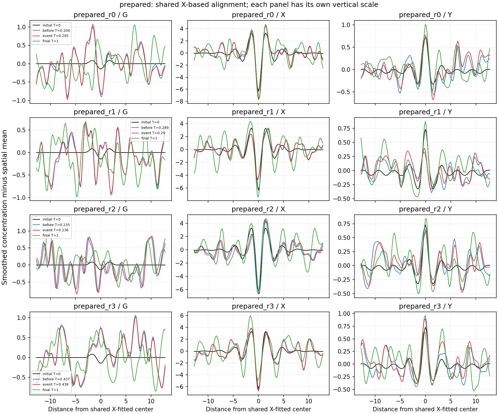
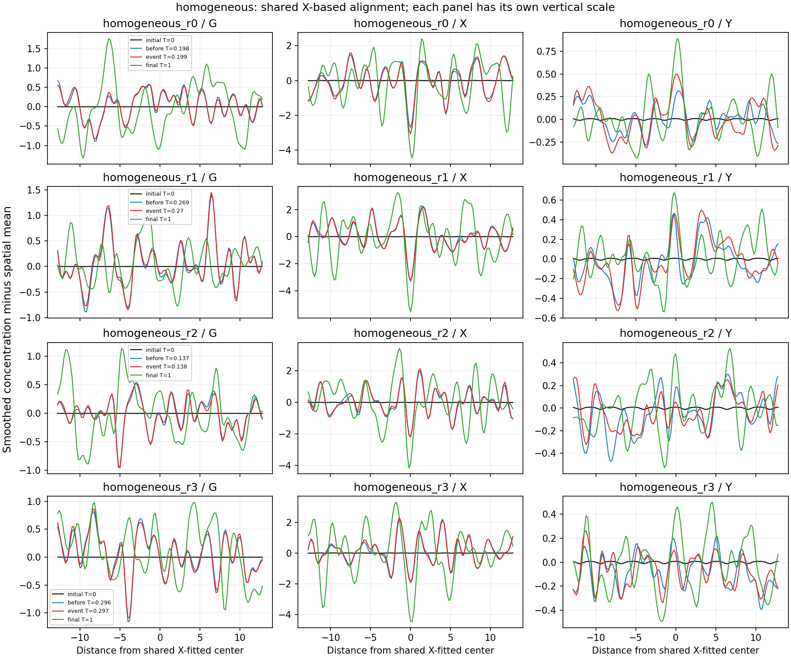

# MG164 - saved G/X/Y profile diagnosis

Examining all three active species supports using a joint, noise-aware measurement rather than simply averaging three raw errors. The prepared X cores remain prominent around their first MG163 failures; Y often retains the associated central feature but with stronger relative distortions, while the much smaller reference G feature is overwhelmed by later fluctuations. At those events the local residual levels are generally comparable to fluctuations away from the core, and X/Y background variations are strongly anticorrelated. These observations make changing, correlated background fluctuations a plausible contributor to X-only residual failures. They do not establish that the full particle persisted, that every discrepancy is noise, or that a new joint measurement would pass. MG163 remains NOT ESTABLISHED under its frozen criterion.

## What was examined

All 1001 saved observations from both marginals of all eight MG163 pairs (16016 fields, three species each); no new simulation draws. All species use the same existing X-fitted position and dilation, with individual amplitude and constant-background fits. G and Y are never independently translated into agreement. Their separate reference shapes and far-field offsets come from the original unrounded preparation. The X-based geometry is a diagnostic anchor, not an independently validated multivariate fit.

Prepared plots show every coarse prepared path at initial time, just before its first X failure, at that failure, and at T=1. Control plots use each selected marginal of each pair with the earliest compatible X crossing (coarse wins a tie). The plotted profiles are smoothed, spatial-mean-subtracted, and centered using the shared X position at each observation; they are not residual-only curves. Each panel has its own vertical scale. Event selection is post-result and descriptive. Both marginal metric histories remain in species_metrics.npz.

## Species differ substantially

| Species | Local residual fraction at T=1, prepared paths | Interpretation |
|---|---:|---|
| G | 0.896279-0.999986 | Its initial feature is small compared with later spatial fluctuations; relative fitted amplitude is poorly conditioned as a persistence marker. |
| X | 0.237225-0.399089 | A substantial template component remains, although the absolute residual fails the frozen X benchmark. |
| Y | 0.353824-0.592171 | Associated structure is visible with a larger unexplained fraction than X. |

Residual fraction means weighted squared fitting error divided by weighted, locally centered observed squared variation. It is descriptive, not a failure threshold or a calibrated noise fraction. All ranges include eight prepared marginal paths; sites/frames/marginals are correlated. For G the fitted relative amplitude ranges from -4.46247 to8.42596 across the horizon. These values do not mean an eightfold physical particle or a physically inverted species: normalization by a small initial spatial template makes the projection highly sensitive to background. Absolute concentrations remain nonnegative; these plotted deviations and projections may have either sign.

## At the first X failures

| Prepared coarse path | T | G residual/background variance | X ratio | Y ratio |
|---|---:|---:|---:|---:|
| prepared_r0 | 0.205 | 0.725227 | 1.14893 | 0.951106 |
| prepared_r1 | 0.29 | 1.07309 | 0.985517 | 0.698305 |
| prepared_r2 | 0.236 | 0.988017 | 0.917128 | 0.733712 |
| prepared_r3 | 0.438 | 0.925517 | 0.688154 | 0.810687 |

The numerator is local Gaussian-weighted residual mean square after fitting; the denominator is spatial variance of the smoothed species field farther than 2R95 (6.4 model-lengths) from the shared center. A ratio near1means comparable local unexplained variation and off-core variation. It is not a statistical test: the regions are spatially correlated, the off-core region may itself contain structure, and the center was selected using X. We cannot simply subtract this variance and declare the remaining core genuine.

Across both ticks at the first prepared failures, off-core X/Y spatial correlation ranges from -0.634278 to -0.568576. This is direct evidence that treating these species as independent noise channels would be inappropriate for these saved profiles. It does not identify nonlinear noise, determine its cause, or establish temporal independence. G/X and G/Y correlations are weaker in these snapshots.

Controls also develop structured fluctuations. Seven of eight control marginals have at least one X-compatible frame in MG163; many such frames carry boundary warnings. An X crossing therefore needs examination of associated G/Y structure and competing cores, rather than being called particle formation or automatically dismissed as an instrument error. This analysis provides no validated rule that separates these control fluctuations from prepared cores across all species.

## Checks and limits

The saved X residual was reproduced for all 16016 fields. A separate weighted-normal-equation calculation agreed on amplitude/residual for 96 selected species fits. 96 compact-array summary/range checks passed. Shared input fields, template generation and smoothing remain dependencies; same-author checks are not external replication. Original observation SHA-256 values are retained. Analysis used one worker/library-thread1 and no Model G draws; initial computation took 5.55016seconds. Timings and figure/summary revision are recorded separately.

Full raw trajectory fields remain local. Public exports contain compact metric/covariance histories and cropped selected profiles used in the figures, not all raw count or event tensors. Undefined background-variance ratios (including initially uniform G background) are NaN in NPZ and null in the public JSON; they are not zero. No combined G/X/Y persistence score or benchmark is defined by this stage.

## Recommended next step

Develop and qualify a separate multivariate instrument with shared geometry and species-specific noise normalization, including cross-species covariance and a safeguard against one species disappearing behind an average. Include state/time-dependent background tests and damaged coupled profiles, not just independent additive Gaussian noise. Account for the weak reference signal of G instead of granting its relative amplitude equal weight. Use independent validation data before any physical or long-horizon persistence claim; all MG163-based choices are development choices, not held-out validation. Preserve the original MG163 score.
