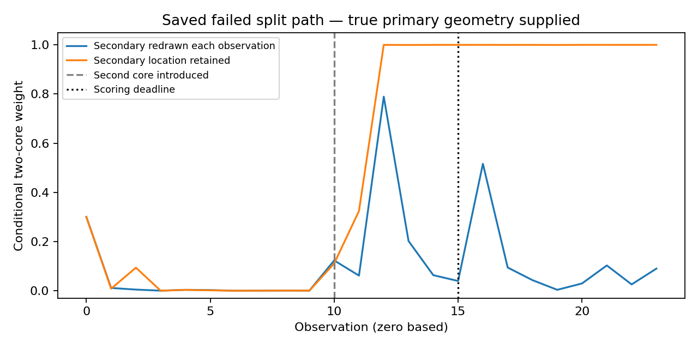

# MG177 split-core and reference audit

The saved split-core failure points to a missing kind of memory: the tracker keeps asking where a second core might be, instead of carrying forward evidence about where it was. With the true primary-core location supplied, searching afresh each observation still misses the second core at the failed deadline, while retaining possible secondary locations makes the same sequence strongly favor two cores. This means the sequence contains useful evidence; the failure does not require an absence of information or an arithmetic error. Separately, species-balance and persistent-mean diagnostics identify the known reference defects missed by MG176. These are conditional, retrospective findings that guide a new design, not a qualified tracker or a change to any earlier result.

## Scope and checks

Source/spec/input bindings were frozen at `28ebf44`, with the prospective gate record published at `59b20b0` before analysis. No new fields or simulations were generated. Twelve saved late-noise, independent-time paths were examined: split and moving single-core controls, noise amplitudes 0.8, 1 and 1.25, two paths per condition. All 288 original tracker labels and class weights replayed unchanged. All 274 independent reference samples from MG176 were examined separately.

Evaluation took 13.4067 seconds and separate checking 0.976118 seconds, below the 600-second cap on one worker. Separate dense real-space template products verified 288 full grids of 5655 secondary alternatives, 576 filter steps and 288 prior/evidence decompositions. Maximum log-likelihood-ratio difference was 6.34363e-07. The driver also checked 864 selected grid likelihoods with direct residual quadratics and recomputed reference quadratics in real space. Checks share templates/precision and the same author; they are not external replication.

## Why the failed split path looked single

| At observation 15, late independent noise, amplitude 1.25, replicate 0 | Value |
|---|---:|
| Original single weight | 0.966513 |
| Original multiple weight | 0.0334867 |
| Predictive structural log odds, multiple versus single | -2.72379 |
| Integrated log evidence ratio | -0.638751 |
| Posterior log odds, multiple versus single | -3.36255 |
| True-primary, uniform current-secondary log likelihood ratio | -0.560563 |
| Known true pair log likelihood ratio | 5.96703 |
| Known true pair, injected rather than estimated scale | 5.9162 |

Positive log ratios favor two cores; negative values favor one. The original structural prior already favored single, and the integrated current evidence slightly reinforced it. At the actual injected second-core position the field favors a second core, but spreading prior weight over all possible secondary positions and widths dilutes that evidence in one observation. That integration is proper for a newly unknown secondary; the problem is that the model redraws its geometry every observation rather than using an earlier location to predict the next one. The known pair is an oracle diagnostic, not an admissible detection procedure.

Correcting the scalar noise estimate to injected variance changes the known-pair ratio only from 5.96703 to 5.9162. Thus scalar estimation error is not needed to explain the failure. The selected primary center was 114 versus injected 115; fixing it exactly still leaves the redrawn-secondary model near 4% multiple weight.

## Exact conditional memory comparison

Both two-class filters know the true primary geometry, use identical estimated covariance, start single/multiple equally weighted, and process all 24 observations. Their structural stay/switch weights are the same. The redrawn filter integrates the full uniform secondary prior anew each observation. The persistent filter propagates all 5655 relative-offset/width alternatives, with births drawn uniformly and surviving secondary offsets retained. No secondary location is selected using truth. This comparison changes the assumed temporal law of the secondary, not merely numerical precision. Keeping a relative offset also assumes the secondary follows the supplied primary motion; an unconstrained tracker must test a broader motion model.

| Noise amplitude | Case | Replicate | Redrawn multiple weight at 15 | Persistent multiple weight at 15 |
|---:|---|---:|---:|---:|
| 0.8 | moving | 0 | 0.000195689 | 0.000186572 |
| 0.8 | moving | 1 | 7.19734e-07 | 7.17974e-07 |
| 0.8 | split | 0 | 1 | 1 |
| 0.8 | split | 1 | 1 | 1 |
| 1.25 | moving | 0 | 0.000275565 | 0.000214881 |
| 1.25 | moving | 1 | 0.00207798 | 0.00191693 |
| 1.25 | split | 0 | 0.0398527 | 0.99998 |
| 1.25 | split | 1 | 0.999849 | 1 |
| 1 | moving | 0 | 0.00145103 | 0.00140001 |
| 1 | moving | 1 | 5.92985e-05 | 5.88286e-05 |
| 1 | split | 0 | 0.972904 | 0.999971 |
| 1 | split | 1 | 0.999999 | 1 |

The target changes from 0.0398527 to 0.999980 multiple weight. All six split paths exceed 0.999970 at the deadline with memory. None of the six moving-single controls reaches 0.95 multiple weight anywhere; their maximum is 0.0804397. These small, conditional controls do not establish a false-positive rate or general tracker performance.

Current class weights are computed before geometry compression, so deleting endpoints cannot directly alter that observation’s already-computed class mass. However, discarded primary geometry and class/geometry associations can affect future predictions. At the target the retained multiple-mode geometry fractions were 0.327470 and 0.172878. This audit does not fully eliminate primary-history compression as a contributor. The truth-primary redrawn filter reproduces the failure without compressed primary history, showing that compression is not necessary for it.

## Reference misses

MG176 tested frequency-band energy summed across species. The new diagnostic instead checks (1) imbalance between two whitened channel energies and (2) a coherent nonzero mean across the 16 reference fields. The diagnostic tail threshold is 0.0005 for each, a Bonferroni total of 0.001. Channel whitening uses a symmetric inverse covariance square root; mean testing uses the independent-Gaussian F reference with 998 and 14970 degrees of freedom. These tests were specified for this audit after the problematic cases were known, so they are retrospective diagnostics, not qualification.

| Saved reference category | Channel-imbalance flags | Coherent-mean flags | Number |
|---|---:|---:|---:|
| Clean primary | 0 | 0 | 264 |
| X-noise amplitude ×1.5 | 2 | 0 | 2 |
| Added stationary core | 0 | 2 | 2 |

The channel test flags the altered species covariance; the mean test flags the stationary contamination. MG176’s original band gate accepted all four defective references. Conversely, the one clean primary reference rejected by that band gate was not flagged by these two diagnostics. Neither outcome warrants replacing a gate after seeing its data. Clean samples come from the assumed Gaussian generator, and only two examples of each defect were examined. Mean-zero contamination, moving contaminants, non-Gaussian noise and temporal misspecification remain untested here. Independent snapshots cannot identify tracking-time correlation; the wrong-rho cases pass these reference diagnostics as expected.

## Recommendation and limits

Develop a new separately registered tracker with explicit secondary-core persistence and bounded motion, including secondary births/deaths, without supplying true primary or secondary geometry. Preserve integrated prior mass and uncertainty across candidate locations. Challenge it on independent single, split, merging/moving-secondary, damaged and absent cases over the noise range; do not lower the single-core threshold to rescue this path. Geometry compression and computational cost need their own checks.

For background qualification, combine species-covariance, coherent-mean and spectral checks, and use time-ordered background data to assess temporal correlation. Validate the complete procedure with fresh clean and contaminated references before using it on saved Model G trajectories. These audit findings support that design but do not establish a production-ready noise estimator or tracker.

MG176 remains FAILED, MG163 scores are unchanged, and G remains unresolved. No new persistence verdict or kinetic allocation is issued. Raw inputs stay in `local_raw/MG176_acquisition`; only compact diagnostic outputs are published. PI closure is pending.
