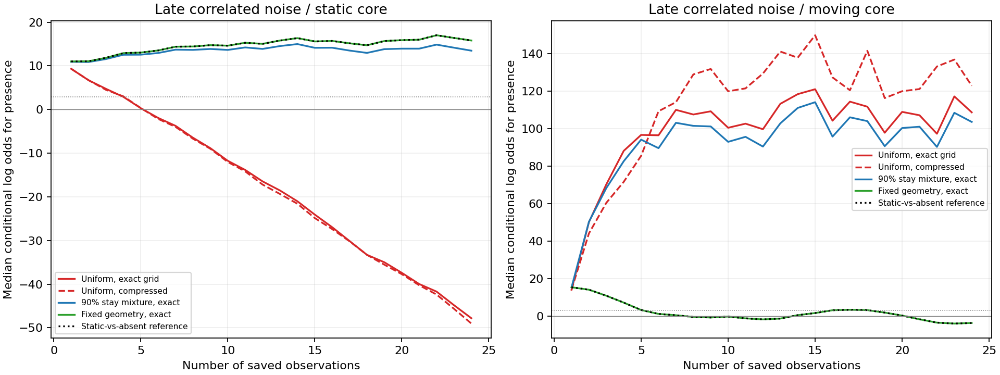

# MG173 - stationary-core motion-prior audit

The remaining false-absence failure is reproduced without beam compression and traced, within this controlled audit, to the motion prediction model. The saved planted static cores are strongly supported by an exact static-versus-absent calculation. An exact filter that keeps every allowed position and width nevertheless favors absence when its prediction spreads weight uniformly across nearby geometry changes. Changing only that motion prior to favor staying still restores presence support in all four late correlated static cases. This is evidence about an inference assumption, not a disappearing simulated particle. The stationary-favoring choice is a sensitivity test on already-seen data, not a validated replacement tracker; MG172 and MG163 remain unchanged and G stays unresolved.

## Question and controlled comparisons

The motion prior is the prediction of how position and width may change between observations. The uniform model gives equal probability to five nearby positions and up to three widths. At interior widths, exactly staying still receives only 1/15 of that prediction mass. The predeclared sensitivity model puts 90% on exact staying and 10% on the same uniform neighborhood, giving exact stay probability 0.906667. The third model fixes position/width completely. These are diagnostic alternatives, not measured properties of Model G.

The exact reference compares a known static X/Y core at the initial seed against no core, with fixed ordinary amplitude 1 and the supplied conditional Gaussian noise/rho. Exact grid filters instead maintain all 13 widths x 500 cyclic positions for each of two classes (present geometry/absent anchor), summing all incoming histories. Class stay/switch odds are 0.98/0.005 conditioned on these two classes (normalize by 0.985). Each grid filter is also run with top2 present/top1 absent class-mass-preserving compression, changing only compression within that pair.

Inputs are all four saved MG172 paths for static, moving and absent cases, at early/late noise regimes and rho0/.95: 48 paths x24 observations. All inputs were already seen; no new random fields or Model G trajectories. Full five-class MG172 weights are context, not a pure one-factor comparison with this restricted two-class audit. Initial seed and width 1 are supplied to every case, including absent controls; no future moving geometry is given. The original convention of a predictive geometry update before every supplied observation, including the first, is retained. Its initialization effect is not isolated here.

## 1. The static signal was available

Under late rho0.95 noise, the exact static-versus-absent reference supports presence at every observation in all four static paths. Final conditional weights are all >=0.999998. The same fixed-geometry switching filter agrees, so the failure is not an inevitable result of the class-switch prior alone. This oracle assumes the core is stationary at its initial geometry; it cannot be treated as a general tracker.

The conditional model has squared static-signal norm 25.3996. With 24 observations and rho0.95, the exact constant-mean information is equivalent to 1.58974 independent observations, not 24. The expected log evidence ratio under a static core is 20.1894 with standard deviation 6.35444. Its Gaussian-model probability of a final presence weight>=0.95 is 0.996675; this is a calculation under the stipulated noise/template model, not a measured real-field detection guarantee.

Correct temporal correlation reduces information substantially but does not erase it. Treating these frames as independent gives much larger apparent evidence and is not a valid shortcut. The independently checked formulas include the initial observation, rather than using a large-sample effective-size approximation that could fall below one.

## 2. Exact grids reproduce the failure under the uniform motion prior

| Late correlated static model | Final presence weights, range across 4 paths | Frames with presence>=0.95 per path |
|---|---:|---|
| Uniform motion / full exact grid | 7.05689e-23 to 5.32372e-21 | 5, 3, 3, 4 |
| Uniform motion / compressed | 8.86574e-23 to 3.18808e-21 | 5, 3, 3, 4 |
| 90% stay mixture / full exact grid | all >= 0.999981 | 24, 24, 24, 24 |
| 90% stay mixture / compressed | all >= 0.999981 | 24, 24, 24, 24 |
| Fixed geometry / full exact grid | all >= 0.999998 | 24, 24, 24, 24 |

The uniform compressed two-class model reproduces the MG172 static-case single/absent log odds to a maximum difference of 5.00222e-12 over these paths. Removing compression does not rescue them. The paired final log-odds shift caused by compression ranges from -2.21058 to 0.22819; changing only the exact-grid motion prior from uniform to the stay mixture shifts it by 60.8353 to 61.8674.

Thus compression is not required for this failure. The uniform prediction spends most probability on geometry changes that the static observations do not support. When successive observations add little independent evidence, that predictive model can lose against the simpler absent explanation. The audit demonstrates this mechanism within the restricted model; it does not prove that compression is harmless in every setting. It can materially change moving-case log odds even when both methods report presence.

## 3. Moving and no-core controls

| Late correlated case | Uniform exact: final weights>=0.95 | Stay-mixture exact | Fixed geometry exact |
|---|---:|---:|---:|
| static | 0/4 | 4/4 | 4/4 |
| moving | 4/4 | 4/4 | 0/4 |
| absent | 0/4 | 0/4 | 0/4 |

The stay mixture retains final presence support for all four moving controls as well as static ones and produces no final false-presence decision in these four absent controls. Fixing geometry completely rejects the moving cores, as expected from its deliberately wrong assumption. This illustrates why a static oracle cannot replace tracking. All early/late and independent/correlated comparisons are retained in analysis.json, not only the target failing condition.

These are final-presence diagnostics, not complete path tracking or localization qualification. The sensitivity choice was fixed before this audit but evaluated on already-seen fields. Only three case families and four paths/cell are included; missing/displaced components, competing cores, variable strength and fresh-real-noise robustness still need independent validation. Do not promote 90% stay to a physical law or silently relax previous gates.

## Correctness, resources and retention

The fixed-geometry grid matched a separately written 2x2 forward calculation at 1152 time points. Independent weighted-observation closed forms reproduced 2304 oracle prefixes; scalar Gaussian transition sums verified 754 nodes across 216 grid snapshots, with 432 normalization/compression checks. All 120 published summaries were recomputed. Geometry probability rows normalize at interior and boundary widths. Shared precision/templates and same-author checks remain dependencies, not external replication.

The saved-data evaluation took 39.0005 seconds on one worker/library-thread1 within 600 active seconds; independent checking took 4.10876 seconds. Full pre/post-grid audit snapshots total 37.5081 MB locally in local_raw/MG173_static_audit, below 100 MB, with physical files SHA-256 manifested. Public exports contain compact weight/geometry curves, summaries, source, figures and hashes only. No new full Model G data or simulations were created, and no immutable audit-cache Git commit is claimed.

## Recommended next step

Develop a separately registered full five-hypothesis tracker with explicit stationary and moving motion modes, using declared priors rather than forcing one uniform random-motion prediction onto every core. Validate the complete tracker on independent synthetic sequences with all original damage/no-core/competing-core controls and correlated noise. Include sensitivity to strength/noise misspecification before any real-trajectory persistence claim. The audit supports addressing the motion model; it does not qualify this stay-mixture choice or authorize another long Model G run. Earlier scores remain unchanged.
