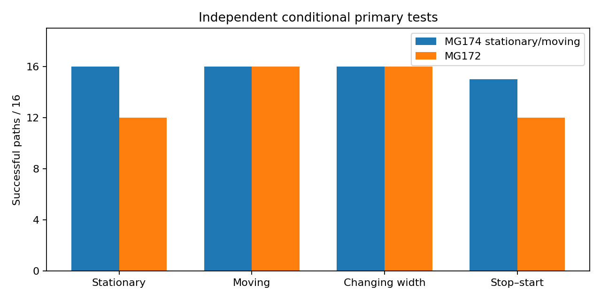

# MG174 stationary/moving tracker results

The new tracker can recognize a core that stays still without continually expecting it to move. It recovered all four difficult stationary-core examples that defeated the previous tracker, while still recognizing moving and changing-width cores and rejecting the negative controls at their deadlines. Across the main intact-core tests it passed 63 of 64 paths, compared with 56 of 64 for MG172 on the same new fields. However, the registered overall screen FAILED: one stop–start path had three uncertain initial observations, exceeding the permitted two. This is substantial instrument progress, but it does not establish particle persistence in Model G or qualify the tracker for the saved physical-model trajectories.

## Frozen design and execution

Source/specification/input bindings and seed 17400 were published at `aafa97b` before evaluation. The single evaluation completed in 280.600 seconds on one worker (600-second cap); no new Model G trajectories were generated. There were 176 primary paths of 24 observations, plus 24 separate sensitivity paths of 12 observations: 200 paths and 4512 fields, each scored by both procedures. The same fields permit a paired comparison; they are independent random realizations conditional on the reused fitted noise parameters.

Five structural alternatives (absent, single, X-only, Y-only, multiple) each have stationary and moving modes. Stationary mode preserves primary geometry exactly; moving mode permits bounded position/width changes. Mode persistence is 0.98, an engineering choice. Current secondary geometry is integrated over the full uniform prior, incoming histories are summed, and compression preserves class/mode mass. There are up to 18 retained geometry states versus 9 for MG172, so this compares complete procedures rather than isolating only the motion prior.

An intact path must have at least 22/24 single labels and at least 22/24 position/width estimates within 2 sites and 0.125 width of truth. Each primary case must pass all four replicates. Negative controls must avoid a single label at observation 5 for absence or 15 for damage beginning at 10 (zero based). The frozen 0.95 structural-weight threshold and innovation/spread guards were unchanged.

## Main results

| Noise regime | Temporal rho | Case | New tracker successes / 4 | MG172 successes / 4 |
|---|---:|---|---:|---:|
| 0.1 | 0 | static | 4 | 4 |
| 0.1 | 0 | moving | 4 | 4 |
| 0.1 | 0 | deforming | 4 | 4 |
| 0.1 | 0 | stop_start | 4 | 4 |
| 0.1 | 0 | absent | 4 | 4 |
| 0.1 | 0 | vanish | 4 | 4 |
| 0.1 | 0 | missingX | 4 | 4 |
| 0.1 | 0 | missingY | 4 | 4 |
| 0.1 | 0 | displacedY | 4 | 4 |
| 0.1 | 0 | split | 4 | 4 |
| 0.1 | 0 | jump | 4 | 4 |
| 0.1 | 0.95 | static | 4 | 4 |
| 0.1 | 0.95 | moving | 4 | 4 |
| 0.1 | 0.95 | deforming | 4 | 4 |
| 0.1 | 0.95 | stop_start | 4 | 4 |
| 0.1 | 0.95 | absent | 4 | 4 |
| 0.1 | 0.95 | vanish | 4 | 4 |
| 0.1 | 0.95 | missingX | 4 | 4 |
| 0.1 | 0.95 | missingY | 4 | 4 |
| 0.1 | 0.95 | displacedY | 4 | 4 |
| 0.1 | 0.95 | split | 4 | 4 |
| 0.1 | 0.95 | jump | 4 | 4 |
| 1 | 0 | static | 4 | 4 |
| 1 | 0 | moving | 4 | 4 |
| 1 | 0 | deforming | 4 | 4 |
| 1 | 0 | stop_start | 4 | 4 |
| 1 | 0 | absent | 4 | 4 |
| 1 | 0 | vanish | 4 | 4 |
| 1 | 0 | missingX | 4 | 4 |
| 1 | 0 | missingY | 4 | 4 |
| 1 | 0 | displacedY | 4 | 4 |
| 1 | 0 | split | 4 | 4 |
| 1 | 0 | jump | 4 | 4 |
| 1 | 0.95 | static | 4 | 0 |
| 1 | 0.95 | moving | 4 | 4 |
| 1 | 0.95 | deforming | 4 | 4 |
| 1 | 0.95 | stop_start | 3 | 0 |
| 1 | 0.95 | absent | 4 | 4 |
| 1 | 0.95 | vanish | 4 | 4 |
| 1 | 0.95 | missingX | 4 | 4 |
| 1 | 0.95 | missingY | 4 | 4 |
| 1 | 0.95 | displacedY | 4 | 4 |
| 1 | 0.95 | split | 4 | 4 |
| 1 | 0.95 | jump | 4 | 4 |

**Overall primary screen: FAILED.** All 112 negative-path deadlines passed for both procedures, including absence, disappearance, missing X/Y, displaced Y, split cores and an out-of-range jump. These are deadline decisions, not guarantees about every intervening observation. All stationary, continuously moving and deforming paths passed for the new tracker. The only failed case was regime 1, rho 0.95, stop–start replicate 1: it produced 21 single and 3 uncertain labels. The uncertain labels occurred at observations 0–2, before motion started; this result does not demonstrate a failure at the movement transition. The sequence was stationary → moving → stationary, with movement at observations 8–15. No criteria were relaxed after observing this result.

The checker found zero high-weight wrong structural winners in modeled primary frames for the new tracker, versus 85 for MG172. This finite conditional diagnostic is not probability calibration. Mode weights are conditional model weights; moving mode also allows zero displacement, and they should not be interpreted as measured physical motion probabilities. Per-path mode weights for the three eight-observation segments are retained in `separate_check.json`.

## Separate sensitivity results

Both weak-static and weak-moving checks used signal amplitude 0.8 while the tracker assumed 1. The new tracker passed all 16 paths; MG172 passed 13. With noise amplitude multiplied by 1.25 but the assumed covariance unchanged, both procedures failed all 8 short paths. These cases are outside the primary denominator and are descriptive. They show that the present noise assumption matters; rejection or uncertainty under misspecified noise is not evidence that a particle disappeared.

## Verification and retention

Separate recomputation passed 45120 class/mode mass checks, 9024 label checks, 400 path outcomes, 501 full secondary grids, 1663 scalar history sums and 12 representative innovation quadratics. The driver also passed 696 selected endpoint checks. Checker runtime was 10.8482 seconds. The separate path uses residual FFTs and explicit history sums, but shares stored templates/precision and the same author; this is not external replication.

Full field/snapshot data remain local in `local_raw/MG174_modes` (57.6141 MB), with hashes in `local_raw_manifest.json`. Public per-case decisions are lossless gzip; uncompressed duplicate decisions are ignored. No full raw fields are uploaded.

## Limits and recommended next step

The tracker assumes a supplied initial center, ordinary known amplitude, known temporal correlation, fixed Gaussian spectral noise, and a finite template family. It applies a predictive transition before the first observation, as earlier versions do. Geometry histories are still compressed; secondary geometry is globally redrawn rather than identity-tracked. Four replicates per primary condition cannot establish a population error rate. G remains unresolved. MG163 and all earlier scores remain unchanged; no real-data persistence verdict is issued, and PI closure is pending.

Recommend a bounded saved-decision audit of the three initial uncertain frames and the deliberately misspecified-noise cases. Separate structural uncertainty, innovation rejection and geometry spread before proposing a revised initialization or noise model. Do not simply lower the threshold or waive the failed path. Any revised scoring rule needs a separate frozen specification and fresh validation.

