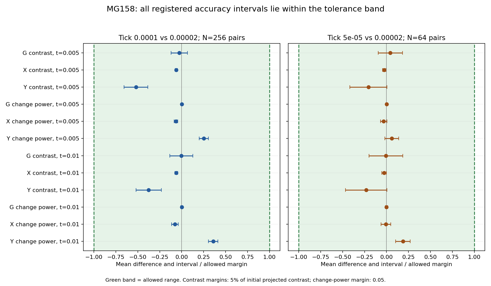

# MG158 — paired tick accuracy qualification results

Both tested tick sizes met the accuracy criterion we set in advance: at the two registered observation times, every measured G/X/Y pattern-contrast and short-scale change-power difference agreed closely enough with the finest reference tick. This means the paired method has now done more than reduce noise: it has supported a direct accuracy decision for the strict-tick hypergraph engine in this tested case. We can use these resolutions with greater confidence for this short-horizon numerical task and consider moving toward longer pattern-persistence studies. The result concerns ensemble means of the specified measurements on one prepared state; it does not establish full-field agreement, long-term particle survival, exact continuum accuracy, physical seconds, or a quantum-vacuum origin for A/B.

## Registered result

**EQUIVALENT for both candidate ticks within the registered scope.** All 24 primary intervals lie entirely inside their respective tolerance bands. PI closure remains pending. No margins, denominators, estimators or scoring rules were changed after seeing the data.

| Tick compared with 0.00002 | Fresh pairs | Registered classification | Largest interval edge / margin |
|---|---:|---|---:|
| 0.0001 | 256 | EQUIVALENT | 0.655517 |
| 5e-05 | 64 | EQUIVALENT | 0.468483 |

The closest interval to a tolerance boundary used 65.5517% of the allowed margin for tick 0.0001 and 46.8483% for tick 0.00005. Both were Y-contrast intervals. Some mean differences are detectably nonzero; equivalence here means small enough for the chosen tolerance, not identical evolution.

## What was tested

The frozen canonical finite LOCAL/LOCAL Omega=10, 500-site prepared state was evolved through model time 0.01. There were 256 fresh coupled pairs comparing ticks 0.0001/0.00002 and 64 comparing 0.00005/0.00002, for 320 pairs and 640 marginal chains. Each chain retained its own strict-tick token reservations and reset calendar. Pilot samples were excluded. Only fixed direct projected contrasts were used; no fitted blend or compensator was introduced.

Primary measurements were G/X/Y projected pattern contrast and G/X/Y high-band change power at model times 0.005 and 0.01. Contrast margins were 5% of the fixed initial projected contrasts; power margins remained the separately defined absolute 0.05. Power includes deterministic and stochastic high-band changes and is not a particle detector. Full mean observation fields are retained in `mean_observation_fields.npz` to support inspection of information a single projection can miss.

Registration and explicit PI budget approval were published before sampling at `5a41341`; the later runtime handoff is `4015154`. The historically named draft specification is the approved frozen design referenced by approval.json and plan.json. The qualification uses paired Student-t intervals with a Bonferroni adjustment across all 24 primary comparisons, providing nominal simultaneous 95% coverage under the interval assumptions. The finest tick is an operational reference, not exact continuum truth.

## All primary intervals

| Candidate tick | Model time | Observable | Mean difference | Adjusted interval | Margin (+/-) | Classification |
|---|---:|---|---:|---|---:|---|
| 0.0001 | 0.005 | G contrast | -1.91487e-06 | [-8.63927e-06, 4.80953e-06] | 7.23355e-05 | equivalent |
| 0.0001 | 0.005 | X contrast | -0.000204353 | [-0.000246531, -0.000162174] | 0.00332205 | equivalent |
| 0.0001 | 0.005 | Y contrast | -0.00153874 | [-0.00193688, -0.0011406] | 0.00295473 | equivalent |
| 0.0001 | 0.005 | G change power | 9.41196e-05 | [-0.000247772, 0.000436012] | 0.05 | equivalent |
| 0.0001 | 0.005 | X change power | -0.00329648 | [-0.00432245, -0.0022705] | 0.05 | equivalent |
| 0.0001 | 0.005 | Y change power | 0.0126075 | [0.00998661, 0.0152283] | 0.05 | equivalent |
| 0.0001 | 0.01 | G contrast | -3.29021e-07 | [-9.77487e-06, 9.11683e-06] | 7.23355e-05 | equivalent |
| 0.0001 | 0.01 | X contrast | -0.000204699 | [-0.000257354, -0.000152044] | 0.00332205 | equivalent |
| 0.0001 | 0.01 | Y contrast | -0.00111232 | [-0.00153879, -0.000685858] | 0.00295473 | equivalent |
| 0.0001 | 0.01 | G change power | 5.3379e-05 | [-0.000487192, 0.00059395] | 0.05 | equivalent |
| 0.0001 | 0.01 | X change power | -0.00386522 | [-0.0057623, -0.00196814] | 0.05 | equivalent |
| 0.0001 | 0.01 | Y change power | 0.0179598 | [0.0152418, 0.0206778] | 0.05 | equivalent |
| 5e-05 | 0.005 | G contrast | 3.09374e-06 | [-6.90868e-06, 1.30962e-05] | 7.23355e-05 | equivalent |
| 5e-05 | 0.005 | X contrast | -8.87509e-05 | [-0.000150793, -2.67083e-05] | 0.00332205 | equivalent |
| 5e-05 | 0.005 | Y contrast | -0.000608267 | [-0.00122945, 1.29167e-05] | 0.00295473 | equivalent |
| 5e-05 | 0.005 | G change power | 6.86064e-05 | [-0.000390518, 0.00052773] | 0.05 | equivalent |
| 5e-05 | 0.005 | X change power | -0.00159808 | [-0.0034427, 0.00024654] | 0.05 | equivalent |
| 5e-05 | 0.005 | Y change power | 0.00301614 | [-0.000924708, 0.00695699] | 0.05 | equivalent |
| 5e-05 | 0.01 | G contrast | -5.06091e-07 | [-1.43204e-05, 1.33083e-05] | 7.23355e-05 | equivalent |
| 5e-05 | 0.01 | X contrast | -9.24791e-05 | [-0.000178812, -6.14659e-06] | 0.00332205 | equivalent |
| 5e-05 | 0.01 | Y contrast | -0.000685389 | [-0.00138424, 1.34642e-05] | 0.00295473 | equivalent |
| 5e-05 | 0.01 | G change power | -6.43833e-06 | [-0.000675451, 0.000662575] | 0.05 | equivalent |
| 5e-05 | 0.01 | X change power | -0.000363392 | [-0.00315491, 0.00242813] | 0.05 | equivalent |
| 5e-05 | 0.01 | Y change power | 0.00933935 | [0.00520183, 0.0134769] | 0.05 | equivalent |

## Uncertainty and distribution diagnostics

Student-t coverage is approximate for non-Gaussian replicate differences. The finer comparison has 64 pairs and some heavy-tailed power differences. The descriptive diagnostics below are retained without dropping any replicate, changing the interval construction or rescoring the registered outcome. They limit any claim that simultaneous coverage is exactly 95%; the report preserves the nominal registered classification rather than asserting a distribution-free theorem.

| Candidate tick | Maximum absolute skew | Maximum excess kurtosis | Largest single-replicate variance share |
|---|---:|---:|---:|
| 0.0001 | 0.667606 | 2.38041 | 0.115591 |
| 5e-05 | 1.89275 | 5.24428 | 0.277126 |

The single-replicate variance share measures the largest squared centered deviation divided by their sum for any primary observable. A large share flags tail sensitivity; it does not authorize removing that observation. Robust-coverage confirmation would be a separate prospective analysis/study, not a post-result replacement of this score.

## Verification and retention

Every saved checkpoint passed integer count reconstruction and conservation checks: 6400 chain checkpoint endpoints. Both full numeric sentinels replayed successfully, including 13.8531 million joint events and every retained reservation/reset boundary. Source hashes, seeds, RNG continuity and observation counts passed checks. Separate analysis recomputed projections from raw fields, change power by Fourier Parseval normalization, variances by centered sums of squares, and critical values through the inverse survival function. All 24 interval endpoints and classifications agreed. No simulation was rerun.

This is separate recomputation by the same author, sharing frozen rule/weight definitions and SciPy distributions, not external replication. All checkpoints, fields, histograms, RNG states, seeds, logs, budgets, source bindings and two complete numeric sentinels are retained in the compact archive. The raw manifest and Git-content verification record document publication. Historical archives remain unchanged.

## Compute and execution

All three fixed sessions completed without failed, replaced or retried jobs. Total session wall time was 6.26802 hours; charged worker time was 175446 seconds (48.7349 core-hours), below the 300,000-second ceiling. Each session was below its 100,000-second worker ceiling. At most eight local workers ran, with one numerical-library thread per worker. Completed audit and separate recomputation used 135.102 measured seconds; the active parent/control/audit allowance is 1,800 seconds. Controller waiting is included in wall time, not treated as another continuously occupied core. The production event count was 2.21693 billion joint events (shared events counted once).

## Recommended next step

Close this bounded accuracy qualification, then prepare a longer pattern-persistence study with explicit survival, shape and drift measurements and a separately measured compute budget. Tick 0.0001 is the cheaper of the two qualified candidates and is reasonable for a pilot within the tested numerical setting; its agreement over much longer evolution must be checked prospectively rather than assumed. Retain the finer reference/control trajectories. No new simulation batch has been launched by this report.

Recompute with `src/check_mg12h3_tick_accuracy.py`, `src/recompute_mg158_accuracy.py`, and `src/report_mg158.py`. Do not rerun production to replace samples. Specification: `spec/MG12H3_tick_accuracy_draft.md`.
